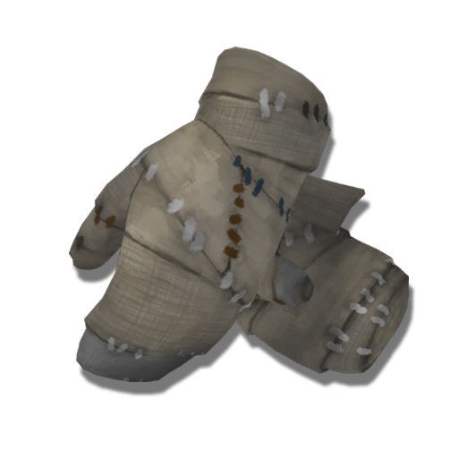
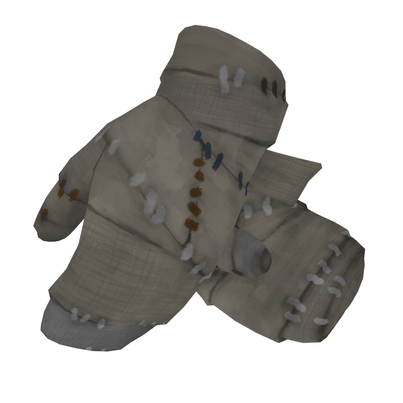
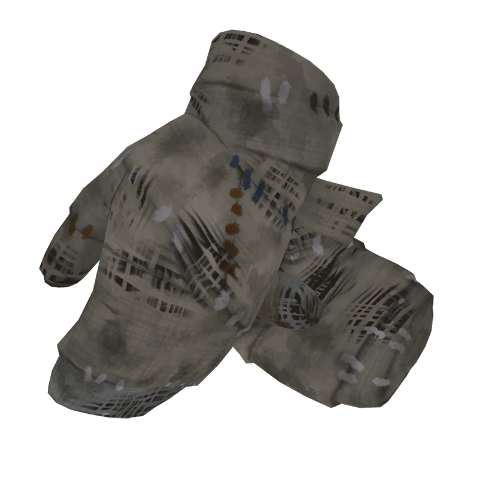

# Improvised Hand Wraps

<table class="infobox">
<caption>Improvised Hand Wraps</caption>
<colgroup>
<col style="width: 50%" />
<col style="width: 50%" />
</colgroup>
<tbody>
<tr>
<td colspan="2"><figure>

<figcaption>improvised_Hand_Wraps_icon.png</figcaption>
</figure></td>
</tr>
<tr>
<td colspan="2" class="section">
<strong>General</strong>
</td>
</tr>
<tr>
<td>
Item Type
</td>
<td>
Clothing|-
</td>
</tr>
<tr>
<td>
Clothing Slot
</td>
<td>
Hands
</td>
</tr>
<tr>
<td colspan="2" class="section">
<strong>Statistics</strong>
</td>
</tr>
<tr>
<td>
Weight
</td>
<td>
0.10 kg(0.22 lbs)
</td>
</tr>
<tr>
<td>
Warmth bonus
</td>
<td>
0.5 °C(0.9 °F)
</td>
</tr>
<tr>
<td>
Windproof bonus
</td>
<td>
0.3 °C(0.5 °F)
</td>
</tr>
<tr>
<td>
Waterproof bonus
</td>
<td>
0.0
</td>
</tr>
<tr>
<td>
Protection
</td>
<td>
0.5%
</td>
</tr>
<tr>
<td>
Mobility
</td>
<td>
0%
</td>
</tr>
<tr>
<td>
Harvest
</td>
<td>
1 × <a href="./Cloth.md" class="wikilink" title="Cloth">Cloth</a> 
10 minutes
</td>
</tr>
<tr>
<td>
Repair
</td>
<td>
1 × <a href="./Cloth.md" class="wikilink" title="Cloth">Cloth</a> 
30 minutes 
25% condition
</td>
</tr>
</tbody>
</table>

<table>
<colgroup>
<col style="width: 33%" />
<col style="width: 33%" />
<col style="width: 33%" />
</colgroup>
<tbody>
<tr>
<td style="vertical-align: top; font-size: 3em; color: #5d5980; padding-right: 10px">
“
</td>
<td>
Hand wrappings made from scraps of cloth.

&#10;

In-game description

</td>
<td style="vertical-align: bottom; font-size: 3em; color: #5d5980; padding-left: 10px">
”
</td>
</tr>
</tbody>
</table>

**Improvised Hand Wraps**are make-shift <a href="./Clothing.md" class="wikilink" title="Clothing">Clothing</a> that can be <a href="./Crafting.md" class="wikilink" title="crafted">crafted</a> and worn for minimal protection from the elements. While they are the worst mittens in the game and not not very warm, they may help prevent <a href="./Frostbite.md" class="wikilink" title="Frostbite">Frostbite</a> on higher difficulties where clothing is scarce.

Crafting the hand wraps takes about 37 minutes and requires 4 pieces of <a href="./Cloth.md" class="wikilink" title="Cloth">Cloth</a> and a <a href="./Sewing%20Kit.md" class="wikilink" title="Sewing Kit">Sewing Kit</a> or <a href="./Fishing%20Tackle.md" class="wikilink" title="Fishing Tackle">Fishing Tackle</a>.

<table class="gallery">
<colgroup>
<col style="width: 50%" />
<col style="width: 50%" />
</colgroup>
<tbody>
<tr>
<td><figure>

<figcaption>Model icon</figcaption>
</figure></td>
<td><figure>

<figcaption>Model icon damaged</figcaption>
</figure></td>
</tr>
</tbody>
</table>

## Crafting

<table class="infobox">
<caption>Improvised Hand Wraps</caption>
<tbody>
<tr>
<td colspan="2">
-
</td>
</tr>
<tr>
<td colspan="2">
-
</td>
</tr>
<tr>
<td colspan="2">
37 minutes
</td>
</tr>
<tr>
<td colspan="2" class="section">
<strong>Requirements</strong>
</td>
</tr>
<tr>
<td>
Facility
</td>
<td>
[[File:Anywhere icon.png
</td>
</tr>
<tr>
<td>
Tool
</td>
<td>
<strong>Template:iconlink</strong>
</td>
</tr>
<tr>
<td colspan="2" class="section">
<strong>Materials</strong>
</td>
</tr>
<tr>
<td colspan="2" class="section">
<strong>Template:iconlink plain</strong>
</td>
</tr>
<tr>
<td>
Item
</td>
<td>
<a href="./Cloth.md" class="wikilink" title="Cloth">Cloth</a>
</td>
</tr>
<tr>
<td>
Quantity
</td>
<td>
4
</td>
</tr>
</tbody>
</table>

## Update history

- UPDATE **6 May 2019 (<a href="./The%20Long%20Dark%20%E2%80%94%20Changelog.md#1.48" class="wikilink" title="Update">Update</a>):**
  - Added to game.

**Lua execution error in Module:Navbox function navbox** <a href="ru:%D0%A1%D0%B0%D0%BC%D0%BE%D0%B4%D0%B5%D0%BB%D1%8C%D0%BD%D1%8B%D0%B5_%D0%BE%D0%B1%D0%BC%D0%BE%D1%82%D0%BA%D0%B8_%D0%B4%D0%BB%D1%8F_%D1%80%D1%83%D0%BA" class="wikilink" title="ru:Самодельные обмотки для рук">ru:Самодельные обмотки для рук</a>

