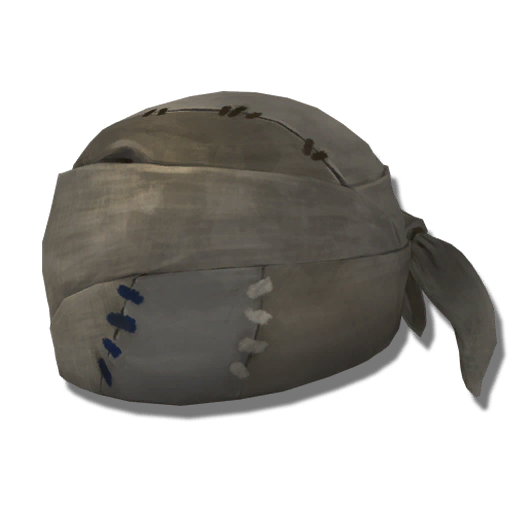
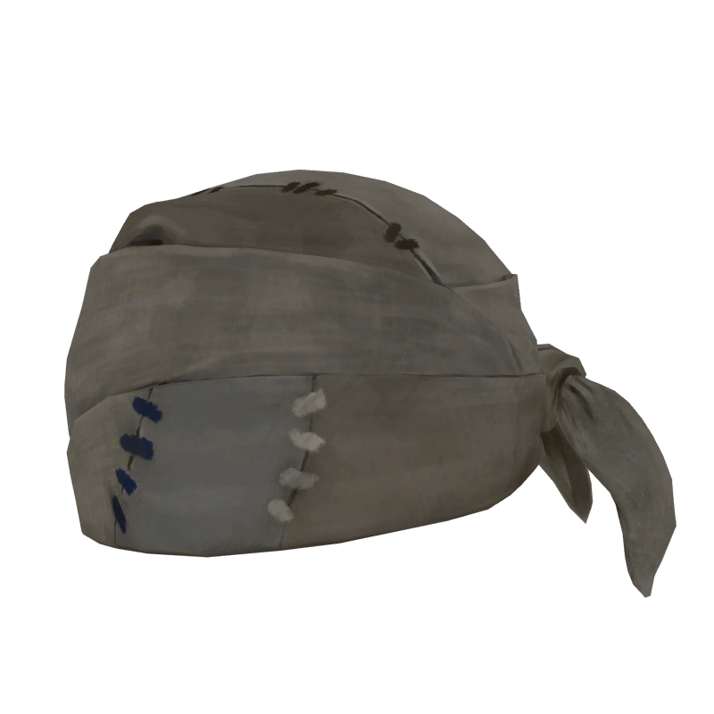
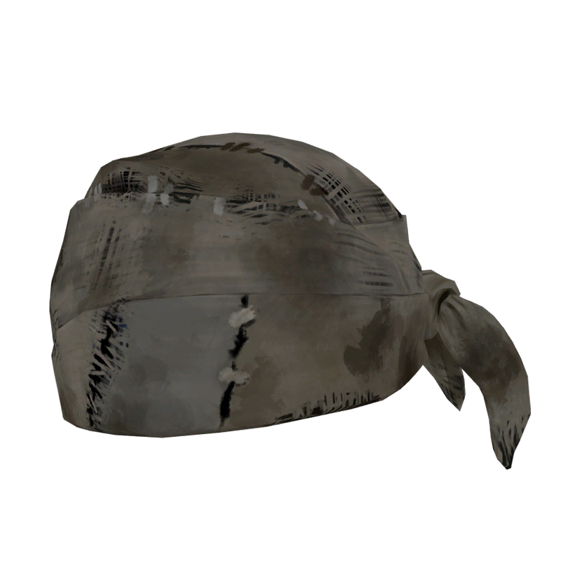

# Improvised Head Wrap

<table class="infobox">
<caption>Improvised Head Wrap</caption>
<colgroup>
<col style="width: 50%" />
<col style="width: 50%" />
</colgroup>
<tbody>
<tr>
<td colspan="2"><figure>

<figcaption>improvised_Head_Wrap_icon.png</figcaption>
</figure></td>
</tr>
<tr>
<td colspan="2" class="section">
<strong>General</strong>
</td>
</tr>
<tr>
<td>
Item Type
</td>
<td>
Clothing|-
</td>
</tr>
<tr>
<td>
Clothing Slot
</td>
<td>
Head
</td>
</tr>
<tr>
<td colspan="2" class="section">
<strong>Statistics</strong>
</td>
</tr>
<tr>
<td>
Weight
</td>
<td>
0.10 kg(0.22 lbs)
</td>
</tr>
<tr>
<td>
Warmth bonus
</td>
<td>
1.0 °C(1.8 °F)
</td>
</tr>
<tr>
<td>
Windproof bonus
</td>
<td>
0.5 °C(0.9 °F)
</td>
</tr>
<tr>
<td>
Waterproof bonus
</td>
<td>
0.0
</td>
</tr>
<tr>
<td>
Protection
</td>
<td>
0.5%
</td>
</tr>
<tr>
<td>
Mobility
</td>
<td>
0%
</td>
</tr>
<tr>
<td>
Harvest
</td>
<td>
1 × <a href="./Cloth.md" class="wikilink" title="Cloth">Cloth</a> 
10 minutes
</td>
</tr>
<tr>
<td>
Repair
</td>
<td>
1 × <a href="./Cloth.md" class="wikilink" title="Cloth">Cloth</a> 
30 minutes 
25% condition
</td>
</tr>
</tbody>
</table>

<table>
<colgroup>
<col style="width: 33%" />
<col style="width: 33%" />
<col style="width: 33%" />
</colgroup>
<tbody>
<tr>
<td style="vertical-align: top; font-size: 3em; color: #5d5980; padding-right: 10px">
“
</td>
<td>
Almost a hat, made from scraps of cloth.

&#10;

In-game description

</td>
<td style="vertical-align: bottom; font-size: 3em; color: #5d5980; padding-left: 10px">
”
</td>
</tr>
</tbody>
</table>

The **Improvised Head Wrap** is a <a href="./Crafting.md" class="wikilink" title="craftable">craftable</a> <a href="./Clothing.md" class="wikilink" title="Clothing">Clothing</a> item that offers minimal protection from the elements. It may help prevent <a href="./Frostbite.md" class="wikilink" title="Frostbite">Frostbite</a>, even if it doesn't keep your head very warm.

It's stats are mostly identical to the <a href="./Cotton%20Toque.md" class="wikilink" title="Cotton Toque">Cotton Toque</a>, with 0.5% less protection from animal attacks and no waterproofing.

<table class="gallery">
<colgroup>
<col style="width: 50%" />
<col style="width: 50%" />
</colgroup>
<tbody>
<tr>
<td><figure>

<figcaption>Model icon</figcaption>
</figure></td>
<td><figure>

<figcaption>Model icon damaged</figcaption>
</figure></td>
</tr>
</tbody>
</table>

## Crafting

<table class="infobox">
<caption>Improvised Head Wrap</caption>
<tbody>
<tr>
<td colspan="2">
-
</td>
</tr>
<tr>
<td colspan="2">
-
</td>
</tr>
<tr>
<td colspan="2">
30 minutes
</td>
</tr>
<tr>
<td colspan="2" class="section">
<strong>Requirements</strong>
</td>
</tr>
<tr>
<td>
Facility
</td>
<td>
[[File:Anywhere icon.png
</td>
</tr>
<tr>
<td>
Tool
</td>
<td>
<strong>Template:iconlink</strong>
</td>
</tr>
<tr>
<td colspan="2" class="section">
<strong>Materials</strong>
</td>
</tr>
<tr>
<td colspan="2" class="section">
<strong>Template:iconlink plain</strong>
</td>
</tr>
<tr>
<td>
Item
</td>
<td>
<a href="./Cloth.md" class="wikilink" title="Cloth">Cloth</a>
</td>
</tr>
<tr>
<td>
Quantity
</td>
<td>
2
</td>
</tr>
</tbody>
</table>

## Update history

- HOTFIX **27 May 2019 (<a href="./The%20Long%20Dark%20%E2%80%94%20Changelog.md#1.52" class="wikilink" title="Update">Update</a>):**
  - \[UI\] Fixed issue causing the Improvised Head Wrap to appear incorrectly on the Clothing screen when combined with a second Hat layer.

<!-- -->

- UPDATE **6 May 2019 (<a href="./The%20Long%20Dark%20%E2%80%94%20Changelog.md#1.48" class="wikilink" title="Update">Update</a>):**
  - Added to game.

**Lua execution error in Module:Navbox function navbox** <a href="ru:%D0%A1%D0%B0%D0%BC%D0%BE%D0%B4%D0%B5%D0%BB%D1%8C%D0%BD%D1%8B%D0%B9_%D0%B3%D0%BE%D0%BB%D0%BE%D0%B2%D0%BD%D0%BE%D0%B9_%D0%BF%D0%BB%D0%B0%D1%82%D0%BE%D0%BA" class="wikilink" title="ru:Самодельный головной платок">ru:Самодельный головной платок</a>

