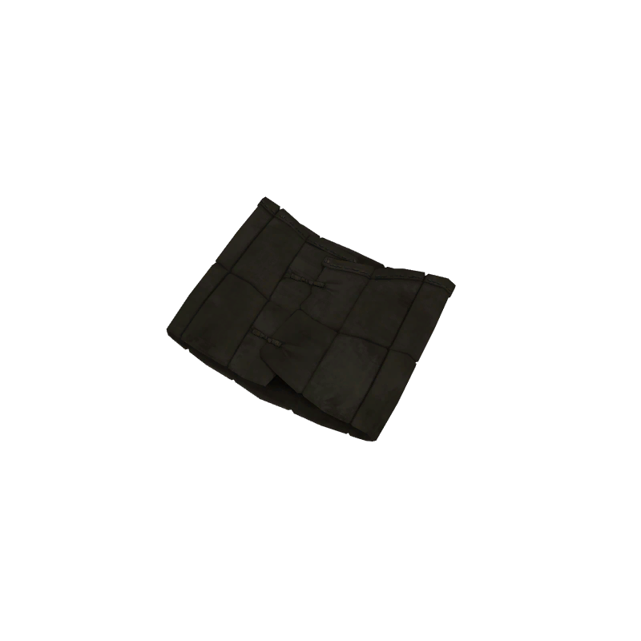
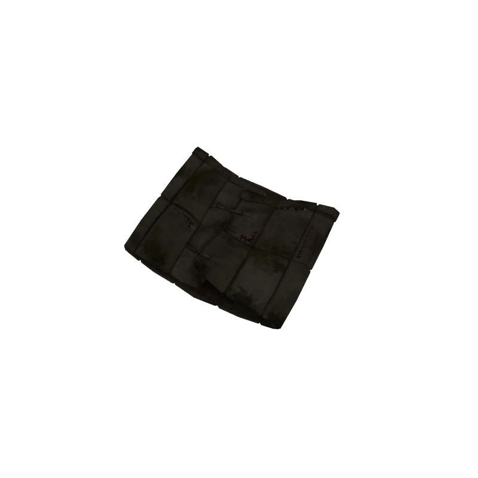

# Improvised Insulation

**Categories:** Clothing, Craftable clothing, DLC Content, Pages with update history · **Source:** [Fandom](https://thelongdark.fandom.com/wiki/Improvised_Insulation)

**Improvised Insulation**

_Improvised\_Insulation\_icon.png_

**General**

**Item Type:** Clothing\|-

**Statistics**

**Weight:** 0.25 kg(0.55 lbs)

**Warmth bonus:** 2 °C(3.6 °F)

**Windproof bonus:** 1.0 °C(1.8 °F)

**Waterproof bonus:** 0

**Protection:** 1%

**Mobility:** 0%

**Harvest:** 20 minutes 2 × [Cloth](./Cloth.md) / 3 x [Ptarmigan Down](./Ptarmigan%20Down.md)

**Repair:** 1 × [Cloth](./Cloth.md) 2 x [Ptarmigan Down](./Ptarmigan%20Down.md) / 30 minutes / 60% condition

_Ptarmigan\_icon.png_

**DLC-Exclusive content.** / This content requires the [Tales from the Far Territory](./Tales%20from%20the%20Far%20Territory.md) addon to be installed before it can be seen or used in regular gameplay.

\|}{\| style="margin:auto"

“

**A simple base layer made from down feathers. Warms the core when equipped.**

”

**Improvised Insulation** is an insulated base layer [Clothing](./Clothing.md) accessory added to the paid update of Part 3: Frontier Comforts for the [Tales from the Far Territory](./Tales%20from%20the%20Far%20Territory.md) expansion. It is made from [Cloth](./Cloth.md) and [Ptarmigan Down](./Ptarmigan%20Down.md) feathers harvested from hunted [Ptarmigans](./Ptarmigan.md).

## Crafting

**Improvised Insulation**

| Property | Details |
| --- | --- |
|  | - |
|  | - |
|  | 120.0 minutes (2 hour 0 minutes) |
| **Requirements** |  |
| Facility | \[\[File:Anywhere icon.png |
| Tool | **Template:iconlink** |
| **Materials** |  |
| **Template:iconlink plain** |  |
| Item | [Cloth](./Cloth.md) |
| Quantity | 4 |
| **Template:iconlink plain** |  |
|  | [Ptarmigan Down](./Ptarmigan%20Down.md) |
|  | 5 |

## Gallery

_Clothing model icon_

_Clothing model icon damaged_

## Update history

- UPDATE **21 June 2023 ([Update](./The%20Long%20Dark%20%E2%80%94%20Changelog.md#2.17)):**
  - Added to game
