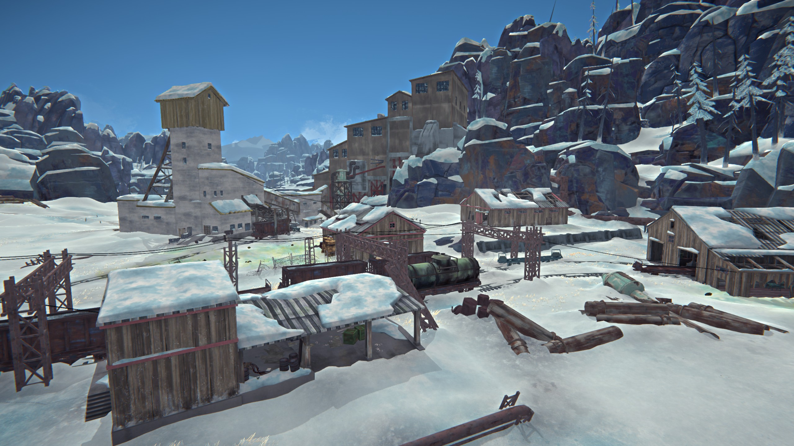
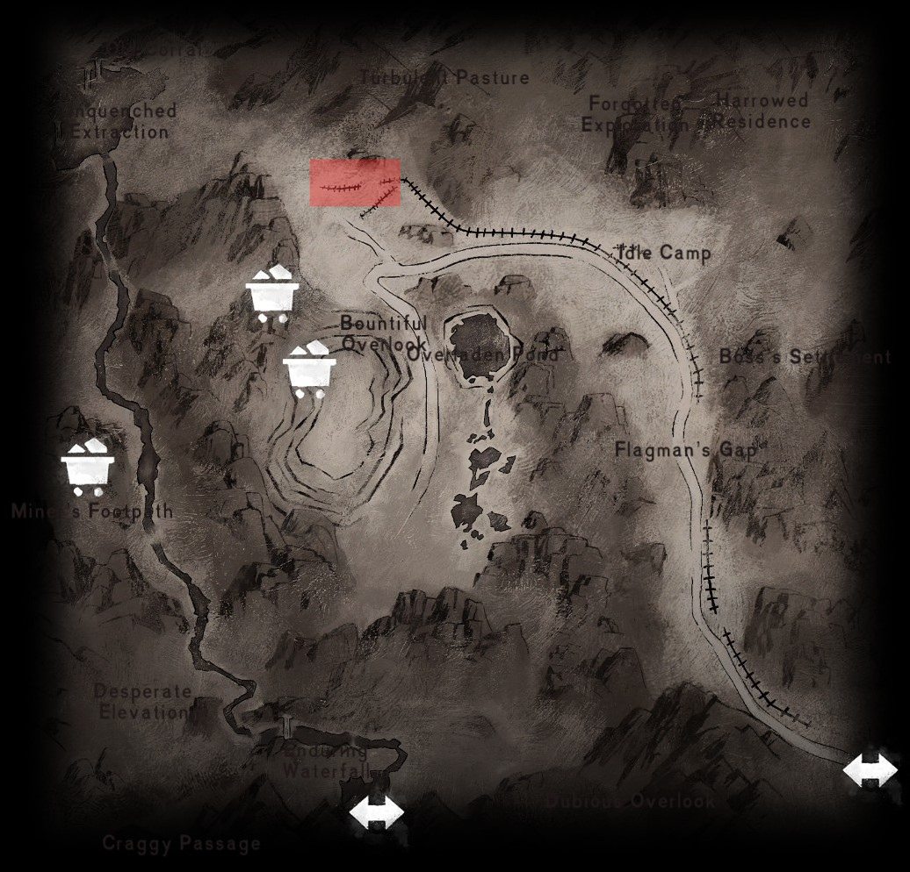

# Indolent Hoppers

**Categories:** Locations, Locations in Zone of Contamination, Locations with a workbench, Sheltered locations · **Source:** [Fandom](https://thelongdark.fandom.com/wiki/Indolent_Hoppers)

**Indolent Hoppers**

_Indolent\_Hoppers.jpg_

**Location**

_Indolent\_Hoppers\_Location.png_

**Region:** [Zone of Contamination](./Zone%20of%20Contamination.md)\|-

**Description:** A polluted trainyard close to the [Headframe Building](./Headframe%20Building.md)

**General**

Type

Firebox

_workbench\_icon\_green.png_

Has a workbench\|-
