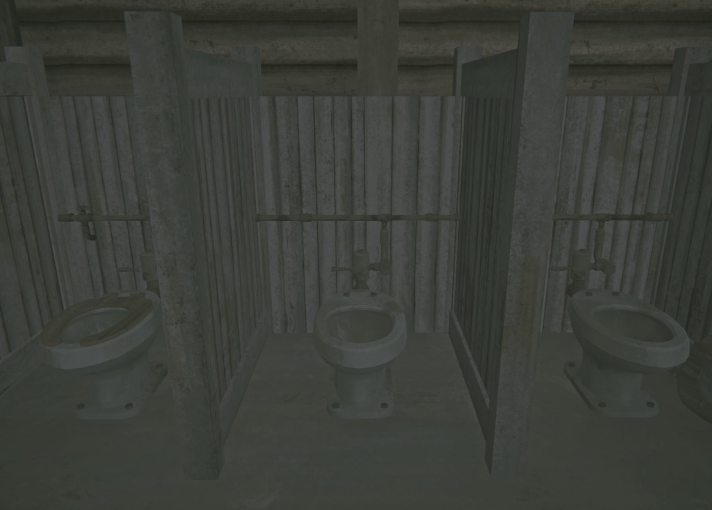

# Industrial Toilet

<table class="infobox">
<caption>Industrial Toilet</caption>
<colgroup>
<col style="width: 50%" />
<col style="width: 50%" />
</colgroup>
<tbody>
<tr>
<td colspan="2"><figure>

<figcaption>Industrial_Toilet.png</figcaption>
</figure></td>
</tr>
<tr>
<td colspan="2" class="section">
<strong>General</strong>
</td>
</tr>
<tr>
<td>
Item Type
</td>
<td>
Item
</td>
</tr>
<tr>
<td>
Wintermute
</td>
<td>
No
</td>
</tr>
</tbody>
</table>

**Industrial Toilets** are stationary interactable objects in <a href="./The%20Long%20Dark.md" class="wikilink" title="The Long Dark"><em>The Long Dark</em></a>.

## Overview

**Industrial Toilets** are very similar to the regular <a href="./Toilet.md" class="wikilink" title="Toilet">Toilet</a>, but lack a reservoir tank.

These objects can be found in <a href="./Idle%20Camp.md" class="wikilink" title="Idle Camp">Idle Camp</a> in the barracks provided to the miners once working there. They can also be found inside <a href="./Bunker%20Alpha.md" class="wikilink" title="Bunker Alpha">Bunker Alpha</a>, <a href="./Bunker%20Beta.md" class="wikilink" title="Beta">Beta</a>, <a href="./Bunker%20Gamma.md" class="wikilink" title="Gamma">Gamma</a>, and <a href="./Bunker%20Omega.md" class="wikilink" title="Omega">Omega</a>.

They can provide clean <a href="./Water%20%28Potable%29.md" class="wikilink" title="Water (Potable)">Water (Potable)</a> when searched, but can sometimes instead provide dirty <a href="./Water%20%28Unsafe%29.md" class="wikilink" title="Water (Unsafe)">Water (Unsafe)</a> and are the only toilet types to do so.

## Gallery

**Lua execution error in Module:Navbox function navbox**

