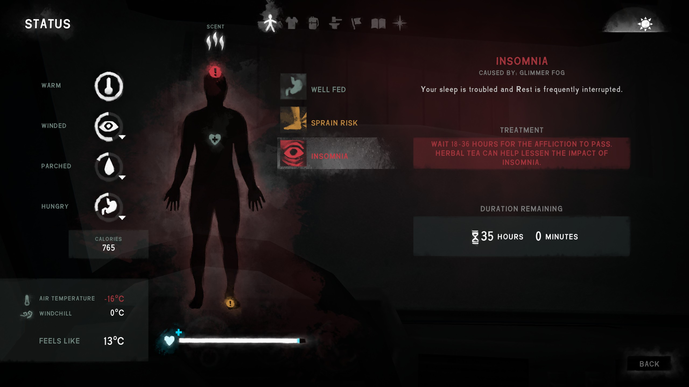

# Insomnia

**Categories:** Afflictions, DLC Content · **Source:** [Fandom](https://thelongdark.fandom.com/wiki/Insomnia)

**Contents**

- [Overview](#overview)
- [Affliction](#affliction)
- [Hazards](#hazards)
- [Survivor Quotes](#survivor-quotes)
- [Trivia](#trivia)
- [Gallery](#gallery)

**Insomnia**

[Insomnia icon](../assets/Insomnia_icon.png)

**Release:** [Dec 5, 2022](./The%20Long%20Dark%20%E2%80%94%20Changelog.md#2.03)

**Update:** 2.03

**Properties**

**Category:** [Afflictions](./Afflictions.md)

**Description:** Your sleep is troubled and Rest is frequently interrupted.

**Caused By:** [Glimmer Fog](./Glimmer%20Fog.md)

**Effect:** Negative

**Type:** Disease

**Affliction Duration:** Until Recovery Time passes

**Treatment**

**Recovery Time:** 18-36 hours

[Ptarmigan icon](../assets/Ptarmigan_icon.png)

**DLC-Exclusive content.** This content requires the [Tales from the Far Territory](./Tales%20from%20the%20Far%20Territory.md) addon to be installed before it can be seen or used in regular gameplay.

“

**Exposure to certain influences may trigger an Insomnia Affliction, introducing a new series of risks for you to manage as you do your best to avoid their cause.** [Official Hinterland description](https://www.thelongdark.com/expansion/)

”

## Overview

**Insomnia** is an [Affliction](./Afflictions.md) added to the Part 1 Update of the [Tales from the Far Territory](./Tales%20from%20the%20Far%20Territory.md) addon, and is contracted from spending too much time in [Glimmer Fog](./Glimmer%20Fog.md) found within certain [Regions](./Region.md) within the Far Territory Frontier. At present, it can only be contracted in the [Forsaken Airfield](./Forsaken%20Airfield.md), [Zone of Contamination](./Zone%20of%20Contamination.md), and [Sundered Pass](./Sundered%20Pass.md) Regions.

## Affliction

"_Your sleep is troubled and Rest is frequently interrupted._"

— In-game description

Failure to manage [Insomnia Risk](./Insomnia%20Risk.md) and thereby contracting Insomnia results in the player character having their rest frequently interrupted for 18-36 hours. This affliction is different from [Cabin Fever](./Cabin%20Fever.md), as the player may still rest anywhere at any time, but with a chance that their sleep may be prematurely disturbed after only a short period of rest (the player will awake with the message "SOMETHING WOKE YOU UP"), denying the player the full healing benefits of sleeping for long periods of time.

Eating certain Recipes created from Frontier Cooking has a chance to lower the effects of Insomnia if consumed. Drinking [Herbal Tea](./Herbal%20Tea.md) or foods that provide the [Improved Rest](./Improved%20Rest.md) benefit can help counteract the effects of Insomnia and allow for deeper rest periods.

Escaping regions that Glimmer Fog frequents will not remove the affliction at this stage. Curing the affliction only requires the player to wait the allotted hours for the disease to pass. Further Glimmer Fog events will not increase the affliction time until it returns to Risk status.

### Hazards

To a healthy survivor with high [condition](./Condition.md), Insomnia is generally quite inconsequential, as interrupted sleep restores [fatigue](./Fatigue.md) just as effectively as uninterrupted sleep. In this situation, its only adverse affect is that sleeping may require a bit more clicking than normal, which is mildly annoying at most.

However, Insomnia can become a major issue to a survivor with low condition, as it can greatly reduce the amount of healing received during sleep, which can leave them in a weak and vulnerable state upon waking. This is most likely to result in [Interloper](./Interloper.md), where losing some condition every day is often seen as an acceptable tradeoff for obtaining resources. The resulting low condition can result in death from freezing, a fall, or a [struggle](./Struggle.md) that would normally be easily survivable. In this situation, it is best to use a [Cup of Herbal Tea](./Cup%20of%20Herbal%20Tea.md) in order to counteract the effects of Insomnia.

In rare cases, Insomnia could save the survivor's life: if they're sleeping in a cave or outside and the "feels like" temperature suddenly drops below 0oC, a random sleep interruption due to being afflicted with Insomnia could prevent them from freezing to death in their sleep.

In late-game [Misery](./Misery.md) where healing is impossible, Insomnia has little impact on gameplay, aside from the interrupted sleep.

## Survivor Quotes

- "I'm tired...can't sleep"
- "I can close my eyes, I just can't sleep."
- "I can close my eyes but I just can't sleep."
- "Just...can't sleep!"

## Trivia

Insomnia was introduced in the [Tales From The Far Territory DLC.](./Tales%20from%20the%20Far%20Territory.md)

Much like Cabin Fever, Insomnia is a psychological condition; specifically one that can be diagnosed as an inability to fall asleep or remain asleep for an adequate length of time due to stress or anxiety. However given the nature of the machine located within the [Langston Mine](./Langston%20Mine.md), the electrostatic field it produces seems to upset the body's natural body chemistry, resulting in the inability to sleep.

Like other afflictions, contracting Insomnia results in the player character providing unique audible cues related to their condition. The survivor will complain about being unable to sleep despite being tired.

A [Note](./Note%20%28Forsaken%20Airfield%29.md) can be found from a survivor detailing their desire to leave the area that Glimmer Fog regularly envelopes, due to them being unable to get any sleep.

## Gallery

