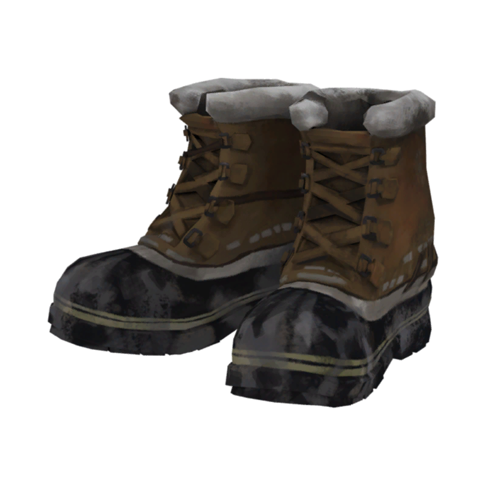

# Insulated Boots

<table class="infobox">
<caption>Insulated Boots</caption>
<colgroup>
<col style="width: 50%" />
<col style="width: 50%" />
</colgroup>
<tbody>
<tr>
<td colspan="2"><figure>

<figcaption>Insulated_Boots_icon.png</figcaption>
</figure></td>
</tr>
<tr>
<td colspan="2" class="section">
<strong>General</strong>
</td>
</tr>
<tr>
<td>
Item Type
</td>
<td>
Clothing|-
</td>
</tr>
<tr>
<td>
Clothing Slot
</td>
<td>
Outer feet
</td>
</tr>
<tr>
<td colspan="2" class="section">
<strong>Statistics</strong>
</td>
</tr>
<tr>
<td>
Weight
</td>
<td>
1.50 kg(3.3 lbs)
</td>
</tr>
<tr>
<td>
Warmth bonus
</td>
<td>
3.0 °C(5.4 °F)
</td>
</tr>
<tr>
<td>
Windproof bonus
</td>
<td>
2.0 °C(3.6 °F)
</td>
</tr>
<tr>
<td>
Waterproof bonus
</td>
<td>
50%
</td>
</tr>
<tr>
<td>
Protection
</td>
<td>
4%
</td>
</tr>
<tr>
<td>
Mobility
</td>
<td>
-12%
</td>
</tr>
<tr>
<td>
Harvest
</td>
<td>
1 × <a href="./Cured%20Leather.md" class="wikilink" title="Cured leather">Cured leather</a> 
90 minutes
</td>
</tr>
<tr>
<td>
Repair
</td>
<td>
1 × <a href="./Cured%20Leather.md" class="wikilink" title="Cured leather">Cured leather</a>, 
1 × <a href="./Cloth.md" class="wikilink" title="Cloth">Cloth</a> 
90 minutes 
30% condition
</td>
</tr>
</tbody>
</table>

<table>
<colgroup>
<col style="width: 33%" />
<col style="width: 33%" />
<col style="width: 33%" />
</colgroup>
<tbody>
<tr>
<td style="vertical-align: top; font-size: 3em; color: #5d5980; padding-right: 10px">
“
</td>
<td>
Highly waterproof boots made of synthetic materials. The felt inner liner keeps your feet nice and warm. Their bulk will slow you down.

&#10;

In-game description

</td>
<td style="vertical-align: bottom; font-size: 3em; color: #5d5980; padding-left: 10px">
”
</td>
</tr>
</tbody>
</table>

**Insulated Boots** are a type of <a href="./Clothing.md" class="wikilink" title="Clothing">Clothing</a> footwear in *The Long Dark*.

## Overview

They are the best non-craftable footwear available for overall statistics. <a href="./Ski%20Boots.md" class="wikilink" title="Ski Boots">Ski Boots</a> provide equivalent warmth and better windchill, but at more than twice the weight and with a high 20% mobility penalty.

The rare <a href="./Mukluks.md" class="wikilink" title="Mukluks">Mukluks</a> are half a degree colder and 10% less waterproof, but also have just 3% of sprint penalty.

## Gallery

<table class="gallery">
<colgroup>
<col style="width: 33%" />
<col style="width: 33%" />
<col style="width: 33%" />
</colgroup>
<tbody>
<tr>
<td><figure>
[Missing image: Insulated_boots_(historical).png]
<figcaption>Old model.</figcaption>
</figure></td>
<td><figure>

<figcaption>Clothing model icon</figcaption>
</figure></td>
<td><figure>

<figcaption>Clothing model icon damaged</figcaption>
</figure></td>
</tr>
</tbody>
</table>

**Lua execution error in Module:Navbox function navbox** <a href="ru:%D0%9F%D1%80%D0%BE%D1%80%D0%B5%D0%B7%D0%B8%D0%BD%D0%B5%D0%BD%D0%BD%D0%B0%D1%8F_%D0%BE%D0%B1%D1%83%D0%B2%D1%8C" class="wikilink" title="ru:Прорезиненная_обувь">ru:Прорезиненная_обувь</a> <a href="fr:bottes_isol%C3%A9es" class="wikilink" title="fr:bottes isolées">fr:bottes isolées</a> <a href="ru:%D0%9F%D1%80%D0%BE%D1%80%D0%B5%D0%B7%D0%B8%D0%BD%D0%B5%D0%BD%D0%BD%D0%B0%D1%8F_%D0%BE%D0%B1%D1%83%D0%B2%D1%8C" class="wikilink" title="ru:Прорезиненная обувь">ru:Прорезиненная обувь</a>

