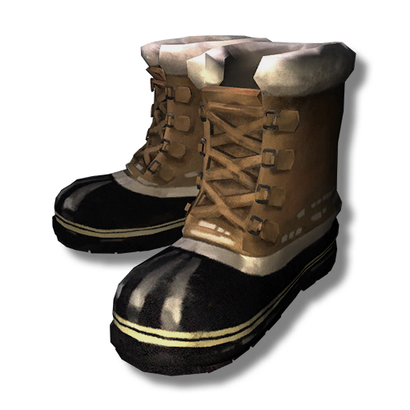
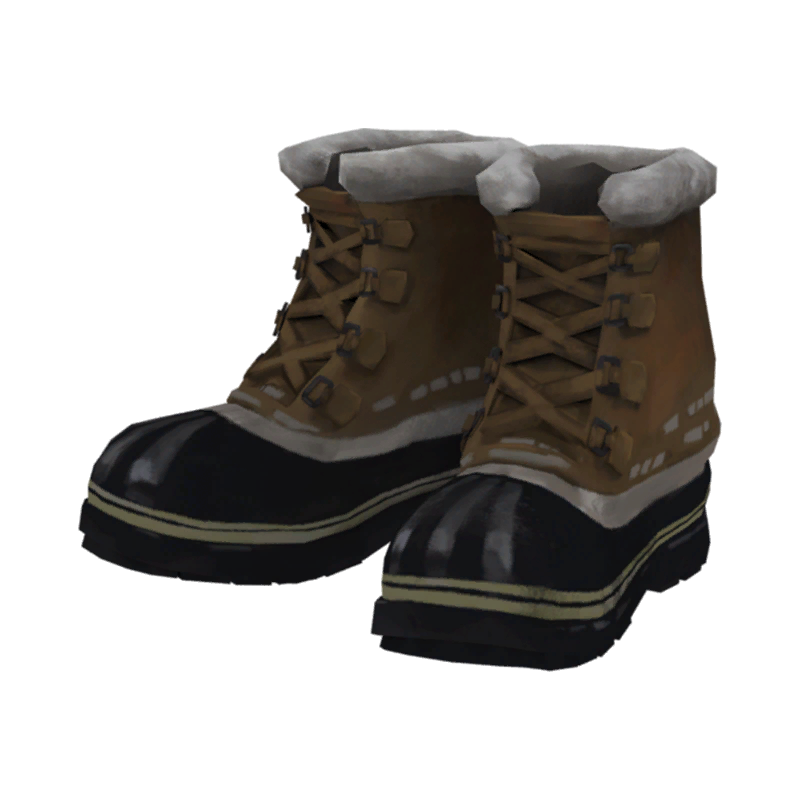

# Insulated Boots

**Insulated Boots**

| Property | Details |
| --- | --- |
|  |  / *Insulated\_Boots\_icon.png* |
| **General** |  |
| Item Type | Clothing\|- |
| Clothing Slot | Outer feet |
| **Statistics** |  |
| Weight | 1.50 kg(3.3 lbs) |
| Warmth bonus | 3.0 °C(5.4 °F) |
| Windproof bonus | 2.0 °C(3.6 °F) |
| Waterproof bonus | 50% |
| Protection | 4% |
| Mobility | -12% |
| Harvest | 1 × [Cured leather](./Cured%20Leather.md) / 90 minutes |
| Repair | 1 × [Cured leather](./Cured%20Leather.md), / 1 × [Cloth](./Cloth.md) / 90 minutes / 30% condition |

> “**Highly waterproof boots made of synthetic materials. The felt inner liner keeps your feet nice and warm. Their bulk will slow you down.**”
>
> — In-game description

**Insulated Boots** are a type of [Clothing](./Clothing.md) footwear in *The Long Dark*.

## Overview

They are the best non-craftable footwear available for overall statistics. [Ski Boots](./Ski%20Boots.md) provide equivalent warmth and better windchill, but at more than twice the weight and with a high 20% mobility penalty.

The rare [Mukluks](./Mukluks.md) are half a degree colder and 10% less waterproof, but also have just 3% of sprint penalty.

## Gallery

| Column 1 | Column 2 | Column 3 |
| --- | --- | --- |
|  / *Old model.* |  / *Clothing model icon* |  / *Clothing model icon damaged* |

**Lua execution error in Module:Navbox function navbox** [ru:Прорезиненная\_обувь](ru:%D0%9F%D1%80%D0%BE%D1%80%D0%B5%D0%B7%D0%B8%D0%BD%D0%B5%D0%BD%D0%BD%D0%B0%D1%8F_%D0%BE%D0%B1%D1%83%D0%B2%D1%8C) [fr:bottes isolées](fr:bottes_isol%C3%A9es) [ru:Прорезиненная обувь](ru:%D0%9F%D1%80%D0%BE%D1%80%D0%B5%D0%B7%D0%B8%D0%BD%D0%B5%D0%BD%D0%BD%D0%B0%D1%8F_%D0%BE%D0%B1%D1%83%D0%B2%D1%8C)
