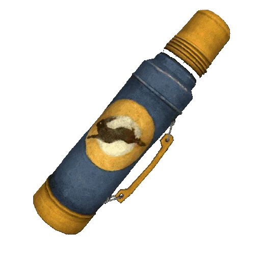
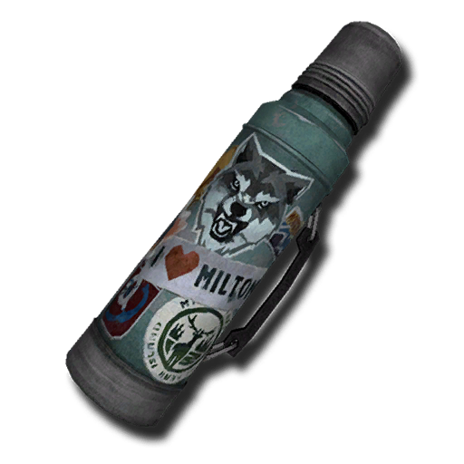
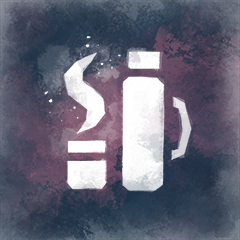

# Insulated Flask

**Contents**

- [Overview](#Overview)
- [Heat Capacity](#Heat_Capacity)
- [Possible Spawns](#Possible_Spawns)
- [Trivia](#Trivia)
- [Gallery](#Gallery)
- [Achievements](#Achievements)
- [Update history](#Update_history)

<table class="infobox">
<caption>Insulated Flask</caption>
<colgroup>
<col style="width: 50%" />
<col style="width: 50%" />
</colgroup>
<tbody>
<tr>
<td colspan="2"><figure>

<figcaption>Insulated_Flasks_animation.gif</figcaption>
</figure></td>
</tr>
<tr>
<td>
Release
</td>
<td>
<a href="./The%20Long%20Dark%20%E2%80%94%20Changelog.md#2.25" class="wikilink" title="5 December 2023">5 December 2023</a>
</td>
</tr>
<tr>
<td>
Wintermute
</td>
<td>
No
</td>
</tr>
<tr>
<td colspan="2" class="section">
<strong>Properties</strong>
</td>
</tr>
<tr>
<td>
Item type
</td>
<td>
<a href="./Tools.md" class="wikilink" title="Tools">Tools</a>|-
</td>
</tr>
<tr>
<td>
Stackable
</td>
<td>
No
</td>
</tr>
<tr>
<td>
Examine
</td>
<td>
A portable container for keeping beverages warm.
</td>
</tr>
<tr>
<td colspan="2" class="section">
<strong>Values</strong>
</td>
</tr>
<tr>
<td>
Weight
</td>
<td>
0.20 kg (0.44 lbs)
</td>
</tr>
<tr>
<td colspan="2" class="section">
<strong>Advanced data</strong>
</td>
</tr>
<tr>
<td>
Item key
</td>
<td>
GEAR_InsulatedFlask
</td>
</tr>
</tbody>
</table>

The **Insulated Flask** (otherwise known as a **Thermos**) is a <a href="./Tools.md" class="wikilink" title="Tool">Tool</a> that was released as part of the free update for the <a href="./Tales%20from%20the%20Far%20Territory.md" class="wikilink" title="Tales from the Far Territory">Tales from the Far Territory</a> expansion Part Four.

There are 6 variants in the game, but a 7th is available for players that own the Tales expansion.

## Overview

An Insulated Flask's primary function acts as both a storage container and an insulator, keeping heated drinks warmer for much longer if placed inside to preserve their <a href="./Warming%20Up.md" class="wikilink" title="Hot">Hot</a> status. Insulated Flasks come in 7 different versions that, aside from aesthetics, all function exactly the same. Selecting the Thermos in the Backpack allows the player to Transfer any drink the player has, Hot or Cold, into the Thermos for storage.

An empty Thermos weighs 0.20 kg, and its storage capacity is 0.80 kg. It is possible to store 8 multiples of the same item type inside a Thermos (such as 8 Reishi Tea weighing 0.10 kg each). This means that the combined maximum weight of a Flask can reach 1.00 kg.

Be aware that there are some limitations of using a Thermos:

- A Thermos cannot be placed on or near a cooking slot of an active fire to reheat its contents, nor can it be used to melt snow or boil water. If the contents of a Flask go COLD, each item must be removed, reheated at the fire to become HOT again, then reinserted.
- You **CANNOT** drink directly from a Thermos. Any stored contents must be removed from the Thermos to be consumed.
- Storing different types of drinks into a single Thermos is not possible, but drinks can be transferred out to store another desired type of drink at any time.
- When placing an initial drink inside a Thermos, pressing the Transfer button to transfer remaining multiples of the same drink type will always insert the lowest Condition items into the Flask by default.
- Only foods that are capable of being HOT/COLD can be placed inside a Thermos, however not all foods of this type can be placed inside a Flask (ex. <a href="./Cooked%20Potato.md" class="wikilink" title="Cooked Potato">Cooked Potato</a>, Stews).
  - Only an opened can of Tomato Soup can be placed inside a flask, other canned goods cannot put inside (<a href="./Canned%20Corn.md" class="wikilink" title="Canned Corn">Canned Corn</a>, <a href="./Condensed%20Milk.md" class="wikilink" title="Condensed Milk">Condensed Milk</a>, <a href="./Dog%20Food.md" class="wikilink" title="Dog Food">Dog Food</a>, <a href="./Pinnacle%20Peaches.md" class="wikilink" title="Pinnacle Peaches">Pinnacle Peaches</a>). It does not matter if the soup has been Cooked.
- Flasks degrade slowly and loose 0.1% condition every 10 days, and cannot be repaired.
- Flasks will rapidly degrade in struggles and falls similarly to worn clothing.

The following foods and drinks can be placed inside an Insulated Flask:

| \|Drinks | \|Foods |
|----|----|
|  <a href="./Birch%20Bark%20Tea.md" class="wikilink" title="Birch Bark Tea">Birch Bark Tea</a> |  <a href="./Broth.md" class="wikilink" title="Broth">Broth</a> |
|  <a href="./Burdock%20Tea.md" class="wikilink" title="Burdock Tea">Burdock Tea</a> |  <a href="./Tomato%20Soup.md" class="wikilink" title="Tomato Soup">Tomato Soup</a>[^1] |
|  <a href="./Cup%20of%20Acorn%20Coffee.md" class="wikilink" title="Cup of Acorn Coffee">Cup of Acorn Coffee</a> |  <a href="./Last%20Resort%20Soup.md" class="wikilink" title="Last Resort Soup">Last Resort Soup</a> |
|  <a href="./Cup%20of%20Coffee.md" class="wikilink" title="Cup of Coffee">Cup of Coffee</a> |  <a href="./Porter%27s%20Soup.md" class="wikilink" title="Porter&#39;s Soup">Porter's Soup</a> |
|  <a href="./Cup%20of%20Herbal%20Tea.md" class="wikilink" title="Cup of Herbal Tea">Cup of Herbal Tea</a> |  <a href="./Vagabond%20Soup.md" class="wikilink" title="Vagabond Soup">Vagabond Soup</a> |
|  <a href="./Reishi%20Tea.md" class="wikilink" title="Reishi Tea">Reishi Tea</a> |  |
|  <a href="./Rose%20Hip%20Tea.md" class="wikilink" title="Rose Hip Tea">Rose Hip Tea</a> |  |

## Heat Capacity

When Hot drinks are placed inside a Flask, a bar on the Flask will designate how much heat remains inside (100% heat capacity at max) until the contents go Cold. The contents of a Flask lose internal heat per minute at a rate of:

- Indoor: 0.25% per min (400 mins until Cold)
- Outdoor: 0.50% per min (200 mins until Cold)

Loss of heat in a Flask begins when a player walks more than 2 meters away from an active fire. As stated before, contents of a Flask cannot be reheated by placing the Flask near an active fire, and must be reheated one at a time and reinserted in order to regain 100% heat capacity.

## Possible Spawns

Typically, only one flask will spawn per region in one of the below locations. Additional flasks can very rarely be found in unsearched containers, such as a combination <a href="./Safe.md" class="wikilink" title="Safe">Safe</a>.

<table>
<colgroup>
<col style="width: 50%" />
<col style="width: 50%" />
</colgroup>
<thead>
<tr>
<th>
Flask Type
</th>
<th>
Possible Spawn Locations
</th>
</tr>
</thead>
<tbody>
<tr>
<td>
 <a href="./Jackrabbit%20Hangar.md" class="wikilink" title="Jackrabbit Remote Transport">Jackrabbit Remote Transport</a> Flask
</td>
<td>
<strong>Mountain Town</strong> <a href="./Mackenzie%27s%20Crashed%20Plane.md" class="wikilink" title="Mackenzie&#39;s Crashed Plane">Mackenzie's Crashed Plane</a>:

<ul>
<li>Under the plane behind the cliff</li>
<li>Inside the floatplane leg at the bottom of the ravine</li>
<li>Under the plane wing in the ravine</li>
<li>Inside one of the green <a href="./Crate.md" class="wikilink" title="Crates">Crates</a> in the ravine</li>
<li>Behind a large <a href="./Cedar%20Limb.md" class="wikilink" title="Cedar Limb">Cedar Limb</a> at the bottom of the ravine, near the cave</li>
<li>Inside the cave at the bottom of the ravine, propped against some rocks in the open</li>
</ul>
<table class="gallery">
<colgroup>
<col style="width: 50%" />
<col style="width: 50%" />
</colgroup>
<tbody>
<tr>
<td><figure>

<figcaption>Near cave</figcaption>
</figure></td>
<td><figure>

<figcaption>Under plane near cliff</figcaption>
</figure></td>
</tr>
</tbody>
</table></td>
</tr>
<tr>
<td>
 Orange Flask
</td>
<td>
<strong>Pleasant Valley</strong>

<ul>
<li>On a table at the <a href="./Misty%20Falls%20Picnic%20Area.md" class="wikilink" title="Misty Falls Picnic Area">Misty Falls Picnic Area</a></li>
<li>Hunting Blind south of Signal Hill, opposite cave transition into Winding River</li>
<li>Hunter's blind west of the access to Timberwolf Mountain</li>
<li>In the shelter next to the overturned boat in <a href="./Thomson%27s%20Crossing.md" class="wikilink" title="Thomson&#39;s Crossing">Thomson's Crossing</a></li>
<li>In the ice fishing hut at <a href="./Pensive%20Pond.md" class="wikilink" title="Pensive Pond">Pensive Pond</a></li>
</ul>

Note: Orange Flask has a chance to spawn in any <a href="./Locker.md" class="wikilink" title="Locker">Locker</a>.
</td>
</tr>
<tr>
<td>
 Purple Flask
</td>
<td>
<strong>Desolation Point</strong> Inside <a href="./The%20Riken.md" class="wikilink" title="Riken">Riken</a>:

<ul>
<li>Inside lower deck next to some barrels</li>
<li>Crew quarters</li>
<li>Kitchen countertop closest to the door</li>
</ul>

Note: Purple Flask has a chance to spawn in any <a href="./Car%20Trunk.md" class="wikilink" title="Car Trunk">Car Trunk</a>.
</td>
</tr>
<tr>
<td>
 Sunburst Flask
</td>
<td>
<strong>Timberwolf Mountain</strong> <a href="./Tail%20Section.md" class="wikilink" title="Tail Section">Tail Section</a>:

<ul>
<li>Beside a corpse on the <a href="./Summit.md" class="wikilink" title="Summit">Summit</a></li>
<li>Behind a cargo container in the <a href="./Tail%20Section.md" class="wikilink" title="Tail Section">Tail Section</a></li>
</ul>

Note: Sunburst Flask has a chance to spawn on any <a href="./Corpse.md" class="wikilink" title="Corpse">Corpse</a>.
</td>
</tr>
<tr>
<td>
 Yellow Plaid Flask
</td>
<td>
<strong>Bleak Inlet</strong> <a href="./Last%20Resort%20Cannery.md" class="wikilink" title="Last Resort Cannery">Last Resort Cannery</a>:

<ul>
<li>On a table inside the building with the rope/building with the kitchen</li>
<li>Inside of the big red building with broken stairs, inside an open locker</li>
<li>At the end of the <a href="./Cannery%20Pier.md" class="wikilink" title="Cannery Pier">Cannery Pier</a> beside a backpack</li>
</ul>

<strong>Zone of Contamination</strong> 
<a href="./Langston%20Mine.md" class="wikilink" title="Langston Mine">Langston Mine</a>:

<ul>
<li>Floor 3 of Langston Mine: elevator area, in the office with a computer</li>
<li>Floor 3 of Langston Mine: elevator area, on the catwalk above</li>
<li>Floor 3 of Langston Mine: mine office area, on a table beside an office container</li>
<li>Floor 2 of Langston Mine: in the office beside the crushing machine</li>
</ul>

Note: Yellow Plaid Flask has a chance to spawn in any <a href="./Drawer.md" class="wikilink" title="Red Tool Chest">Red Tool Chest</a>.
</td>
</tr>
<tr>
<td>
 Red Plaid Flask
</td>
<td>
<strong>Blackrock</strong> In <a href="./Blackrock%20Prison.md" class="wikilink" title="Blackrock Prison">Blackrock Prison</a>:

<ul>
<li>Inside the prison watchtower with the climbing rope</li>
<li>In the Warden's Office next to the Coffee Maker</li>
<li>Under the driver's seat of the <a href="./Bus.md" class="wikilink" title="Bus">Bus</a> in the maintenance shed next to the <a href="./Steam%20Tunnels.md" class="wikilink" title="Steam Tunnels">Steam Tunnels</a> entrance</li>
<li>Next to a desk chair in the Infirmary</li>
<li>In the open locker #4 in the guard barracks</li>
</ul>

<strong>Forsaken Airfield</strong>

<ul>
<li>Under the front counter in the <a href="./Terminal.md" class="wikilink" title="Terminal">Terminal</a></li>
<li>On a shelf under the stairs inside <a href="./Mindful%20Cabin.md" class="wikilink" title="Mindful Cabin">Mindful Cabin</a></li>
<li>Outside <a href="./Island%20Cottage.md" class="wikilink" title="Island Cottage">Island Cottage</a>, on the workbench in the open shed</li>
<li>In the Toll Cabin on the road just before the Terminal</li>
</ul>

Note: Red Plaid Flask has a chance to spawn in any <a href="./Safe.md" class="wikilink" title="Safe">Safe</a>.
</td>
</tr>
<tr>
<td>
 Sticker Flask
</td>
<td><ul>
<li>Available to players that own the <a href="./Tales%20from%20the%20Far%20Territory.md" class="wikilink" title="Tales from the Far Territory">Tales from the Far Territory</a> addon, the <a href="./Trader.md" class="wikilink" title="Trader">Trader</a> has a chance to trade a unique "Sticker" Insulated Flask to the player at higher Trust levels.</li>
</ul></td>
</tr>
</tbody>
</table>

## Trivia

- Insulated Flasks are a real world containers for insulating food and beverage.
- "Thermos" is one of the most commonly recognized names globally for insulated beverage flasks, and began as a brand name in 1904 until becoming a genericized trademark term in 1962.

The "Sticker" Insulated Flask has many stickers across it depicting <a href="./Great%20Bear%20Island.md" class="wikilink" title="Great Bear Island">Great Bear Island</a> locations or Canadian themes. Including:

- <a href="./Blackrock%20Prison.md" class="wikilink" title="Blackrock Federal Penitentiary">Blackrock Federal Penitentiary</a> Logo
- <a href="./Langston%20Mine.md" class="wikilink" title="Langston Mining Corporation">Langston Mining Corporation</a> Logo
- <a href="./Quonset%20Garage.md" class="wikilink" title="Quonset Garage">Quonset Garage</a> Logo
- <a href="./Carter%20Hydro%20Dam.md" class="wikilink" title="&quot;Carter&quot; Hydro-Electric Dam">"Carter" Hydro-Electric Dam</a> logo
- <a href="./Desolation%20Point.md" class="wikilink" title="&quot;Desolation Point&quot;">"Desolation Point"</a> with <a href="./Lonely%20Lighthouse.md" class="wikilink" title="Lonely Lighthouse">Lonely Lighthouse</a>
- "I \<3 <a href="./Milton.md" class="wikilink" title="Milton">Milton</a>"
- "Great Bear Island <a href="./Mystery%20Lake%20%28location%29.md" class="wikilink" title="Mystery Lake&quot;">Mystery Lake"</a> campground
- <a href="./Last%20Resort%20Cannery.md" class="wikilink" title="&quot;Last Resort Cannery&quot;">"Last Resort Cannery"</a> (possibly the top label from a <a href="./Tin%20of%20Sardines.md" class="wikilink" title="Tin of Sardines">Tin of Sardines</a>)
- "<a href="./Trans-Island%20Railway%20Line.md" class="wikilink" title="Trans-Island Line&quot;">Trans-Island Line"</a> railroad
- Snarling <a href="./Timberwolf.md" class="wikilink" title="Timberwolf">Timberwolf</a>
- <a href="./Coho%20Salmon%20%28Raw%29.md" class="wikilink" title="Coho Salmon">Coho Salmon</a>
- <a href="./Bear.md" class="wikilink" title="Bear">Bear</a> inside a maple leaf
- <a href="./Moose.md" class="wikilink" title="Moose">Moose</a> crossing warning road sign
- Canadian Flag
- "Mountain Time" with mountains

## Gallery

<table class="gallery">
<colgroup>
<col style="width: 25%" />
<col style="width: 25%" />
<col style="width: 25%" />
<col style="width: 25%" />
</colgroup>
<tbody>
<tr>
<td><figure>

<figcaption>Orange</figcaption>
</figure></td>
<td><figure>

<figcaption>Purple</figcaption>
</figure></td>
<td><figure>

<figcaption>Red Plaid</figcaption>
</figure></td>
<td><figure>

<figcaption>Yellow Plaid</figcaption>
</figure></td>
</tr>
<tr>
<td><figure>

<figcaption>Sunburst</figcaption>
</figure></td>
<td><figure>

<figcaption>Jackrabbit</figcaption>
</figure></td>
<td><figure>

<figcaption>Sticker</figcaption>
</figure></td>
<td><figure>

<figcaption>The Sticker flask with all the stickers</figcaption>
</figure></td>
</tr>
<tr>
<td><figure>

<figcaption>All Flasks with various drinks in front of them</figcaption>
</figure></td>
<td></td>
<td></td>
<td></td>
</tr>
</tbody>
</table>

## Achievements

-  <a href="./Something%20Warm%20to%20Drink.md" class="wikilink" title="Something Warm to Drink">Something Warm to Drink</a>

## Update history

- UPDATE **5 December 2023 (<a href="./The%20Long%20Dark%20%E2%80%94%20Changelog.md#2.25_%28Steam%29" class="wikilink" title="Update">Update</a>):**
  - Added to game.
- UPDATE **2 December 2024 (<a href="./The%20Long%20Dark%20%E2%80%94%20Changelog.md#2.33_%28Steam%29" class="wikilink" title="Update">Update</a>):**
  - Added a 7th variant from the <a href="./Trader.md" class="wikilink" title="Trader">Trader</a>.

**Lua execution error in Module:Navbox function navbox**

<a href="ru:%D0%A2%D0%B5%D1%80%D0%BC%D0%BE%D1%81" class="wikilink" title="ru:Термос">ru:Термос</a>

## Notes

[^1]: Tomato Soup cannot be placed inside a Flask until the can has been opened.
