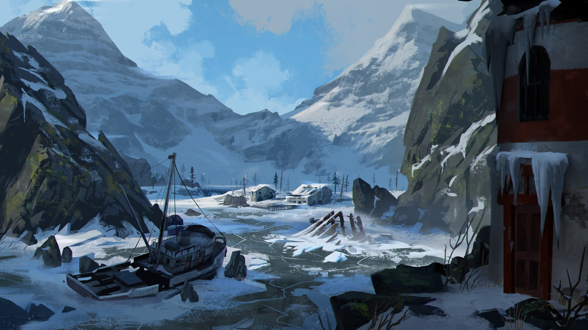
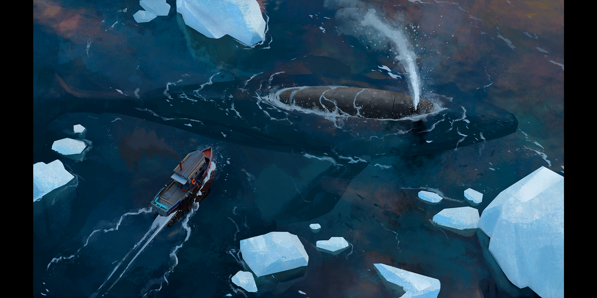
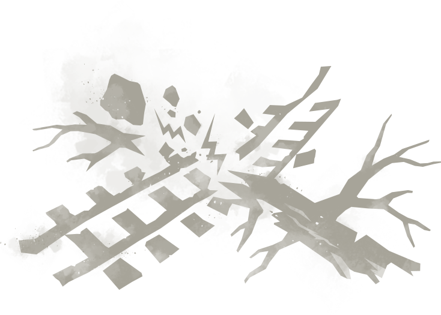
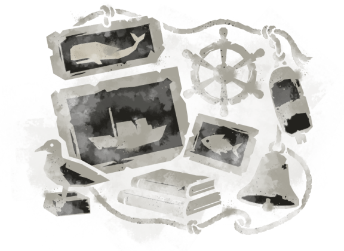
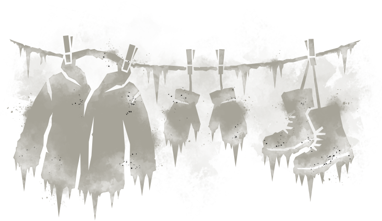

# Iron Road

**Source:** [Fandom](https://thelongdark.fandom.com/wiki/Iron_Road)

**Contents**

- [Overview](#overview)
- [World and Setting:](#world-and-setting)
- [Part One: Anna Island](#part-one-anna-island)
- [New Regions](#new-regions)
- [New Vehicles and Track Systems](#new-vehicles-and-track-systems)
- [New Items](#new-items)
- [Part Two:](#part-two)
- [Part Three:](#part-three)
- [Part Four:](#part-four)
- [Part Five:](#part-five)
- [Upcoming Content](#upcoming-content)
- [New Train and Track Systems:](#new-train-and-track-systems)
- [New Gameplay Tools and Wildlife:](#new-gameplay-tools-and-wildlife)
- [New Clothing:](#new-clothing)
- [Trivia](#trivia)
- [Gallery](#gallery)
- [References](#references)
- [Links](#links)

_Iron\_Road\_logo.png_

> “**Welcome to Cauldron Island. Lost to history, hiding a mystery. A vast northern chain of islands with 100km+ of railway winding its way across the craggy and desolate landscape, and the abandoned remnants of a once-thriving whaling industry there for you to discover.**”
>
> — Restore and activate a century-old train to travel deep along this forgotten caldera to uncover a dark secret. What you discover in the end will change how you survive in this Aurora-bathed world, forever. Official Marketing

**_Iron Road_** is [downloadable content](./The%20Long%20Dark.md#Downloadable_Addon_Content) for _[The Long Dark](./The%20Long%20Dark.md)_. It is the Second expansion to the [Survival Mode](./Survival%20Mode.md) portion of the game, and will be released in 5 major parts over the course of several years.

Early Access launched October 27th, 2026 on Steam only. Updates are planned to be a balance of small and large updates. News regarding other platforms is to be announced.

## Overview

_Cauldron Island_

> “**A century ago, a rich industrialist named Hamish McLeod harnessed the unique properties of Cauldron Island with a plan for economic domination through whale-oil powered technology. But this history was erased, and the dark truth about how things went wrong has been hidden in the past. Until now.**”
>
> — Get to Cauldron Island and uncover the truth. Follow the path laid by Alice McLeod, his great-granddaughter, who came here to crack the mystery of her family legacy. Because uncovering the mystery of Cauldron Island is core to your survival in this new Aurora-blasted world. And the journey Alice started is yours to complete. Official Marketing

### World and Setting:

- [Cauldron Island](./Cauldron%20Island.md) is a chain of five islands located near Great Bear Island, with each one being named after one of McLeod’s daughters: Anna, Stella, Freya, Morag, and Skye. Each island can contain multiple Regions and is connected to the others via a hydraulic train bridge that is disabled until it is unlocked as Early Access unfolds.
- The [“Fulmar” Autopilot Boat](./Fulmar%20Autopilot%20Boat.md) will allow the Survivor to travel between [Desolation Point](./Desolation%20Point.md) ([Great Bear Island](./Great%20Bear%20Island.md)) and [Port Remnant](./Port%20Remnant.md) ([Cauldron Island](./Cauldron%20Island.md)). Anna Island is always the starting point to the Island.
  - Travelling costs 20.00 L of water, 5000 calories of food, 20.00 kg of any fuel, and 5 tinder plugs. The “Fulmar” boat sports a 150.00 kg storage container to carry more gear between trips. The boat must be resupplied for each journey between the 2 major islands.
- A Prototype Steam Train can be found on the Island, and is the fastest and safest way to traverse the new Aurora stricken lands (as well as serving as a mobile base).
  - Find Train Repair sheds, Fuel and Water Stations, Switches, and a host of other obstacles and points of interest to explore all related to the Prototype Steam Train.
  - Travel across dozens of Track Sections and Exploration Regions (over 100km of dedicated train tracks) throughout the full Cauldron Island landmass, eventually looping around all 5 islands of the caldera.
- The game world now reflects the post [Episode 5: The Light At The End Of All Things](./Episode%205%20-%20The%20Light%20At%20The%20End%20Of%20All%20Things.md) [Aurora](./Aurora.md) world: as the player travels deeper into Cauldron Island, new dangers beset the player's health.
- Iron Road features a series of audio collectibles and light narrative missions that provide objectives and motivate your journey across the entirety of Cauldron Island (similar to [Tales from the Far Territory](./Tales%20from%20the%20Far%20Territory.md)). Find Wax Cylinders that reveal the history of the caldera and discover more about McLeod's failed operations from a century ago.

## Part One: Anna Island

### New Regions

- Access to [Anna Island](./Cauldron%20Island.md#Anna_Island) with multiple new Regions:
  - [Port Remnant](./Port%20Remnant.md)
  - [Anna Island -- Track Section 1](./Anna%20Island%20--%20Track%20Section%201.md)
  - [Anna Island -- Track Section 2](./Anna%20Island%20--%20Track%20Section%202.md)
  - [Anna Island -- Track Section 3](./Anna%20Island%20--%20Track%20Section%203.md)
  - [Anna Island -- Track Section 4](./Anna%20Island%20--%20Track%20Section%204.md)
  - [Anna Island -- Track Section 5](./Anna%20Island%20--%20Track%20Section%205.md)
  - [Anna Island -- Track Section 6](./Anna%20Island%20--%20Track%20Section%206.md)

### New Vehicles and Track Systems

- [Fulmar Autopilot Boat](./Fulmar%20Autopilot%20Boat.md)
- [The Prototype Iron Train](./Prototype%20Train.md)
  - 30 kms of track with obstacles, [whale oil refueling stations](./Oil%20Tank.md), [water stations](./Water%20Tower.md), [train switches](./Track%20Switch.md), etc.
  - [Damaged Track](./Damaged%20Track.md)
  - Deep Drifts (large snow piles)
  - Fallen Trees

### New Items

- [Brake Shoe](./Brake%20Shoe.md)
- [Whale Oil Can](./Whale%20Oil%20Can.md)
- [McLeod Ultra-Efficiency Whale Oil Heater](./McLeod%20Ultra-Efficiency%20Whale%20Oil%20Heater.md)
- [Wax Cylinder Player](./Wax%20Cylinder%20Player.md), 16 Wax Cylinders, and 4 other Collectibles

## Part Two:

TBA

## Part Three:

TBA

## Part Four:

TBA

## Part Five:

TBA

## Upcoming Content

### New Train and Track Systems:

- Train upgrades to various components, unlocking new train-based gameplay tools
- Train cosmetics, to allow personalization of the cabin and exterior details

- Electrified Track Sections
- Hidden Trees

- Broken Switches
- Rockfalls
- Puzzle Gates
- Aurora Gates

### New Gameplay Tools and Wildlife:

- New [Safehouse Customization](./Safehouse%20Customization.md) [Decorations](./Decorations.md) themed around the 1920s-30s
- Enhanced Gun Oil
- Harpoon &amp; Seal Hunting

- Whale Oil Lamp
- Flensing Knife
- Canned Whale Meat
- New Cooking Recipes

- New Fish Types
- Seals
- Seabirds
- New Aurora Hazards

### New Clothing:

- Whaler’s Coat
- Whaler’s Hat
- Sealskin Mittens
- Mariner’s Mitts
- Islander Sweater
- Sealskin Boots

## Trivia

- Players currently cannot start on Cauldron Island when selecting a starting Region on a fresh save file, as Survival Mode's narrative stipulates that the Survivor character had their plane crash in the remote wilderness of Great Bear Island.
  - This means that the player must start in Desolation Point and load up the required materials into the Fulmar in order to access Cauldron Island on every new playthrough.
- There are no [Frozen Corpses](./Frozen%20Corpse.md) on the caldera due to a lack of human activity in over 100 years.

## Gallery

_August 2026 teaser for Cauldron Island._

_Concept art of the Iron Train_

_ditto, of the train's cabin_

_Ditto_

_Concept of the Fulmar Boat_

_ditto_

_ditto_

_ditto_

_ditto_

_Iron\_Road\_Train\_Tracks.png_

_Iron\_Road\_Decorations.png_

_Iron\_Road\_Seal\_and\_Seagull.png_

_Iron\_Road\_Clothing\_Logo.png_

## References

&lt;div class="references-small" ;"&gt;

## Links
