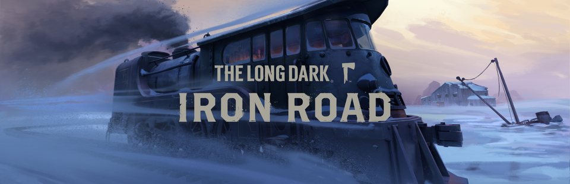
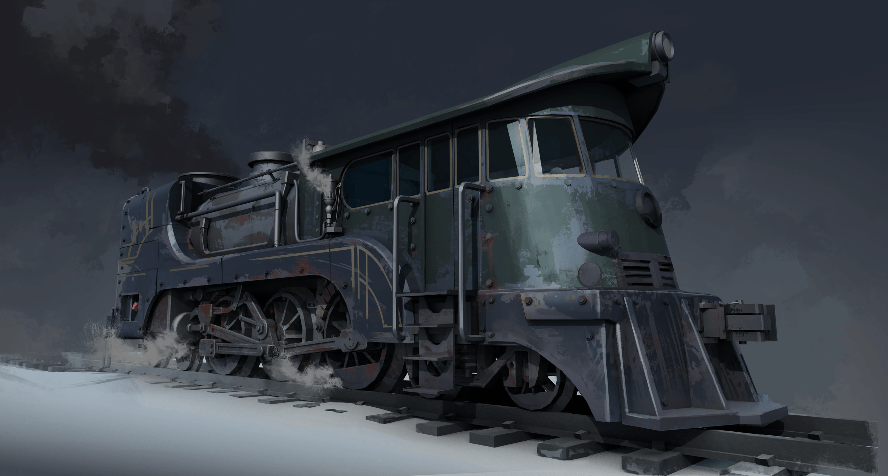
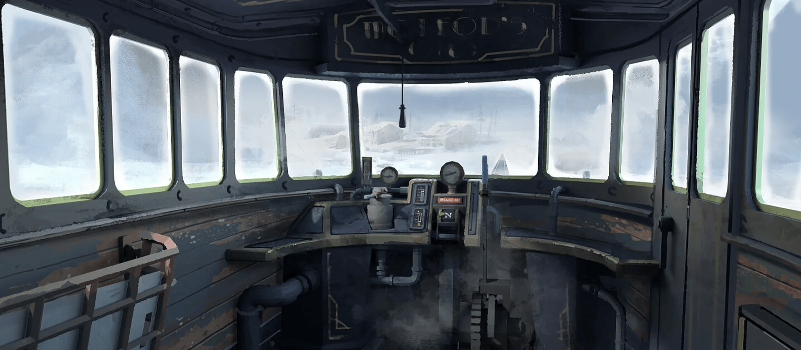
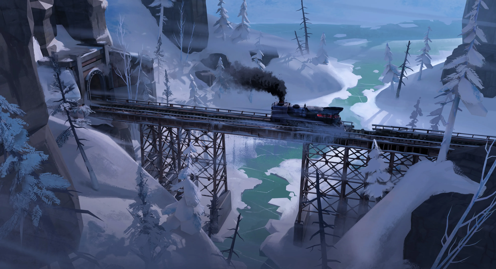
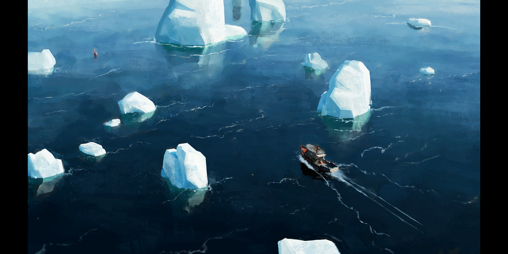
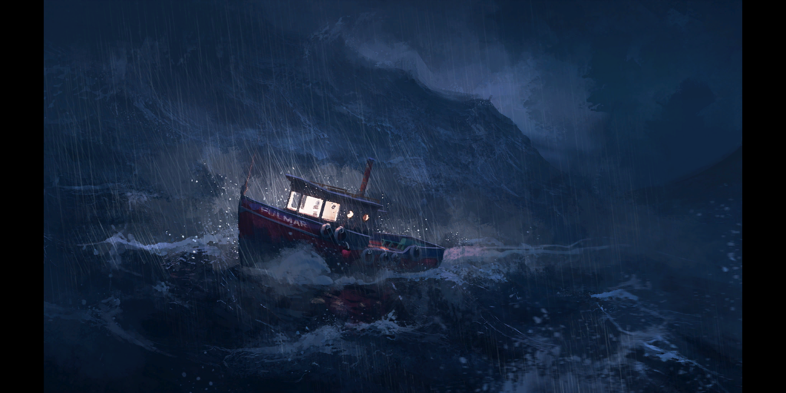
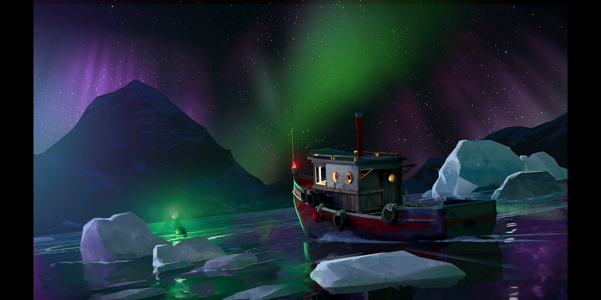
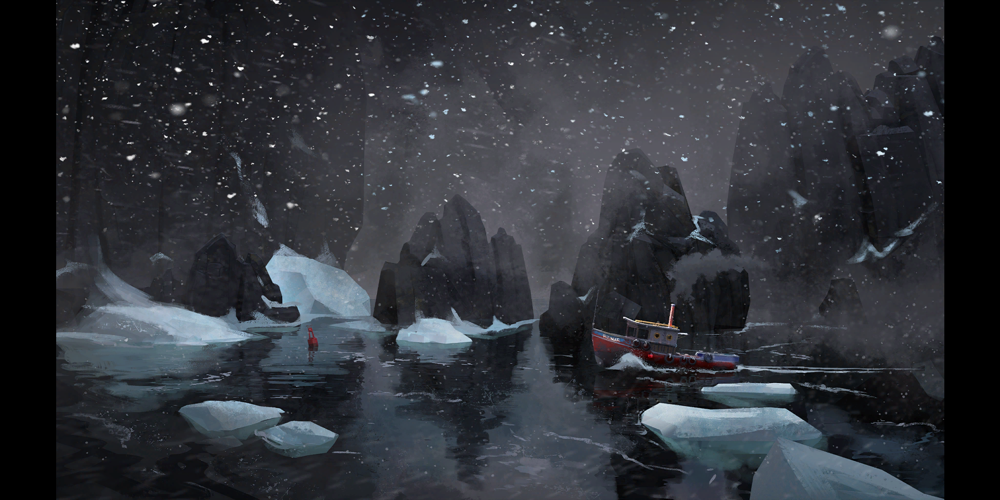

# Iron Road

**Contents**

- [Overview](#Overview)
- [World and Setting:](#World_and_Setting%3A)
- [Part One: Anna Island](#Part_One%3A_Anna_Island)
- [New Regions](#New_Regions)
- [New Vehicles and Track Systems](#New_Vehicles_and_Track_Systems)
- [New Items](#New_Items)
- [Part Two:](#Part_Two%3A)
- [Part Three:](#Part_Three%3A)
- [Part Four:](#Part_Four%3A)
- [Part Five:](#Part_Five%3A)
- [Upcoming Content](#Upcoming_Content)
- [New Train and Track Systems:](#New_Train_and_Track_Systems%3A)
- [New Gameplay Tools and Wildlife:](#New_Gameplay_Tools_and_Wildlife%3A)
- [New Clothing:](#New_Clothing%3A)
- [Trivia](#Trivia)
- [Gallery](#Gallery)
- [References](#References)
- [Links](#Links)

<figure>

<figcaption>Iron_Road_logo.png</figcaption>
</figure>

<table>
<colgroup>
<col style="width: 33%" />
<col style="width: 33%" />
<col style="width: 33%" />
</colgroup>
<tbody>
<tr>
<td style="vertical-align: top; font-size: 3em; color: #5d5980; padding-right: 10px">
“
</td>
<td>
Welcome to Cauldron Island. Lost to history, hiding a mystery. A vast northern chain of islands with 100km+ of railway winding its way across the craggy and desolate landscape, and the abandoned remnants of a once-thriving whaling industry there for you to discover.

Restore and activate a century-old train to travel deep along this forgotten caldera to uncover a dark secret. What you discover in the end will change how you survive in this Aurora-bathed world, forever.

&#10;

Official Marketing

</td>
<td style="vertical-align: bottom; font-size: 3em; color: #5d5980; padding-left: 10px">
”
</td>
</tr>
</tbody>
</table>

***Iron Road*** is <a href="./The%20Long%20Dark.md#Downloadable_Addon_Content" class="wikilink" title="downloadable content">downloadable content</a> for *<a href="./The%20Long%20Dark.md" class="wikilink" title="The Long Dark">The Long Dark</a>*. It is the Second expansion to the <a href="./Survival%20Mode.md" class="wikilink" title="Survival Mode">Survival Mode</a> portion of the game, and will be released in 5 major parts over the course of several years.

Early Access launched October 27th, 2026 on Steam only. Updates are planned to be a balance of small and large updates. News regarding other platforms is to be announced.

## Overview

<figure class="thumb">

<figcaption aria-hidden="true">Cauldron Island</figcaption>
</figure>

<table>
<colgroup>
<col style="width: 33%" />
<col style="width: 33%" />
<col style="width: 33%" />
</colgroup>
<tbody>
<tr>
<td style="vertical-align: top; font-size: 3em; color: #5d5980; padding-right: 10px">
“
</td>
<td>
A century ago, a rich industrialist named Hamish McLeod harnessed the unique properties of Cauldron Island with a plan for economic domination through whale-oil powered technology. But this history was erased, and the dark truth about how things went wrong has been hidden in the past. Until now.

Get to Cauldron Island and uncover the truth. Follow the path laid by Alice McLeod, his great-granddaughter, who came here to crack the mystery of her family legacy.

Because uncovering the mystery of Cauldron Island is core to your survival in this new Aurora-blasted world. And the journey Alice started is yours to complete.

&#10;

Official Marketing

</td>
<td style="vertical-align: bottom; font-size: 3em; color: #5d5980; padding-left: 10px">
”
</td>
</tr>
</tbody>
</table>

### World and Setting:

- <a href="./Cauldron%20Island.md" class="wikilink" title="Cauldron Island">Cauldron Island</a> is a chain of five islands located near Great Bear Island, with each one being named after one of McLeod’s daughters: Anna, Stella, Freya, Morag, and Skye. Each island can contain multiple Regions and is connected to the others via a hydraulic train bridge that is disabled until it is unlocked as Early Access unfolds.
- The <a href="./Fulmar%20Autopilot%20Boat.md" class="wikilink" title="“Fulmar” Autopilot Boat">“Fulmar” Autopilot Boat</a> will allow the Survivor to travel between <a href="./Desolation%20Point.md" class="wikilink" title="Desolation Point">Desolation Point</a> (<a href="./Great%20Bear%20Island.md" class="wikilink" title="Great Bear Island">Great Bear Island</a>) and <a href="./Port%20Remnant.md" class="wikilink" title="Port Remnant">Port Remnant</a> (<a href="./Cauldron%20Island.md" class="wikilink" title="Cauldron Island">Cauldron Island</a>). Anna Island is always the starting point to the Island.
  - Travelling costs 20.00 L of water, 5000 calories of food, 20.00 kg of any fuel, and 5 tinder plugs. The “Fulmar” boat sports a 150.00 kg storage container to carry more gear between trips. The boat must be resupplied for each journey between the 2 major islands.
- A Prototype Steam Train can be found on the Island, and is the fastest and safest way to traverse the new Aurora stricken lands (as well as serving as a mobile base).
  - Find Train Repair sheds, Fuel and Water Stations, Switches, and a host of other obstacles and points of interest to explore all related to the Prototype Steam Train.
  - Travel across dozens of Track Sections and Exploration Regions (over 100km of dedicated train tracks) throughout the full Cauldron Island landmass, eventually looping around all 5 islands of the caldera.
- The game world now reflects the post <a href="./Episode%205%20-%20The%20Light%20At%20The%20End%20Of%20All%20Things.md" class="wikilink" title="Episode 5: The Light At The End Of All Things">Episode 5: The Light At The End Of All Things</a> <a href="./Aurora.md" class="wikilink" title="Aurora">Aurora</a> world: as the player travels deeper into Cauldron Island, new dangers beset the player's health.
- Iron Road features a series of audio collectibles and light narrative missions that provide objectives and motivate your journey across the entirety of Cauldron Island (similar to <a href="./Tales%20from%20the%20Far%20Territory.md" class="wikilink" title="Tales from the Far Territory">Tales from the Far Territory</a>). Find Wax Cylinders that reveal the history of the caldera and discover more about McLeod's failed operations from a century ago.

## Part One: Anna Island

### New Regions

- Access to <a href="./Cauldron%20Island.md#Anna_Island" class="wikilink" title="Anna Island">Anna Island</a> with multiple new Regions:
  - <a href="./Port%20Remnant.md" class="wikilink" title="Port Remnant">Port Remnant</a>
  - <a href="./Anna%20Island%20--%20Track%20Section%201.md" class="wikilink" title="Anna Island -- Track Section 1">Anna Island -- Track Section 1</a>
  - <a href="./Anna%20Island%20--%20Track%20Section%202.md" class="wikilink" title="Anna Island -- Track Section 2">Anna Island -- Track Section 2</a>
  - <a href="./Anna%20Island%20--%20Track%20Section%203.md" class="wikilink" title="Anna Island -- Track Section 3">Anna Island -- Track Section 3</a>
  - <a href="./Anna%20Island%20--%20Track%20Section%204.md" class="wikilink" title="Anna Island -- Track Section 4">Anna Island -- Track Section 4</a>
  - <a href="./Anna%20Island%20--%20Track%20Section%205.md" class="wikilink" title="Anna Island -- Track Section 5">Anna Island -- Track Section 5</a>
  - <a href="./Anna%20Island%20--%20Track%20Section%206.md" class="wikilink" title="Anna Island -- Track Section 6">Anna Island -- Track Section 6</a>

### New Vehicles and Track Systems

- <a href="./Fulmar%20Autopilot%20Boat.md" class="wikilink" title="Fulmar Autopilot Boat">Fulmar Autopilot Boat</a>
- <a href="./Prototype%20Train.md" class="wikilink" title="The Prototype Iron Train">The Prototype Iron Train</a>
  - 30 kms of track with obstacles, <a href="./Oil%20Tank.md" class="wikilink" title="whale oil refueling stations">whale oil refueling stations</a>, <a href="./Water%20Tower.md" class="wikilink" title="water stations">water stations</a>, <a href="./Track%20Switch.md" class="wikilink" title="train switches">train switches</a>, etc.
  - <a href="./Damaged%20Track.md" class="wikilink" title="Damaged Track">Damaged Track</a>
  - Deep Drifts (large snow piles)
  - Fallen Trees

### New Items

- <a href="./Brake%20Shoe.md" class="wikilink" title="Brake Shoe">Brake Shoe</a>
- <a href="./Whale%20Oil%20Can.md" class="wikilink" title="Whale Oil Can">Whale Oil Can</a>
- <a href="./McLeod%20Ultra-Efficiency%20Whale%20Oil%20Heater.md" class="wikilink" title="McLeod Ultra-Efficiency Whale Oil Heater">McLeod Ultra-Efficiency Whale Oil Heater</a>
- <a href="./Wax%20Cylinder%20Player.md" class="wikilink" title="Wax Cylinder Player">Wax Cylinder Player</a>, 16 Wax Cylinders, and 4 other Collectibles

## Part Two:

TBA

## Part Three:

TBA

## Part Four:

TBA

## Part Five:

TBA

## Upcoming Content

### New Train and Track Systems:

- Train upgrades to various components, unlocking new train-based gameplay tools
- Train cosmetics, to allow personalization of the cabin and exterior details

<!-- -->

- Electrified Track Sections
- Hidden Trees

<!-- -->

- Broken Switches
- Rockfalls
- Puzzle Gates
- Aurora Gates

### New Gameplay Tools and Wildlife:

- New <a href="./Safehouse%20Customization.md" class="wikilink" title="Safehouse Customization">Safehouse Customization</a> <a href="./Decorations.md" class="wikilink" title="Decorations">Decorations</a> themed around the 1920s-30s
- Enhanced Gun Oil
- Harpoon & Seal Hunting

<!-- -->

- Whale Oil Lamp
- Flensing Knife
- Canned Whale Meat
- New Cooking Recipes

<!-- -->

- New Fish Types
- Seals
- Seabirds
- New Aurora Hazards

### New Clothing:

- Whaler’s Coat
- Whaler’s Hat
- Sealskin Mittens
- Mariner’s Mitts
- Islander Sweater
- Sealskin Boots

## Trivia

- Players currently cannot start on Cauldron Island when selecting a starting Region on a fresh save file, as Survival Mode's narrative stipulates that the Survivor character had their plane crash in the remote wilderness of Great Bear Island.
  - This means that the player must start in Desolation Point and load up the required materials into the Fulmar in order to access Cauldron Island on every new playthrough.
- There are no <a href="./Frozen%20Corpse.md" class="wikilink" title="Frozen Corpses">Frozen Corpses</a> on the caldera due to a lack of human activity in over 100 years.

## Gallery

<table class="gallery">
<colgroup>
<col style="width: 25%" />
<col style="width: 25%" />
<col style="width: 25%" />
<col style="width: 25%" />
</colgroup>
<tbody>
<tr>
<td><figure>
[Missing image: Tld-august-dev-diary-site-support-img-1.jpg]
<figcaption>August 2026 teaser for Cauldron Island.</figcaption>
</figure></td>
<td><figure>

<figcaption>Concept art of the Iron Train</figcaption>
</figure></td>
<td><figure>

<figcaption>ditto, of the train's cabin</figcaption>
</figure></td>
<td><figure>

<figcaption>Ditto</figcaption>
</figure></td>
</tr>
<tr>
<td><figure>

<figcaption>Concept of the Fulmar Boat</figcaption>
</figure></td>
<td><figure>

<figcaption>ditto</figcaption>
</figure></td>
<td><figure>

<figcaption>ditto</figcaption>
</figure></td>
<td><figure>

<figcaption>ditto</figcaption>
</figure></td>
</tr>
<tr>
<td><figure>

<figcaption>ditto</figcaption>
</figure></td>
<td><figure>

<figcaption>Iron_Road_Train_Tracks.png</figcaption>
</figure></td>
<td><figure>

<figcaption>Iron_Road_Decorations.png</figcaption>
</figure></td>
<td><figure>

<figcaption>Iron_Road_Seal_and_Seagull.png</figcaption>
</figure></td>
</tr>
<tr>
<td><figure>

<figcaption>Iron_Road_Clothing_Logo.png</figcaption>
</figure></td>
<td></td>
<td></td>
<td></td>
</tr>
</tbody>
</table>

## References

\

## Links

[Hinterland.com Iron Road Roadmap](https://www.thelongdark.com/iron-road/#early-access-roadmap)**Lua execution error in Module:Navbox function navbox**

<a href="ru:%D0%96%D0%B5%D0%BB%D0%B5%D0%B7%D0%BD%D0%B0%D1%8F_%D0%B4%D0%BE%D1%80%D0%BE%D0%B3%D0%B0" class="wikilink" title="ru:Железная дорога">ru:Железная дорога</a>

