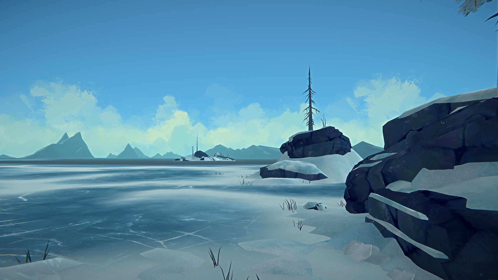
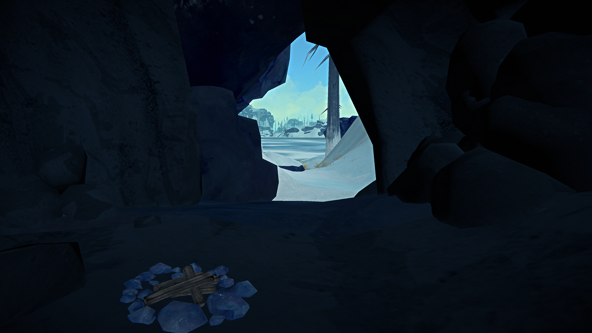

# Island Cave

**Categories:** Caves, Islands, Locations, Locations in Bleak Inlet, Sheltered locations, Unofficial locations, Unofficially named content · **Source:** [Fandom](https://thelongdark.fandom.com/wiki/Island_Cave)

**Island Cave**

[IslandCave](../assets/IslandCave.png)

**Location**

**Region:** [Bleak Inlet](./Bleak%20Inlet.md)

**Description:** A small cave on an offshore island.

**General**

**Type:** Cave

## Overview

Until the release of [Tales from the Far Territory](./Tales%20from%20the%20Far%20Territory.md), this was the only cave in the game that was located on an island, aside from the small bear cave at [Misanthrope's Homestead](./Misanthrope%27s%20Homestead.md). The cave provides a +10oC warmth bonus inside, and a [campfire](./Campfire.md) spawns near the entrance, which can be lit if the player is still too cold.

The cave must be accessed using a footpath which starts from the northern side of the island, but it's possible to safely jump down onto the ice from the cave. The cave and path leading to it can be good vantage point from which to hunt the nearby [timberwolves](./Timberwolf.md) in relative safety. Timberwolves won't walk into the cave unless actively pursuing a player.

A [frozen corpse](./Frozen%20Corpse.md) may spawn in the cave, along with some random food and drink and pieces of mid-grade clothing.

## Gallery

