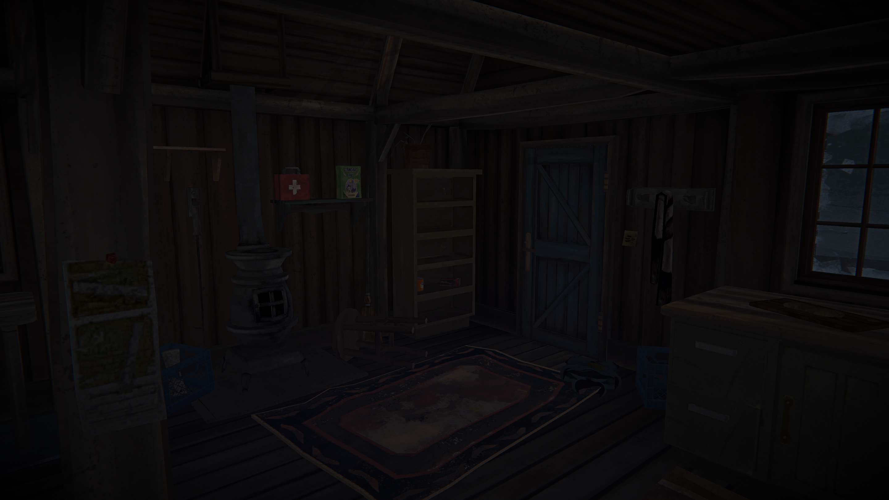
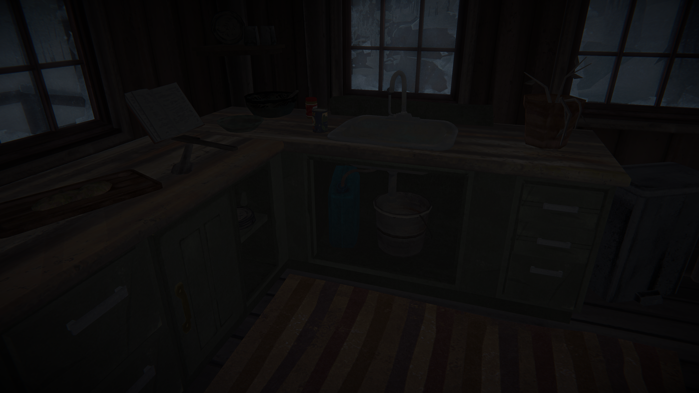
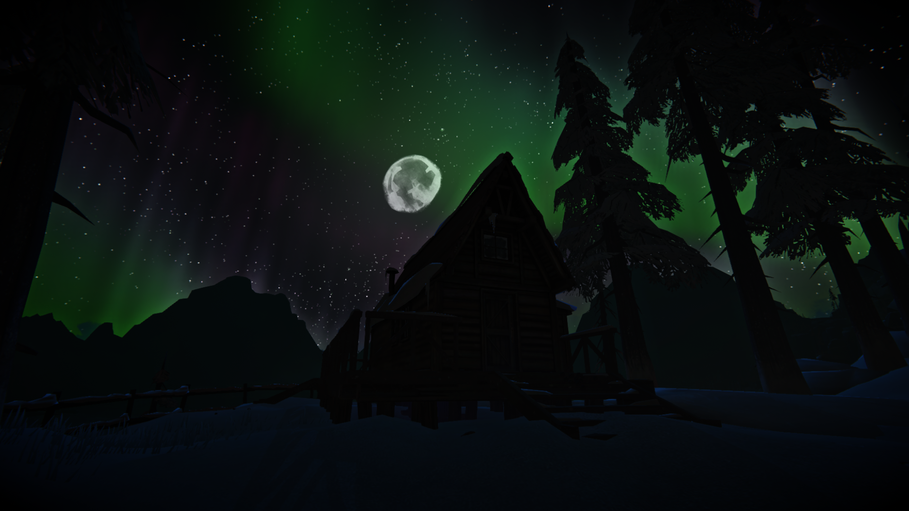
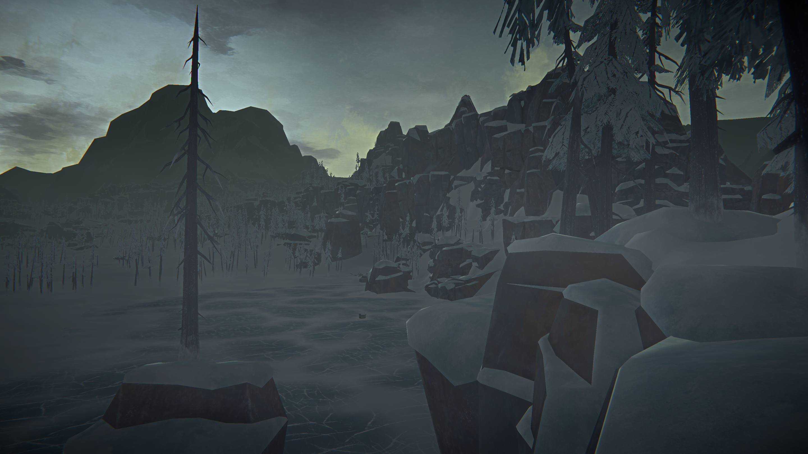

# Island Cottage

**Categories:** Indoor locations, Locations, Locations in Forsaken Airfield, Locations with a workbench, Residential locations · **Source:** [Fandom](https://thelongdark.fandom.com/wiki/Island_Cottage)

**Island Cottage**

[Island Cottage](../assets/Island_Cottage.png)

**Location**

[Island Cottage Location](../assets/Island_Cottage_Location.png)

**Region:** [Forsaken Airfield](./Forsaken%20Airfield.md)

**Description:** A cabin overlooking [Shoulder Lake](./Shoulder%20Lake.md).

**General**

**Type:** Residential

[Workbench icon green](../assets/Workbench_icon_green.png)

Has a workbench

## Overview

The cabin is easiest to access by walking through the [Cove](./Cove.md), up a staircase and through a short cave. From there, walking farther uphill will lead the player to the cottage.

The cottage itself has one main room, with a [Pot Belly Stove](./Pot%20Belly%20Stove.md) and a [Bed](./Bed.md). It does not have a loading screen upon entering. From the cottage's balcony, it is possible to see all the way across Shoulder Lake if the weather is clear enough.

Notable loot includes a possible [Hacksaw](./Hacksaw.md) in the shed just outside, a [Heavy Hammer](./Heavy%20Hammer.md) on a [Barrel](./Barrel.md) near the front door, a [Survival Bow](./Survival%20Bow.md) with three [Simple Arrows](./Simple%20Arrow.md) near the back door, and a [Polaroid](./Polaroids.md) on the nightstand next to the bed.

As of the Part 4 Buried echoes update, a [Work Bench](./Work%20Bench.md) spawns in the nearby shed.

## Safehouse

The cottage itself could make for a potential [Safe House](./Safehouse.md) in the region, as there are a lot of [Rabbits](./Rabbit.md) and [Ice Fishing](./Ice%20Fishing.md) opportunities nearby, as well as a potential [Moose](./Moose.md) spawn on the lake ice below the cabin. [Ptarmigans](./Ptarmigan.md) sparsely flock in the nearby clearing north of the cabin, allowing for further hunting opportunities. Additionally, the cave leading up from the Cove to the cabin is outdoors, yet protected from the wind, making it ideal for cooking the rabbits that were recently [snared](./Trapping.md) (Note that some of the rabbit spawn areas maybe too close to the cabin to allow a snare to work unless you leave the area for an extended period). If [Cabin Fever](./Cabin%20Fever.md) becomes an issue, there is a cave located to the north-east; sleeping in a nearby fishing hut is also an option.

Unfortunately, it is not safe from the [Glimmer Fog](./Glimmer%20Fog.md) and [Wolves](./Wolf.md) can frequent the immediate areas around the building. However most of them don't climb up onto the island unless in pursuit of a player.

Much like its other cabin counterpart in the region, the [Mindful Cabin](./Mindful%20Cabin.md), there are no electrical devices within the location, meaning that it will not immediately be obvious that an [Aurora](./Aurora.md) or Glimmer Fog event is active, should the player awaken from sleep after passing time. Luckily the many windows and wide open views should allow the player to spot the potentially dangerous phenomena before venturing far.

## Gallery

