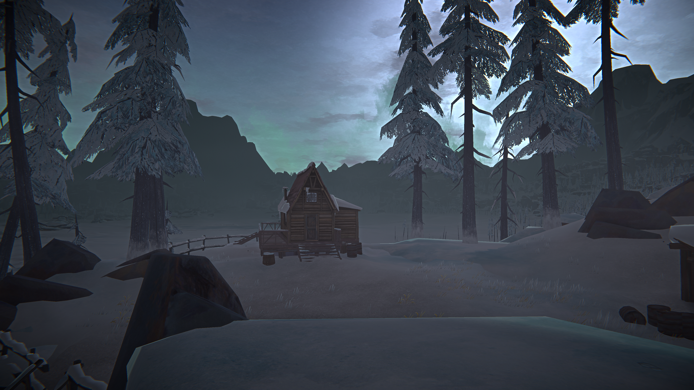
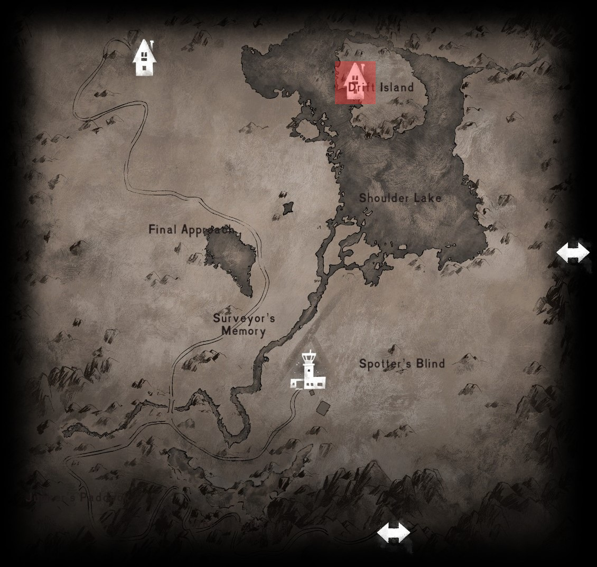

# Island Cottage

**Island Cottage**

| Property | Details |
| --- | --- |
|  |  / *Island\_Cottage.png* |
| **Location** |  |
|  |  / *Island\_Cottage\_Location.png* |
| Region | [Forsaken Airfield](./Forsaken%20Airfield.md)\|- |
| Description | A cabin overlooking [Shoulder Lake](./Shoulder%20Lake.md). |
| **General** |  |
| Type | Residential\|- |
|  / *workbench\_icon\_green.png* | Has a workbench\|- |
