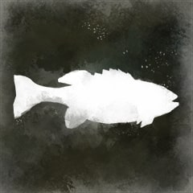

# It was THIS Big\!

<table class="infobox">
<caption>It was THIS Big!</caption>
<colgroup>
<col style="width: 50%" />
<col style="width: 50%" />
</colgroup>
<tbody>
<tr>
<td colspan="2"><figure>

<figcaption>It_was_THIS_Big!_icon.png</figcaption>
</figure></td>
</tr>
<tr>
<td colspan="2"></td>
</tr>
<tr>
<td>
Description
</td>
<td>
Caught a fish weighing over 5kg (11 lbs).
</td>
</tr>
</tbody>
</table>

**It was THIS Big!** is an <a href="./The%20Long%20Dark%20%E2%80%94%20Achievements.md" class="wikilink" title="achievement">achievement</a> in *<a href="./The%20Long%20Dark.md" class="wikilink" title="The Long Dark">The Long Dark</a>*.

## Guide

This achievement is obtained after catching a fish weighing greater than five kilograms. Typically, the only fish that can weigh greater than five kilograms is the <a href="./Coho%20Salmon%20%28Raw%29.md" class="wikilink" title="Coho Salmon">Coho Salmon</a> and the <a href="./Burbot%20%28Raw%29.md" class="wikilink" title="Burbot">Burbot</a>. Coho Salmon can only be caught at <a href="./Fishing%20Hut.md" class="wikilink" title="Fishing Huts">Fishing Huts</a> (or Free Form Fishing) in saltwater, namely in:

- <a href="./Coastal%20Highway.md" class="wikilink" title="Coastal Highway">Coastal Highway</a>
- <a href="./Desolation%20Point.md" class="wikilink" title="Desolation Point">Desolation Point</a>
- <a href="./Crumbling%20Highway.md" class="wikilink" title="Crumbling Highway">Crumbling Highway</a>
- <a href="./Bleak%20Inlet.md" class="wikilink" title="Bleak Inlet">Bleak Inlet</a>

Burbot can rarely be caught in freshwater, which can be found in the following regions:

- <a href="./Ash%20Canyon.md" class="wikilink" title="Ash Canyon">Ash Canyon</a>
- <a href="./Broken%20Railroad.md" class="wikilink" title="Broken Railroad">Broken Railroad</a>
- <a href="./Forsaken%20Airfield.md" class="wikilink" title="Forsaken Airfield">Forsaken Airfield</a>
- <a href="./Hushed%20River%20Valley.md" class="wikilink" title="Hushed River Valley">Hushed River Valley</a>
- <a href="./Keeper%27s%20Pass%20South.md" class="wikilink" title="Keeper&#39;s Pass South">Keeper's Pass South</a>
- <a href="./Mountain%20Town.md" class="wikilink" title="Mountain Town">Mountain Town</a>
- <a href="./Mystery%20Lake%20%28region%29.md" class="wikilink" title="Mystery Lake">Mystery Lake</a>
- <a href="./Pleasant%20Valley.md" class="wikilink" title="Pleasant Valley">Pleasant Valley</a>
- <a href="./Sundered%20Pass.md" class="wikilink" title="Sundered Pass">Sundered Pass</a>
- <a href="./Timberwolf%20Mountain.md" class="wikilink" title="Timberwolf Mountain">Timberwolf Mountain</a>
- <a href="./Winding%20River.md" class="wikilink" title="Winding River">Winding River</a>
- <a href="./Zone%20of%20Contamination.md" class="wikilink" title="Zone of Contamination">Zone of Contamination</a>

As Burbot is a rare fish, using a <a href="./Fishing%20Lure%20%28disambiguation%29.md" class="wikilink" title="Fishing Lure">Fishing Lure</a> improves the chances of catching it. Using <a href="./Fishing%20Bait.md" class="wikilink" title="Fishing Bait">Fishing Bait</a> can help increase the chances of getting a sufficiently large fish. However, at skill levels 4 and above, it is possible to catch a <a href="./Smallmouth%20Bass%20%28Raw%29.md" class="wikilink" title="Smallmouth Bass (Raw)">Smallmouth Bass (Raw)</a> or <a href="./Rockfish%20%28Raw%29.md" class="wikilink" title="Rockfish">Rockfish</a> weighing over 5kg and get the achievement this way (due to the increased average fish weight effect from level 4 or 5 ice fishing).

The achievement can also be unlocked by quite easily by catching the <a href="./Big%20Bass%20%28Raw%29.md" class="wikilink" title="Big Bass">Big Bass</a> (15.00kg\] for the <a href="./Tall%20Tales.md" class="wikilink" title="Tall Tales">Tall Tales</a> side mission in <a href="./Episode%203%20-%20Crossroads%20Elegy.md" class="wikilink" title="Episode 3: Crossroads Elegy">Episode 3: Crossroads Elegy</a>, by following the <a href="./Joplin%27s%20Bunker%20Raid.md" class="wikilink" title="Joplin&#39;s Bunker Raid">Joplin's Bunker Raid</a> side mission.

## Game history

This achievement was introduced on 1 April 2015 in <a href="./The%20Long%20Dark%20%E2%80%94%20Changelog.md#0.212" class="wikilink" title="version 0.212">version 0.212</a>.

**Lua execution error in Module:Navbox function navbox**

