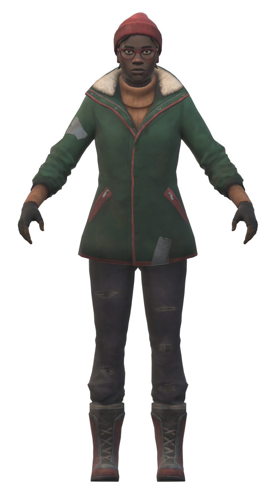

# Jace

**Contents**

- [History](#History)
- [Appearance](#Appearance)
- [The Lion's Roar Intro](#The_Lion%27s_Roar_Intro)
- [Episode 4: Fury, Then Silence](#Episode_4%3A_Fury%2C_Then_Silence)
- [Blackrock Blues](#Blackrock_Blues)
- [The Power Plant](#The_Power_Plant)
- [The Detonators](#The_Detonators)
- [Donner (mission)](#Donner_%28mission%29)
- [Episode 5: The Light At The End Of All Things](#Episode_5%3A_The_Light_At_The_End_Of_All_Things)
- [Trivia](#Trivia)
- [Update history](#Update_history)

<table class="infobox">
<caption>Jace</caption>
<colgroup>
<col style="width: 50%" />
<col style="width: 50%" />
</colgroup>
<tbody>
<tr>
<td colspan="2"><figure>

<figcaption>Jace.png</figcaption>
</figure></td>
</tr>
<tr>
<td>
Release
</td>
<td>
<a href="./The%20Long%20Dark%20%E2%80%94%20Changelog.md#1.95" class="wikilink" title="1.95">1.95</a>
</td>
</tr>
<tr>
<td>
Date
</td>
<td>
6 October 2021
</td>
</tr>
<tr>
<td>
Wintermute
</td>
<td>
<a href="./Episode%204%20-%20Fury%2C%20Then%20Silence.md" class="wikilink" title="Episode 4">Episode 4</a> <a href="./Episode%205%20-%20The%20Light%20At%20The%20End%20Of%20All%20Things.md" class="wikilink" title="Episode 5">Episode 5</a>
</td>
</tr>
<tr>
<td>
Mission
</td>
<td>
<strong>•</strong> <a href="./Blackrock%20Blues.md" class="wikilink" title="Blackrock Blues">Blackrock Blues</a> 
<strong>•</strong> <a href="./The%20Power%20Plant.md" class="wikilink" title="The Power Plant">The Power Plant</a> 
<strong>•</strong> <a href="./The%20Detonators.md" class="wikilink" title="The Detonators">The Detonators</a> 
<strong>•</strong> <a href="./Donner.md" class="wikilink" title="Donner">Donner</a>
</td>
</tr>
<tr>
<td>
Location(s)
</td>
<td>
<a href="./Power%20Plant.md" class="wikilink" title="Power Plant">Power Plant</a>
</td>
</tr>
<tr>
<td colspan="2" class="section">
<strong>Biographical Information</strong>
</td>
</tr>
<tr>
<td>
Age
</td>
<td>
20's
</td>
</tr>
<tr>
<td>
Status
</td>
<td>
Alive
</td>
</tr>
<tr>
<td>
Occupation
</td>
<td>
Graduate student in astrophysics
</td>
</tr>
<tr>
<td colspan="2" class="section">
<strong>Physical Information</strong>
</td>
</tr>
<tr>
<td>
Hair
</td>
<td>
Dark Brown
</td>
</tr>
<tr>
<td>
Eyes
</td>
<td>
Dark Brown
</td>
</tr>
<tr>
<td colspan="2" class="section">
<strong>Game Information</strong>
</td>
</tr>
<tr>
<td>
Voiced by
</td>
<td>
Tina Grant
</td>
</tr>
</tbody>
</table>

<table>
<colgroup>
<col style="width: 33%" />
<col style="width: 33%" />
<col style="width: 33%" />
</colgroup>
<tbody>
<tr>
<td style="vertical-align: top; font-size: 3em; color: #5d5980; padding-right: 10px">
“
</td>
<td>
A graduate student in astrophysics, Jace normally has her eyes on the stars. Chance, and the Aurora, have brought her to Blackrock. 
 
Whip-smart, Jace has the air of superiority that many academics inherit. But deep down she is starting to worry that her career choice has left her unprepared for the current situation, especially if the power never comes back.

&#10;

<a href="./What%20I%20Know.md" class="wikilink" title="What I Know">What I Know</a> description

</td>
<td style="vertical-align: bottom; font-size: 3em; color: #5d5980; padding-left: 10px">
”
</td>
</tr>
</tbody>
</table>

**Jace**is a supporting character that appears in <a href="./Wintermute.md" class="wikilink" title="Wintermute">Wintermute</a>.

## History

Jace is a young graduate student in astrophysics, having come to <a href="./Great%20Bear%20Island.md" class="wikilink" title="Great Bear Island">Great Bear Island</a> while staying at the <a href="./Suzuki%20Radio%20Telescope.md" class="wikilink" title="Suzuki Radio Telescope">Suzuki Radio Telescope</a> with her thesis professor <a href="./Atwood.md" class="wikilink" title="Atwood">Atwood</a>. She normally has her sights set on the stars, but unfortunate luck and the <a href="./Aurora.md" class="wikilink" title="Aurora Borealis">Aurora Borealis</a> of the "<a href="./First%20Flare.md" class="wikilink" title="First Flare">First Flare</a>" stopped her car from working while she was driving through <a href="./Blackrock.md" class="wikilink" title="Blackrock">Blackrock</a>. She now finds herself struggling with <a href="./Mathis.md" class="wikilink" title="Mathis">Mathis</a>, <a href="./Donner.md" class="wikilink" title="Donner">Donner</a>, and the other <a href="./Convicts.md" class="wikilink" title="Convicts">Convicts</a> of the Penitentiary. Originally deciding to face them from the shadows all by herself, the unexpected arrival of <a href="./Will%20Mackenzie.md" class="wikilink" title="Will Mackenzie">Will Mackenzie</a> has created mutual aid between the 2 heroes as they both fight to prevent the Convicts from leaving the region.

Endowed with great intelligence, Jace is independent and self-taught, which has enabled her to acquire a great deal of knowledge, particularly in computer security. But deep down, she begins to worry that her career choice hasn't prepared her for the current situation, especially if things will never go back to the way they were before the Quiet Apocalypse.

## Appearance

(work in progress)

## The Lion's Roar Intro

Jace does not appear in Wintermute until Episode 4, but she is first seen in the Lion's Roar cutscene; sleeping at a computer and slowly waking up as she realizes the whole server room she is in is becoming powered by the Aurora.

## Episode 4: Fury, Then Silence

### <a href="./Blackrock%20Blues.md" class="wikilink" title="Blackrock Blues">Blackrock Blues</a>

Jace makes her first appearance over the phone in the <a href="./Blackrock%20Prison.md" class="wikilink" title="Blackrock Prison">Blackrock Prison</a> infirmary, asking who Mackenzie is why he is helping the <a href="./Convicts.md" class="wikilink" title="Convicts">Convicts</a>. Mackenzie states that he is not helping them, in turn asking who the woman on the phone is. The two talk until Jace hangs up, telling the bush pilot to pick a side soon.

### <a href="./The%20Power%20Plant.md" class="wikilink" title="The Power Plant">The Power Plant</a>

Jace appears on the phone again at the <a href="./Power%20Plant.md" class="wikilink" title="Power Plant">Power Plant</a>, properly introducing herself and earning the trust of Mackenzie. The pilot informs her that he's here to restore power to the Prison for the Convicts, but he and Jace know this won't work. Jace then asks Mackenzie to sabotage the locking mechanism to Donner's cell in Solitary to prevent him from getting out.

Jace also reveals that she was driving through the area when the <a href="./First%20Flare.md" class="wikilink" title="First Flare">First Flare</a> hit, causing her car to stop working. She eventually found her way to the prison, hearing the Convicts executing the Prison's staff and deciding her best course of action would be to mess with their plans. Mackenzie eventually agrees to destroy the locking mechanism, with Jace stating that this will act as her "Nuclear option" should things not go their way in the future.

### <a href="./The%20Detonators.md" class="wikilink" title="The Detonators">The Detonators</a>

Jace appears over the phone once again, this time in the <a href="./Last%20Prospect.md" class="wikilink" title="Last Prospect">Last Prospect</a> mine. Mackenzie informs her that he will be delivering <a href="./Detonators.md" class="wikilink" title="Detonators">Detonators</a> to the Convicts so they can blow open the cell door to Solitary, freeing Donner. Jace remarks that she now needs to use here "Nuclear option" after this.

Jace also reveals that the reason she is staying to mess with the Convicts is to keep them away from <a href="./Perseverance%20Mills.md" class="wikilink" title="Perseverance Mills">Perseverance Mills</a>, as her thesis professor <a href="./Atwood.md" class="wikilink" title="Atwood">Atwood</a> is working near there. She also reveals that she is a grad student in astrophysics, currently on Great Bear Island to study the stars at the Suzuki Radio Telescope. Mackenzie is taken aback, telling Jace that he has a message for Atwood, and that they both need to meet her. Eventually the conversation ends and Mackenzie leaves to deliver the Detonators to Mathis.

### <a href="./Donner%20%28mission%29.md" class="wikilink" title="Donner (mission)">Donner (mission)</a>

Jace is eventually responsible for nudging the Convicts into blowing up the Blackrock Prison, with the Detonators blowing too early and destroying the <a href="./Steam%20Tunnels.md" class="wikilink" title="Steam Tunnels">Steam Tunnels</a> below the Prison. The chain reaction of destruction gives Mackenzie the opportunity to escape Mathis' imminent execution of him, and Jace hacks into the security cameras and controls of the Prison as the Aurora restored power to the Prison. She then turns the prison lockdown on, causing several sliding doors to close and buying the pilot time to escape and retrieve <a href="./Astrid%27s%20Hardcase.md" class="wikilink" title="Astrid&#39;s Hardcase">Astrid's Hardcase</a>.

Mackenzie escapes to the Warden's office and receives a phone call from Jace, directing the pilot on the best escape route from the Prison and to meet her at the Power Plant through the Steam Tunnels.

The two eventually meet in person for the first time, as Mathis and his gang catch up with them. Having no where else to go, the two attempt to fight Mathis, until Mackenzie pushes the both of them into the river below where they wash ashore down stream. The final scene of the Episode shows the two wet and freezing in the wind. Jace remarks that Mathis and his Convicts will never give up following them now, but Mackenzie tells her that they will not give up either. Mackenzie then offers to start a fire, as Jace is now cold enough to begin feeling warm due to the effects of <a href="./Hypothermia.md" class="wikilink" title="Hypothermia">Hypothermia</a>. The two look at Blackrock Prison, now burning orange in the night sky under the aurora.

## <a href="./Episode%205%20-%20The%20Light%20At%20The%20End%20Of%20All%20Things.md" class="wikilink" title="Episode 5: The Light At The End Of All Things">Episode 5: The Light At The End Of All Things</a>

TBA

## Trivia

- In the intro cutscene to each Episode, Jace can briefly be seen awaking from her slumber during the start of an Aurora. Curiously, her eyebrow piercings are on her left eyebrow, and she has a lip piercing. Whereas in Episode 4, her piercings are on her right eyebrow, and she is missing the lip piercing.
  - This was also her first appearance in the game starting in 2017, far before she would actually appear in Episode 4 in 2021.
- A car found near <a href="./Blocked%20Bridge.md" class="wikilink" title="Blocked Bridge">Blocked Bridge</a> with a <a href="./Letter%20%28Car%29.md" class="wikilink" title="Letter">Letter</a> inside belongs to Jace, and might explain how she came upon the Prison long after the Convicts executed the staff when the First Flare began.

## Update history

- UPDATE **6 October 2021 (<a href="./The%20Long%20Dark%20%E2%80%94%20Changelog.md#1.95" class="wikilink" title="Update">Update</a>):**
  - Added to game.

**Lua execution error in Module:Navbox function navbox** <a href="ru:%D0%94%D0%B6%D0%B5%D0%B9%D1%81" class="wikilink" title="ru:Джейс">ru:Джейс</a>

