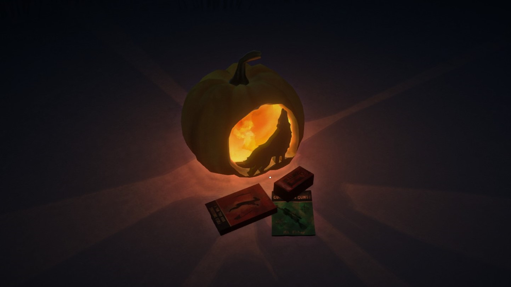
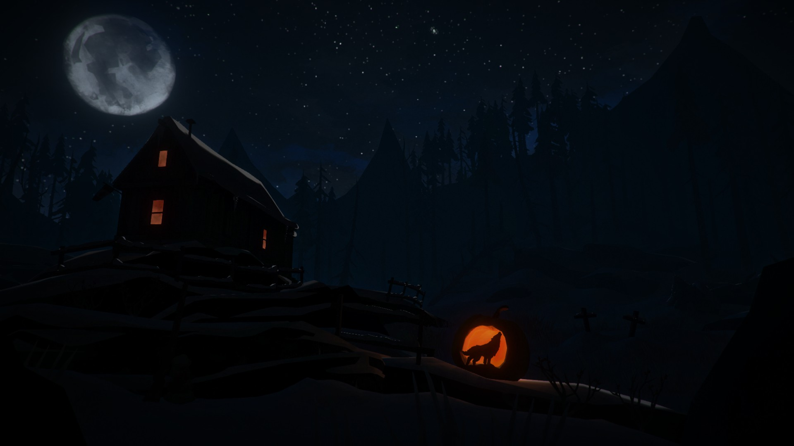
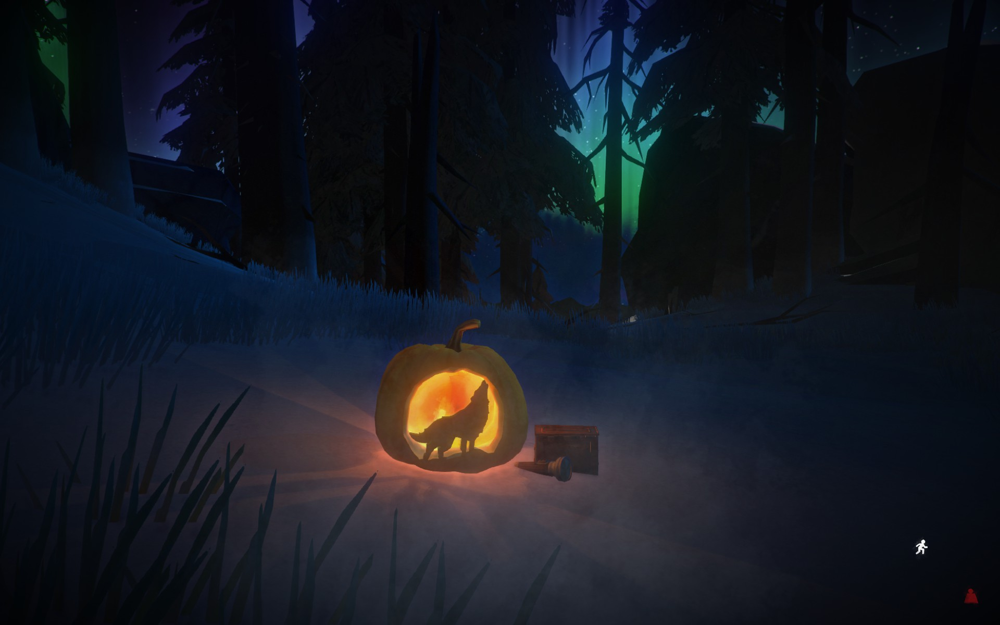

# Jack\-o\-Lantern

**Categories:** Interactable Objects · **Source:** [Fandom](https://thelongdark.fandom.com/wiki/Jack-o-Lantern)

**Jack-o-Lantern**

| Property | Details |
| --- | --- |
|  | [Jack o Lantern](../assets/Jack-o-Lantern.png) |
| Release | 28 October 2016 |
| Update | [0.372](./The%20Long%20Dark%20%E2%80%94%20Early%20Access%20Changelog.md#0.372) |
| Story item | No |

A **Jack-o-Lantern** is a non-interactable object that appear during the [4 Days of Night Event](./4%20Days%20of%20Night%20Event.md). Jack-o-Lantern served as a marker for [Hidden Caches](./Hidden%20Cache.md) or other loot, during the event, by emitting a permanent light similar to a camp fire.

## Locations

While the event was active, Jack-o-Lanterns had a chance to appear in the following locations:

| Region | Location | Description |
| --- | --- | --- |
| [Mystery Lake](./Mystery%20Lake%20%28region%29.md) | [Forestry Lookout](./Forestry%20Lookout.md) | Located at the lookout. |
| [Mystery Lake](./Mystery%20Lake%20%28region%29.md) | [Deadfall Area](./Deadfall%20Area.md) | In the burned out cabin, next to the stove. |
| [Mystery Lake](./Mystery%20Lake%20%28region%29.md) | [River (Southern Access)](./River%20%28Southern%20Access%29.md) | Located on the western bank of the frozen river. |
| [Mountain Town](./Mountain%20Town.md) | [St. Christopher's Church](./St.%20Christopher%27s%20Church.md) | Behind the church. |
| [Coastal Highway](./Coastal%20Highway.md) | [Jackrabbit Island](./Jackrabbit%20Island.md) | On the small island partway towards [Misanthrope's Homestead](./Misanthrope%27s%20Homestead.md). |
| [Coastal Highway](./Coastal%20Highway.md) | [Waterfront Cottages](./Waterfront%20Cottages.md) | Out in front of the cottages. |
| [Pleasant Valley](./Pleasant%20Valley.md) | [Pensive Pond](./Pensive%20Pond.md) | On the dock. |
| [Pleasant Valley](./Pleasant%20Valley.md) | [Pleasant Valley Farmstead](./Pleasant%20Valley%20Farmstead.md) | In the sheds towards [Pleasant Valley Outbuildings](./Pleasant%20Valley%20Outbuildings.md). |

## Gallery

