# Jackrabbit Hangar

**Categories:** Locations, Story · **Source:** [Fandom](https://thelongdark.fandom.com/wiki/Jackrabbit_Hangar)

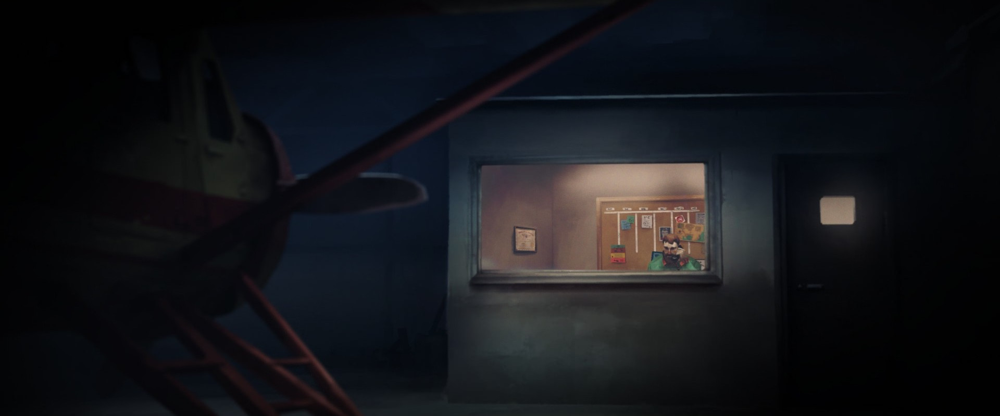

**Jackrabbit Remote Transport** is the family business of the Mackenzie family, originally operated solely by Jack Mackenzie. The transport business runs supplies and people to and from hard-to-reach places isolated in the Canadian wilderness, hence the latter part of the name.

Before the Quiet Apocalypse, [Will Mackenzie](./Will%20Mackenzie.md), Jack's son, serves as the pilot for the company. He speaks briefly on the phone with a woman named Maureen (who seems to work for or with the company, possibly in administration). It is unknown if the company employs anyone else apart from these two. It is implied by Maureen and Will in combination that the company is financially underperforming due to lack of clients. This might be a result of decreased demand caused by [The Collapse](./The%20Collapse.md).

<!-- #Wintermute -->
​

<!-- #wintermute -->
## Wintermute

[Episode 1: Do Not Go Gentle](./Episode%201%20-%20Do%20Not%20Go%20Gentle.md)

The business shows up as a location named **Jackrabbit Hangar** in a short playable section of [Memories](./Memories.md), serving as a safe environment for the player to explore as part of the tutorial.

The company itself plays little role in the game's plot after the mission Memories and exists mainly as a catalyst for the progression of the story. It is not mentioned at all after the first cinematic.

The only remaining reference to the company after the crash is the logo found on the back of [Mackenzie's Parka](./Mackenzie%27s%20Parka.md).

<!-- #Trivia -->
​

<!-- #trivia -->
## Trivia

- Despite a common misconception, the word "Air" is not included in the company name. It is seen in the subtitles as "Jackrabbit Remote Air Transport" the first time the name is mentioned by Will in the cinematic at the very beginning of [Episode 1](./Episode%201%20-%20Do%20Not%20Go%20Gentle.md). The audio however, excludes the word "Air," and so does the poster found inside the hangar. When Will comments on the poster he also uses this wording.
- A unique [Insulated Flask](./Insulated%20Flask.md) themed off the company can be found in [Survival Mode](./Survival%20Mode.md).
- Hinterland released a purchasable real world coffee mug based off the Jackrabbit Remote Transport Company.
- The office board contains a photo of [Astrid Greenwood](./Astrid%20Greenwood.md), the old [Hinterland Studio Inc.](./Hinterland%20Studio%20Inc..md) logo found on the old [Cup of Coffee](./Cup%20of%20Coffee.md) model, and an old map of Great Bear Island before V1.15 of _The Long Dark_ was released.

<!-- #Gallery -->
​

<!-- #gallery -->
## Gallery

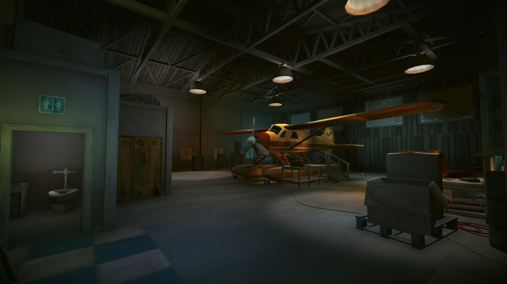

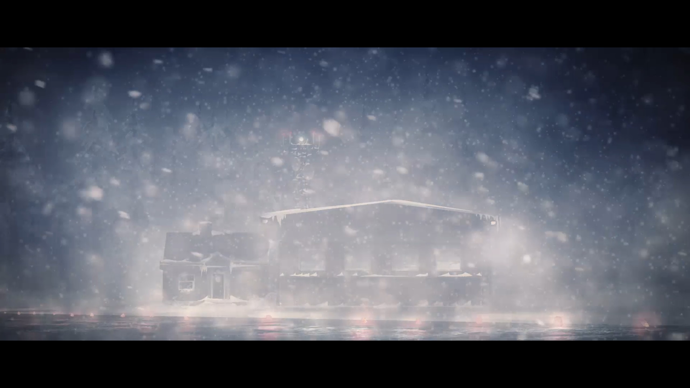

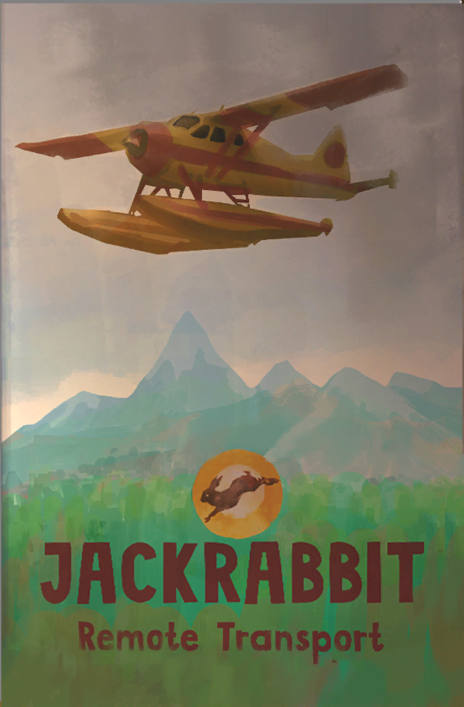

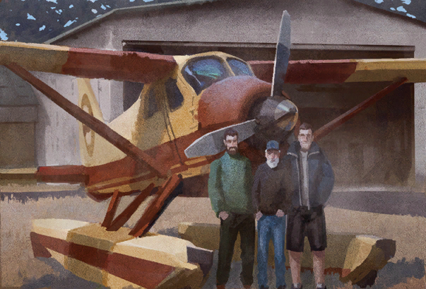

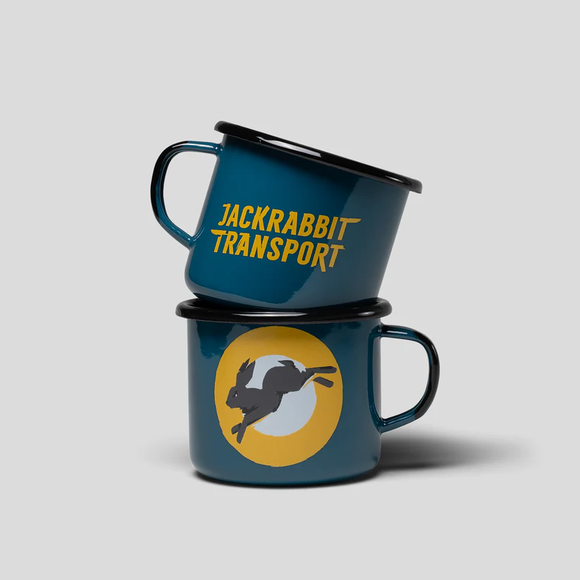

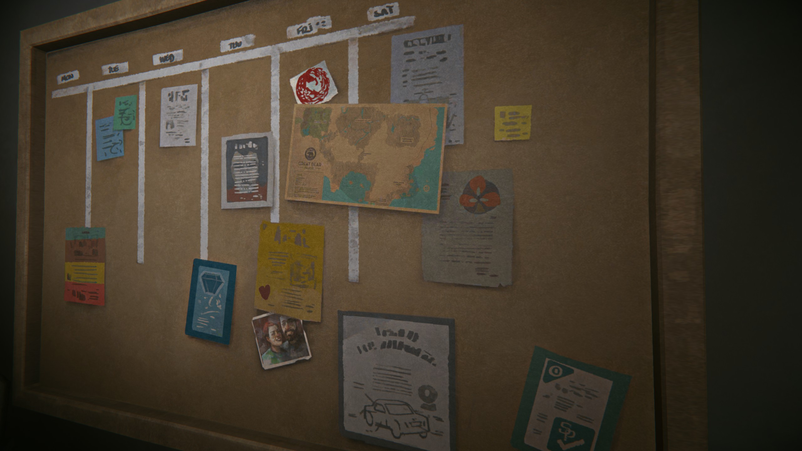

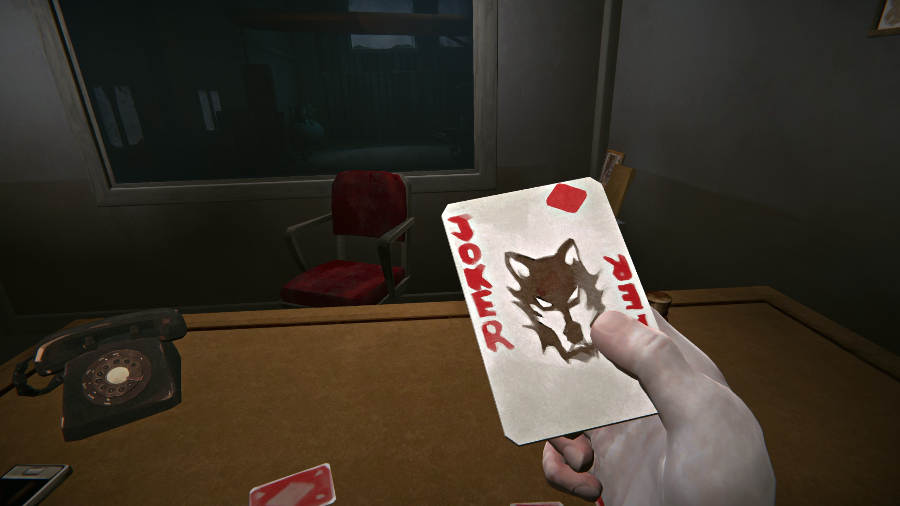

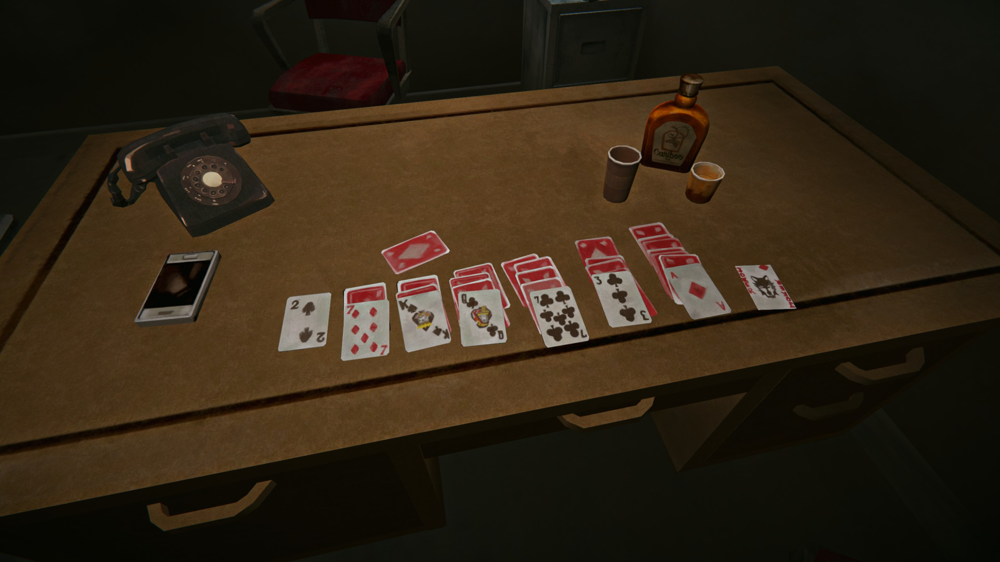

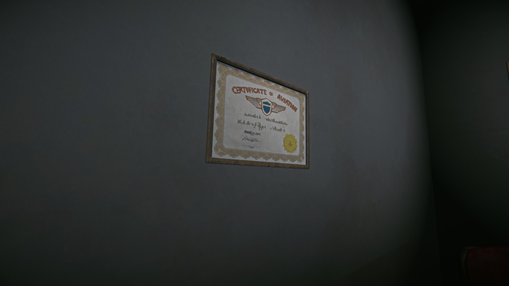

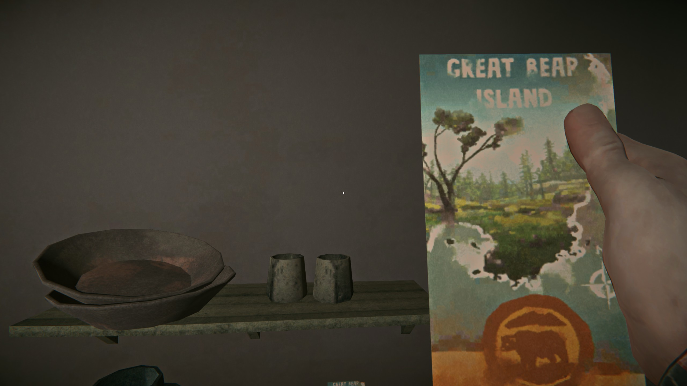
