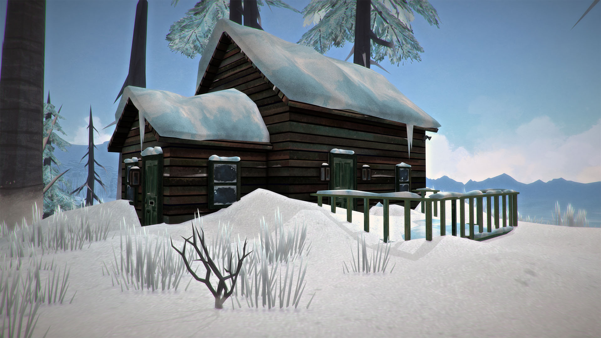
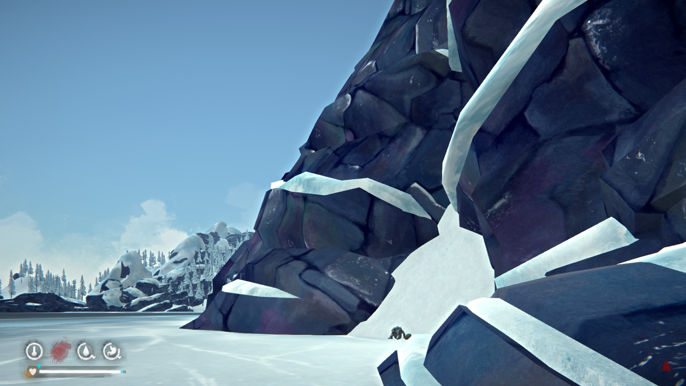

# Jackrabbit Island

**Categories:** Indoor locations, Islands, Locations, Locations in Coastal Highway · **Source:** [Fandom](https://thelongdark.fandom.com/wiki/Jackrabbit_Island)

**Jackrabbit Island**

\[\[File: /  / _Jackrabbit\_Island.jpg_

250px\]\]

_Jackrabbit\_Island.jpg_

**Location**

_Jackrabbit\_Island\_map.png_

Region

[Coastal Highway](./Coastal%20Highway.md)

Location

**Description:** An island with a rabbit grove

**General**

Type

_The house on Jackrabbit Island._

_Second body behind the island_

_A view of the Jackrabbit Island house at night_
