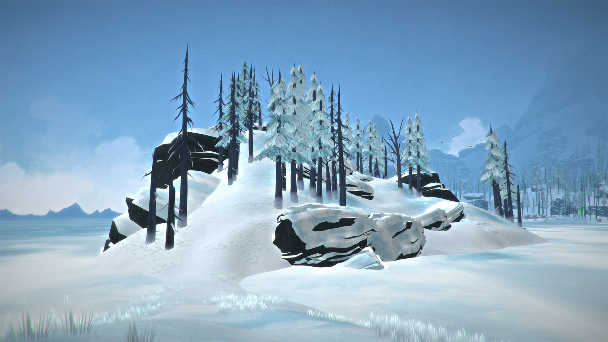
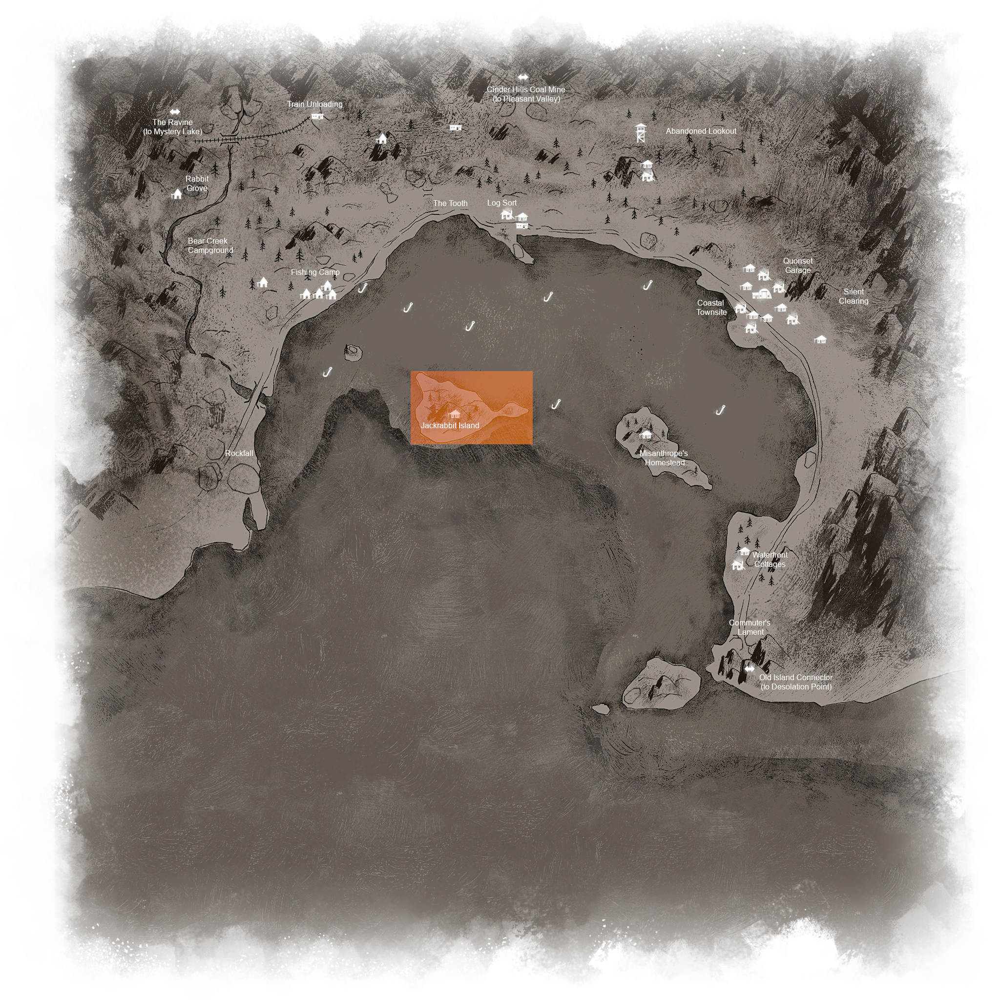
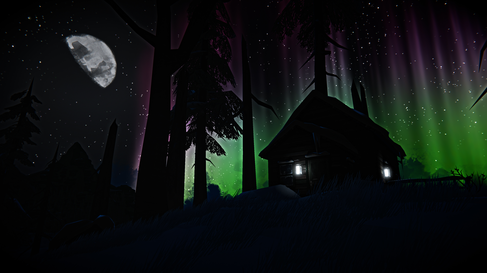

# Jackrabbit Island

**Jackrabbit Island**

| Property | Details |
| --- | --- |
| \[\[File: / \| Column 1 \| / \| --- \| / \|  / *Jackrabbit\_Island.jpg* \| | 250px\]\] |
|  |  / *Jackrabbit\_Island.jpg* |
| **Location** |  |
|  / *Jackrabbit\_Island\_map.png* |  |
| Region | [Coastal Highway](./Coastal%20Highway.md)\|- / Location |
| Description | An island with a rabbit grove |
| **General** |  |
| Type |  |
|  | Has an interior\|} **Jackrabbit Island** is one of the two larger offshore islands in [Coastal Highway](./Coastal%20Highway.md), the other being the [Misanthrope's Homestead](./Misanthrope%27s%20Homestead.md). / ## Overview / Jackrabbit Island can be reached by traversing over the frozen ice in the bay area of Coastal Highway. The house on the island has ample loot including processed [foods](./Food%20And%20Drink.md), clothing and even a revolver under the bed. / [Old man's beard lichens](./Old%20Man%27s%20Beard%20Lichen.md) and [rose hips](./Rose%20Hip.md) can be found on the island. A [frozen corpse](./Frozen%20Corpse.md) may be found between the house and the island's northern bank. / As implied by its name, Jackrabbit Island is home to numerous [rabbits](./Rabbit.md). Placing [snares](./Snare.md) on or around the island will yield ample meat for the player for a long time. / ### Use as a base / Jackrabbit Island is a popular location for a base camp on all difficulty levels. As mentioned before, there are a lot of rabbits on the island, which can be snared, providing a good supply of [meat](./Rabbit%20%28Raw%29.md), pelts, and guts. There's ample storage in the house, and plenty of furniture and curtains to break down for fuel and cloth. If rabbit meat becomes boring, there's lots of [fishing](./Ice%20Fishing.md) nearby, along with [deer](./Deer.md) and [wolves](./Wolf.md) to hunt -- conveniently, the wolves don't come on the island itself unless actively hunting a rabbit or the player. Workbenches can be found nearby at [Quonset Garage](./Quonset%20Garage.md) and [Fishing Camp](./Fishing%20Camp.md), if necessary. Finally, the view from the island on a clear day is spectacular. / The main disadvantage of Jackrabbit Island as a long-term base is its lack of a stove, forcing the player to make campfires outside to cook rabbits and make water. A less obvious disadvantage of the island is that it can be very difficult to find in low visibility conditions. Finally, one challenge with Coastal Highway in general is the lack of warm caves to fight [cabin fever](./Cabin%20Fever.md), meaning the player will need to use vehicles or fishing huts to sleep if they catch cabin fever. / ## Gallery / \| Column 1 \| Column 2 \| Column 3 \| / \| --- \| --- \| --- \| / \|  / *The house on Jackrabbit Island.* \|  / *Second body behind the island* \|  / *A view of the Jackrabbit Island house at night* \| / **Lua execution error in Module:Navbox function navbox** [es:Isla de liebres](es:Isla_de_liebres) |
|  / *The house on Jackrabbit Island.* |  / *Second body behind the island* /  / *A view of the Jackrabbit Island house at night* |
