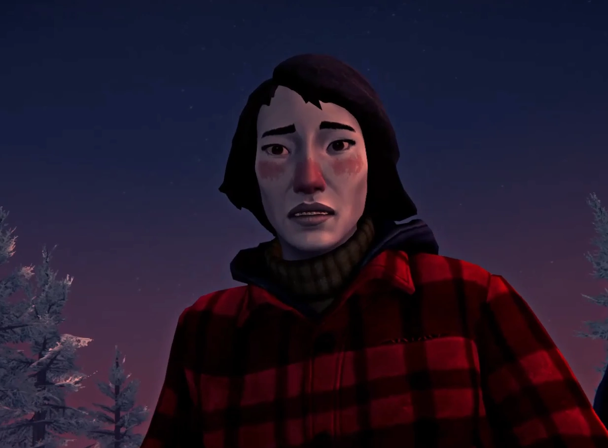

# Jane Yang

**Contents**

- [History](#History)
- [History](#History_2)
- [Episode 3](#Episode_3)
- [Fallen Star](#Fallen_Star)
- [Episode 4](#Episode_4)
- [Donner (mission)](#Donner_%28mission%29)
- [Episode 5](#Episode_5)
- [Notes](#Notes)

<table class="infobox">
<caption>Jane Yang</caption>
<colgroup>
<col style="width: 50%" />
<col style="width: 50%" />
</colgroup>
<tbody>
<tr>
<td colspan="2"><figure>

<figcaption>Jane_Yang.png</figcaption>
</figure></td>
</tr>
<tr>
<td>
Release
</td>
<td>
<a href="./The%20Long%20Dark%20%E2%80%94%20Changelog.md#1.95" class="wikilink" title="1.95">1.95</a>
</td>
</tr>
<tr>
<td>
Date
</td>
<td>
6 October 2021
</td>
</tr>
<tr>
<td>
Wintermute
</td>
<td>
<a href="./Episode%203%20-%20Crossroads%20Elegy.md" class="wikilink" title="Episode 3">Episode 3</a> (Flashback) <a href="./Episode%204%20-%20Fury%2C%20Then%20Silence.md" class="wikilink" title="Episode 4">Episode 4</a> <a href="./Episode%205%20-%20The%20Light%20At%20The%20End%20Of%20All%20Things.md" class="wikilink" title="Episode 5">Episode 5</a>
</td>
</tr>
<tr>
<td>
Location(s)
</td>
<td>
<a href="./Perseverance%20Mills.md" class="wikilink" title="Perseverance Mills">Perseverance Mills</a>
</td>
</tr>
<tr>
<td colspan="2" class="section">
<strong>Biographical Information</strong>
</td>
</tr>
<tr>
<td>
Age
</td>
<td>
30's - 40's
</td>
</tr>
<tr>
<td>
Status
</td>
<td>
Alive
</td>
</tr>
<tr>
<td colspan="2" class="section">
<strong>Physical Information</strong>
</td>
</tr>
<tr>
<td>
Sex
</td>
<td>
Female
</td>
</tr>
<tr>
<td>
Hair
</td>
<td>
Black
</td>
</tr>
<tr>
<td>
Eyes
</td>
<td>
Brown
</td>
</tr>
<tr>
<td colspan="2" class="section">
<strong>Game Information</strong>
</td>
</tr>
<tr>
<td>
Voiced by
</td>
<td>
Rita Yee (Episode 3 &amp; 4) Jessica Wong (Episode 5)
</td>
</tr>
</tbody>
</table>

**Spoiler Warning:***This page may contain spoilers from the <a href="./Wintermute.md" class="wikilink" title="story">story</a> of The Long Dark.*

**Jane Yang** a major character in <a href="./Episode%205%20-%20The%20Light%20At%20The%20End%20Of%20All%20Things.md" class="wikilink" title="Episode 5">Episode 5</a> of <a href="./Wintermute.md" class="wikilink" title="Wintermute">Wintermute</a> in <a href="./The%20Long%20Dark.md" class="wikilink" title="The Long Dark"><em>The Long Dark</em></a>.

## History

An old friend of <a href="./Astrid%20Greenwood.md" class="wikilink" title="Astrid Greenwood">Astrid Greenwood</a>, Jane is a resident of <a href="./Perseverance%20Mills.md" class="wikilink" title="Perseverance Mills">Perseverance Mills</a> and a native of <a href="./Great%20Bear%20Island.md" class="wikilink" title="Great Bear Island">Great Bear Island</a>. Astrid and Jane appear to have a deep friendship before the events of the game, with the freelance doctor willing to steal a guarded cure and chart a flight to Great Bear Island in order to save the few people of the mysterious plague stricken Mills.

## History

### Episode 3

### <a href="./Fallen%20Star.md" class="wikilink" title="Fallen Star">Fallen Star</a>

<table>
<colgroup>
<col style="width: 33%" />
<col style="width: 33%" />
<col style="width: 33%" />
</colgroup>
<tbody>
<tr>
<td style="vertical-align: top; font-size: 3em; color: #5d5980; padding-right: 10px">
“
</td>
<td>
Astrid...it's getting worse. You have to do something. You understand that better than anyone...I'm afraid it's happening again Astrid. I'm afraid we'll lose her this time.

&#10;

Jane over the phone in <a href="./Episode%203%20-%20Crossroads%20Elegy.md" class="wikilink" title="Episode 3">Episode 3</a>

</td>
<td style="vertical-align: bottom; font-size: 3em; color: #5d5980; padding-left: 10px">
”
</td>
</tr>
</tbody>
</table>

Jane is an unseen character that first appears during the events of <a href="./Episode%203%20-%20Crossroads%20Elegy.md" class="wikilink" title="Episode 3: Crossroads Elegy">Episode 3: Crossroads Elegy</a>.

During a flashback sequence showing Astrid working at Seraphim Sleep Research Centre, Jane calls Astrid over the phone. Astrid scolds Jane that it is risky to call her at her place of work, but Jane states that she is scared; pleading with Astrid to hurry and find something of importance located in the Centre as fast as possible. Astrid remarks that it will take time to acquire this item.

Jane asks if Astrid is willing to speak to <a href="./Will%20Mackenzie.md" class="wikilink" title="Will Mackenzie">Will Mackenzie</a> to chart a flight to the Island, but Astrid hesitantly states she hasn't asked him for help yet. Jane ends the phone call pleading with Astrid to hurry and help soon, stating that "I'm afraid we'll lose her this time". Astrid promises that that won't happen before the flashback ends.

### Episode 4

#### <a href="./Donner%20%28mission%29.md" class="wikilink" title="Donner (mission)">Donner (mission)</a>

|  |  |  |
|----|----|----|
| “ | Astrid. You came. You said you would, and you did. But where is the case? Where's the cure? | ” |

She is seen briefly at the end of <a href="./Episode%204%20-%20Fury%2C%20Then%20Silence.md" class="wikilink" title="Episode 4: Fury, Then Silence">Episode 4: Fury, Then Silence</a> in her home town of Perseverance Mills. A quarantine is effecting the town, with Jane running to the docks when she notices two other residents of the town finding what she presumes is another victim of the illnesses afflicting the town. Jane is surprised and relieved to see Astrid has finally come to the town like she promised, but after searching her canoe and asking one of the residents to get the doctor some water, Jane is confused as to why Astrid doesn't have the <a href="./Astrid%27s%20Hardcase.md" class="wikilink" title="Hardcase">Hardcase</a> with her.

### Episode 5

Jane Yang will mostly likely make a major appearance in <a href="./Episode%205%20-%20The%20Light%20At%20The%20End%20Of%20All%20Things.md" class="wikilink" title="Episode 5: The Light At The End Of All Things">Episode 5: The Light At The End Of All Things</a>.

## Notes

So far, Jane's name is only mentioned in the closing credits of Episode 4:

- She is listed as "Astrid's Friend" in Episode 3's credits.
- Her name was fully revealed in Episode 4's credits.

**Lua execution error in Module:Navbox function navbox** <a href="ru:%D0%94%D0%B6%D0%B5%D0%B9%D0%BD_%D0%AF%D0%BD%D0%B3" class="wikilink" title="ru:Джейн Янг">ru:Джейн Янг</a>

