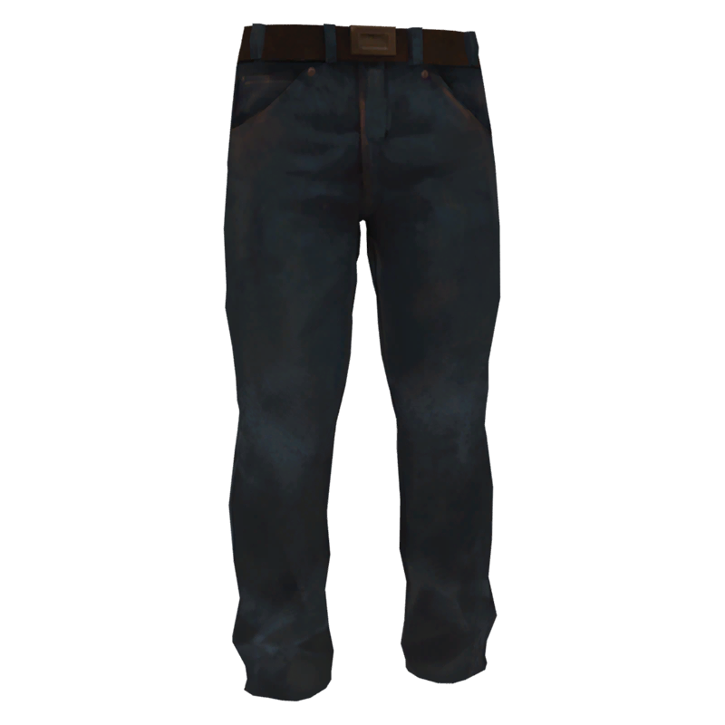

# Jeans

**Categories:** Clothing · **Source:** [Fandom](https://thelongdark.fandom.com/wiki/Jeans)

**Jeans**

_Jeans\_icon.png_

**General**

**Item Type:** Clothing

**Clothing Slot:** Outer legs

**Statistics**

**Weight:** 0.50 kg(1.1 lbs)

**Warmth bonus:** 1.0 °C(1.8 °F)

**Windproof bonus:** 0.0 °C(0 °F)

**Waterproof bonus:** 0%

**Protection:** 2%

**Mobility:** -1%

**Harvest:** 1 × [Cloth](./Cloth.md) / 30 minutes

**Repair:** 1 × [Cloth](./Cloth.md) / 30 minutes / 30% condition

> “**Basic denim jeans. Better than nothing.**”
>
> — In-game description

**Jeans** are a type of [Clothing](./Clothing.md) in _The Long Dark_.

## Overview

Low tier pants and a common outer layer legs starting item. While light and common, they provide minimal protection and warmth, and should be replaced as soon as possible.

_Clothing model icon_

_Clothing model icon damaged_
