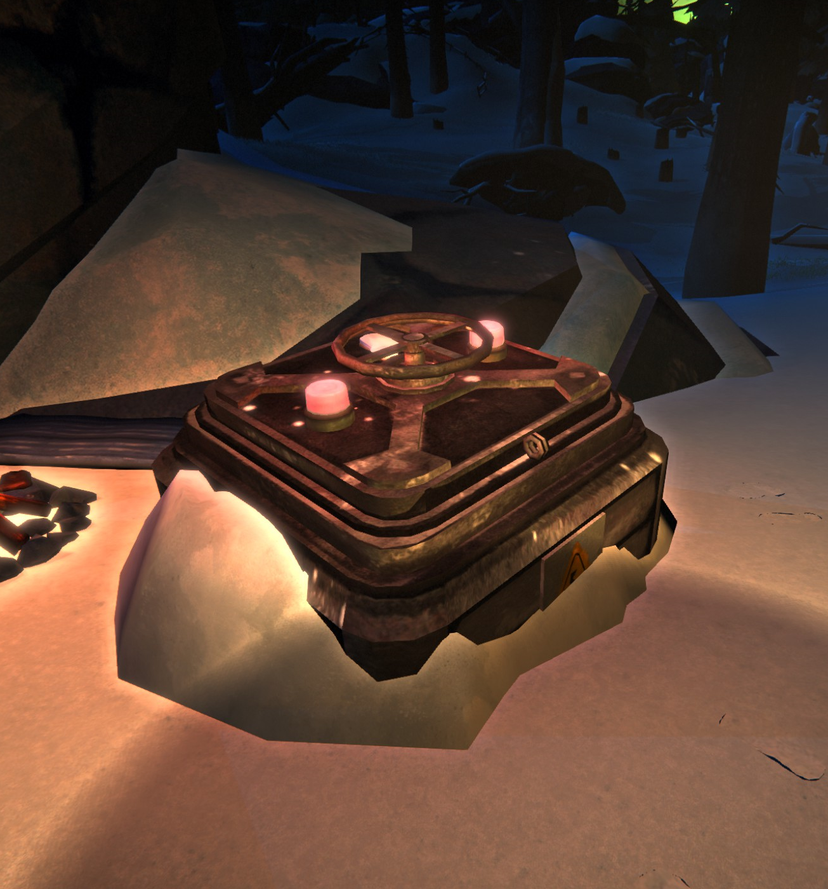

# Jeremiah's Hideout

**Contents**

- [Tasks](#Tasks)
- [Overview](#Overview)
- [Locate the hidden bunker](#Locate_the_hidden_bunker)
- [Enter the Bunker when the Aurora is active](#Enter_the_Bunker_when_the_Aurora_is_active)
- [Find Jeremiah's Letters](#Find_Jeremiah%27s_Letters)
- [Burn Jeremiah's Papers](#Burn_Jeremiah%27s_Papers)
- [Rewards](#Rewards)
- [Differences from Aurora Hatch](#Differences_from_Aurora_Hatch)
- [Transcript](#Transcript)
- [Locate the hidden bunker](#Locate_the_hidden_bunker_2)
- [Gallery](#Gallery)
- [Update history](#Update_history)

<table class="infobox">
<caption>Jeremiah's Hideout</caption>
<colgroup>
<col style="width: 50%" />
<col style="width: 50%" />
</colgroup>
<tbody>
<tr>
<td colspan="2"><figure>

<figcaption>Aurora_hatch.png</figcaption>
</figure></td>
</tr>
<tr>
<td>
Episode
</td>
<td>
<a href="./Episode%202%20-%20Luminance%20Fugue.md" class="wikilink" title="Episode 2">Episode 2</a>|-
</td>
</tr>
<tr>
<td>
Current
</td>
<td>
Jeremiah's Hideout
</td>
</tr>
<tr>
<td>
Region
</td>
<td>
<a href="./Forlorn%20Muskeg.md" class="wikilink" title="Forlorn Muskeg">Forlorn Muskeg</a>
</td>
</tr>
</tbody>
</table>

**Spoiler Warning:***This page may contain spoilers from the <a href="./Wintermute.md" class="wikilink" title="story">story</a> of The Long Dark.*

<table>
<colgroup>
<col style="width: 33%" />
<col style="width: 33%" />
<col style="width: 33%" />
</colgroup>
<tbody>
<tr>
<td style="vertical-align: top; font-size: 3em; color: #5d5980; padding-right: 10px">
“
</td>
<td>
Jeremiah has told you about the location of a hidden bunker in Forlorn Muskeg. There are some letters there he wants you to burn for him.

&#10;

In-game description

</td>
<td style="vertical-align: bottom; font-size: 3em; color: #5d5980; padding-left: 10px">
”
</td>
</tr>
</tbody>
</table>

**Jeremiah's Hideout** was a side mission of the Predux <a href="./Episode%202%20-%20Luminance%20Fugue.md" class="wikilink" title="Episode 2: Luminance Fugue">Episode 2: Luminance Fugue</a> of the <a href="./Wintermute.md" class="wikilink" title="Wintermute">Wintermute</a> story. It has since been replaced after the V1.47 Wintermute Redux version of the game, but is still playable to those that download versions V1.15, V1.30, or V1.37 of Steam version of *<a href="./The%20Long%20Dark.md" class="wikilink" title="The Long Dark">The Long Dark</a>* by using the <a href="./Time%20Capsule.md" class="wikilink" title="Time Capsule">Time Capsule</a>.

Jeremiah's Hideout was later replaced by the mission <a href="./Aurora%20Hatch.md" class="wikilink" title="Aurora Hatch">Aurora Hatch</a>.

## Tasks

- Locate the hidden bunker
- Enter the Bunker when the Aurora is active.
- Find Jeremiah's Letters.
- Burn Jeremiah's Letters.

## Overview

To start the side mission, Mackenzie has to raise the Trust of <a href="./Jeremiah.md" class="wikilink" title="Jeremiah">Jeremiah</a> to the maximum of 375 points and speak to him about Old Letters. He will ask Mackenzie for a favor, to find a hidden bunker of his and burn some old letters between himself and an old correspondent. Mackenzie will ask why an old misanthropic trapper is out here with his own bunker writing letters to someone, but Jeremiah deflects the question. Jeremiah then gives Mackenzie a code, the location of the bunker, and asks him to burn the letters found inside (but no peaking at the letters as they "won't do you any good") and to keep anything else he finds inside the bunker as payment for this favor.

### Locate the hidden bunker

The hideout is located in Forlorn Muskeg in the northern part of the map, slightly northeast behind the <a href="./Shortwave%20Tower.md" class="wikilink" title="Shortwave Tower">Shortwave Tower</a>. The hideout is an advanced version of a <a href="./Prepper%20Cache.md" class="wikilink" title="Prepper Cache">Prepper Cache</a>, with the most notable difference being two red lights on top of the hatch that only power hatch door during an <a href="./Aurora.md" class="wikilink" title="Aurora">Aurora</a>.

This mission can be unlocked as early as You Fix My Rifle? by making your way to <a href="./Broken%20Railroad.md" class="wikilink" title="Broken Railroad">Broken Railroad</a> and fixing <a href="./Jeremiah%27s%20Broken%20Rifle.md" class="wikilink" title="Jeremiah&#39;s Broken Rifle">Jeremiah's Broken Rifle</a> to unlock the Aurora. Return to the hatch at a later date and wait for an Aurora to occur (This can take several nights). One good way to trigger the Aurora is to either head to the hatch after repairing the broken rifle and looting the <a href="./Flashlight.md" class="wikilink" title="Flashlight">Flashlight</a> and <a href="./Hunting%20Lodge%20Rifle.md" class="wikilink" title="Hunting Lodge Rifle">Hunting Lodge Rifle</a>, then making your way to the hatch, or to wait until the mission <a href="./Renewed%20Hope%20%28Predux%29.md" class="wikilink" title="Renewed Hope">Renewed Hope</a> while waiting for the <a href="./Carter%20Hydro%20Dam.md" class="wikilink" title="Carter Hydro Dam">Carter Hydro Dam</a> to be powered up, then running to the hatch.

### Enter the Bunker when the Aurora is active

When an Aurora is in the sky, go inside and you will see the hallway to the back of the hideout is filled with live wires. Wait for the Aurora to pass if you want to safely pass over them, though this will lock the hatch door behind you (though you have plenty of supplies on your side of the bunker to last until the next Aurora). You can choose to run across the hot wires with with 100% <a href="./Condition.md" class="wikilink" title="Condition">Condition</a> but you will get at least 3 <a href="./Burns.md" class="wikilink" title="Burns">Burns</a> if you do, make sure to turn the Switch Box off to disable the live wires.

### Find Jeremiah's Letters

Find <a href="./Jeremiah%27s%20Papers.md" class="wikilink" title="Jeremiah&#39;s Papers">Jeremiah's Papers</a> sitting on the desk before you and leave the hatch.

### Burn Jeremiah's Papers

Now start a fire anywhere and select Jeremiah's Papers as the fuel. Use an <a href="./Accelerant.md" class="wikilink" title="Accelerant">Accelerant</a> if you need to. Successfully start the fire and the mission will be completed. Mackenzie will then remark "I'd better stay focused on finding Astrid. It's time I got going."

## Rewards

Rewards found inside the Hideout include:

- 2 <a href="./Military-Grade%20MRE.md" class="wikilink" title="Military-Grade MRE">Military-Grade MRE</a>
- 3 <a href="./Condensed%20Milk.md" class="wikilink" title="Condensed Milk">Condensed Milk</a>
- <a href="./Painkillers.md" class="wikilink" title="Painkillers">Painkillers</a>
- <a href="./Antibiotics.md" class="wikilink" title="Antibiotics">Antibiotics</a>
- 3 <a href="./Book.md" class="wikilink" title="Books">Books</a>
- <a href="./Cowichan%20Sweater.md" class="wikilink" title="Cowichan Sweater">Cowichan Sweater</a>
- <a href="./Snow%20Pants.md" class="wikilink" title="Snow Pants">Snow Pants</a>
- Plenty of <a href="./Water%20%28Potable%29.md" class="wikilink" title="Water (Potable)">Water (Potable)</a>

## Differences from Aurora Hatch

- The side mission is now activated after finding the <a href="./Aurora%20Hatch%20Door%20Entry%20Code.md" class="wikilink" title="Aurora Hatch Door Entry Code">Aurora Hatch Door Entry Code</a> note
- A door separates the corridor to the back room, and requires a code to be input first

## Transcript

The following is the mission transcript

*Once the player has maximum Trust with Jeremiah, selecting this dialogue option produces the following exchange*

- OLD CORESPONDANCE

Jeremiah: "I need you to do something for me before you leave Mystery Lake."

Mackenzie: "What's that?"

Jeremiah: "I have some old letters. Stuff I don't want anyone to get their hands on."

Mackenzie: "Don't tell me...correspondence from personal ads?"

Jeremiah: "Smart ass. I'm serious, Mackenzie. Those letters are important to me."

Mackenzie: "Ok. You want me to get them and bring 'em back?"

Jeremiah: "Nah. Just burn 'em. It'll be better that way."

Mackenzie: "Ok..."

Jeremiah: "No peeking. Trust me, it's better if you don't."

Mackenzie: "Got it. Find them. Burn them. Where are they?"

Jeremiah: "Old supply cache of mine. More like a bunker, I guess."

Mackenzie: "What do you need a bunker for out here?"

Jeremiah: "I have my reasons. Burn those letters. And take whatever else you need from there."

### Locate the hidden bunker

*Mackenzie travels to Forlorn Muskeg, and finds the bunker. He enters it while the Aurora is active, but his path is blocked by live wires. Waiting for the aurora to pass, he picks up <a href="./Jeremiah%27s%20Papers.md" class="wikilink" title="Jeremiah&#39;s Papers">Jeremiah's Papers</a> but finds himself locked inside the bunker. Once a new aurora arrives, he leaves and starts a fire, burning the papers*

Mackenzie: "I'd better stay focused on finding Astrid."

## Gallery

<table class="gallery">
<colgroup>
<col style="width: 100%" />
</colgroup>
<tbody>
<tr>
<td><figure>

<figcaption>The Aurora Hatch.</figcaption>
</figure></td>
</tr>
</tbody>
</table>

## Update history

- UPDATE **1 August 2017 (<a href="./The%20Long%20Dark%20%E2%80%94%20Changelog.md#1.00" class="wikilink" title="Update">Update</a>):**
  - Added to game.
- UPDATE **17 December 2018 (<a href="./The%20Long%20Dark%20%E2%80%94%20Changelog.md#1.41" class="wikilink" title="Update">Update</a>):**
  - Removed from the game as part of the Redux edition and replaced with <a href="./Aurora%20Hatch.md" class="wikilink" title="Aurora Hatch">Aurora Hatch</a>.

**Lua execution error in Module:Navbox function navbox**

