# Jeremiah

**Categories:** Characters · **Source:** [Fandom](https://thelongdark.fandom.com/wiki/Jeremiah)

**Contents**

- [Episode 1: Do Not Go Gentle](#episode-1-do-not-go-gentle)
- [Paradise Lost](#paradise-lost)
- [Episode 2: Luminance Fugue](#episode-2-luminance-fugue)
- [The Wounded Trapper](#the-wounded-trapper)
- [The Best Defense](#the-best-defense)
- [Signal to Noise](#signal-to-noise)
- [Episode 4: Fury, Then Silence](#episode-4-fury-then-silence)
- [Episode 5: The Light At The End Of All Things](#episode-5-the-light-at-the-end-of-all-things)
- [Possible Military Background](#possible-military-background)
- [Trivia](#trivia)
- [Predux Episode 2](#predux-episode-2)
- [Redux Episode 1](#redux-episode-1)
- [Redux Episode 2](#redux-episode-2)

**Jeremiah**

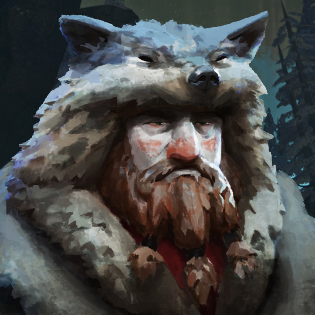

_Jeremiah.png_

**Release:** [Wintermute Launch (v1.0)](./The%20Long%20Dark%20%E2%80%94%20Changelog.md#1.00)

**Date:** 1 August 2017

**Wintermute:** [Episode 2](./Episode%202%20-%20Luminance%20Fugue.md)

**Mission:** **•** [Paradise Lost](./Paradise%20Lost.md) / **•** [The Wounded Trapper](./The%20Wounded%20Trapper.md) / **•** [The Best Defense](./The%20Best%20Defense.md) / **•** [Signal to Noise](./Signal%20to%20Noise.md) / **•** [Renewed Hope](./Renewed%20Hope.md)

**Location(s):** [Trapper's Homestead](./Trapper%27s%20Homestead.md)

**Biographical Information**

**Age:** 50's

**Status:** Alive

**Occupation:** Trapper

**Game Information**

**Voiced by:** [David Hayter](wikipedia:David_Hayter)

> “**A tough old trapper and hermit. Lives alone in the wilderness of Mystery Lake. Doesn't seem to like people much.**”
>
> — In-game description

**Jeremiah** (Also known as **John**) is the primary non-player character in [Episode 2: Luminance Fugue](./Episode%202%20-%20Luminance%20Fugue.md) of [Wintermute](./Wintermute.md).

## [Episode 1: Do Not Go Gentle](./Episode%201%20-%20Do%20Not%20Go%20Gentle.md)

### [Paradise Lost](./Paradise%20Lost.md)

At the end of Episode 1, [Will Mackenzie](./Will%20Mackenzie.md) enters [Mystery Lake](./Mystery%20Lake%20%28region%29.md) and encounters Jeremiah being disarmed and attacked by the [Old Bear](./Old%20Bear.md). While The Old Bear mauls him, Will arms himself with Jeremiah's [Hunting Rifle](./Hunting%20Rifle.md). The screen turns black a gunshot rings out as Will shoots the beast.

Will then rescues and stabilizes the trapper in his nearby cabin in between Episode 1 and 2.

## [Episode 2: Luminance Fugue](./Episode%202%20-%20Luminance%20Fugue.md)

### [The Wounded Trapper](./The%20Wounded%20Trapper.md)

Jeremiah regains consciousness to find himself being cared for by Will inside [Trapper's Homestead](./Trapper%27s%20Homestead.md), but is delirious from an infection from the bear attack. To save Jeremiah's life, Will retrieves [antibiotics](./Carter%20Hydro%20Medical%20Supplies.md) and some [Radio Parts](./Radio%20Parts.md) from [Carter Hydro Dam](./Carter%20Hydro%20Dam.md), however The Old Bear follows Will, who barely manages to escape. Jeremiah stabilizes but is too ill for travel, as he desperately needs to get a message out. He and Will agree to radio Perseverance Mills, however Jeremiah's radio was damaged by [The First Flare](./First%20Flare.md) and requires replacement parts, and The Old Bear is still stalking them both.

Jeremiah relays a tale during [Great Bear Island](./Great%20Bear%20Island.md)'s settling days, of a neigh-invincible "demon bear" and the settler from [Forlorn Muskeg](./Forlorn%20Muskeg.md) who slew it with a [Bear Spear](./Bear%20Spear.md). He then details his own efforts to kill the Old Bear they face has survived many of his own efforts to kill it. Jeremiah suggests Will find this spear to defend himself while he tinkers with the radio.

### [The Best Defense](./The%20Best%20Defense.md)

Will survives another encounter with The Old Bear, and meets [Methuselah](./Methuselah.md) again, this time during an active [aurora](./Aurora.md) along with aurora wolves. Finding and repairing the Bear Spear, Will encounters the Old Bear as he returns to Jeremiah.

Will presents the Spear to Jeremiah, who reveals that he barely got the radio to work during the Aurora the other night, and he needs a stronger signal. He commands Mackenzie to collect the [Transponder Parts](./Transponder%20Parts.md) from 3 Shortwave towers in Forlorn Muskeg to boost the signal, which Mackenzie reluctantly agrees to do.

### [Signal to Noise](./Signal%20to%20Noise.md)

After collecting the radio components and getting mauled by The Old Bear and dragged off to his cave, Mackenzie kills the beast with the spear. He returns to the Trapper's Homestead but collapses from exhaustion with the Transponder parts.

Jeremiah repairs the radio as Mackenzie sleeps, allowing Will the honors of reaching [Perseverance Mills](./Perseverance%20Mills.md) in search of his [ex-wife](./Astrid%20Greenwood.md) once he wakes. Mackenzie tries to contact the Mills but the aurora overloads and destroys the radio, denying Jeremiah the chance to send his own message out along with it. With no means to contact Perseverance Mills, and Jeremiah still too ill for travel, he insists that Mackenzie travel in his stead to deliver the message "Wintermute" to a woman named [Atwood](./Atwood.md) near the Mills. Jeremiah states that he has a small mission he needs to attend to now that the Old Bear is dead, and will tend to it after a few more days of rest.

Jeremiah is not see again for the rest of the Episode after Mackenzie leaves the cabin.

## [Episode 4: Fury, Then Silence](./Episode%204%20-%20Fury%2C%20Then%20Silence.md)

Jeremiah does not appear in the Episode, but his voice is heard in the intro recap regarding Atwood and the message Wintermute.

## [Episode 5: The Light At The End Of All Things](./Episode%205%20-%20The%20Light%20At%20The%20End%20Of%20All%20Things.md)

TBR

## Possible Military Background

Jeremiah indicates having a military background from conversations about his technical expertise, model of radio, and the mysterious relay towers in Forlorn Muskeg. However he refuses to elaborate on his out of place knowledge, revealing that he hides more to his background than he lets on.

- Based on his location in a remote island in Canada and his Enfield-style rifle, he may have been a member of the Canadian Rangers, but this can't be confirmed.
- Jeremiah's voice actor is David Hayter, most famous for his role as Solid Snake from the Metal Gear franchise. Similarly to Jeremiah, after the events of Metal Gear 2, Solid Snake retires from his duty to the Arctic, though he retreats to Alaska and raises sled dogs instead.
- He happens to own a military grade shortwave radio as well as military cartography maps of Great Bear Island, with Mackenzie noticing this and Jeremiah constantly deflecting these facts.
- He often uses the term "clicks" instead of kilometers, a common military term (though [Jace](./Jace.md) also uses "clicks").
- Jeremiah states that there's no reason to stay on Great Bear Island after [The Collapse](./The%20Collapse.md), and that the only reason people would stay is to hide from something. Mackenzie asks what Jeremiah is doing on the Island then, with the Trapper only responding with "I have my reasons".
- Jeremiah originally had a [hideout bunker](./Jeremiah%27s%20Hideout.md) all to himself before it was cut in the Redux version.
- Despite being a supposedly lonely trapper that spends most of his time trapping and drying furs, Jeremiah seems to have connections and frequent conversations with other individuals. (ex. [Atwood](./Atwood.md), [Jeremiah's Papers](./Jeremiah%27s%20Papers.md) before they were cut)

It is eventually revealed in Episode 5 that Jeremiah served in the Canadian Military, and was later tried and sent to a Military Prison due to ilegally accessing classified NATO documents. Despite this, he would eventually be released, stopping once at the [Suzuki Radio Telescope](./Suzuki%20Radio%20Telescope.md) before leaving for Mystery Lake.

## Trivia

- The iconic Trapper's Homestead of Mystery Lake seems to be Jeremiah's home, suggesting his profession to be a fur trapper, as well as his fur-based attire. A list of his belongings include:
  - [Jeremiah's Broken Rifle](./Jeremiah%27s%20Broken%20Rifle.md) (cut)
  - [Jeremiah's Repaired Rifle](./Jeremiah%27s%20Repaired%20Rifle.md) (cut)
  - Jeremiah's [Hunting Rifle](./Hunting%20Rifle.md) (Redux)
  - [Jeremiah's Knife](./Jeremiah%27s%20Knife.md) (cut)
  - [Jeremiah's Hideout](./Jeremiah%27s%20Hideout.md) and [Jeremiah's Papers](./Jeremiah%27s%20Papers.md) (cut)
  - [Jeremiah's Bearskin Coat](./Jeremiah%27s%20Bearskin%20Coat.md) (cut)
  - Unique gloves and coat (presumably made from animals)
  - [Wolfskin Hat](./Wolfskin%20Hat.md)
  - [Deerskin Boots](./Deerskin%20Boots.md)
  - A shortwave radio
  - A geological cartography survey map of Great Bear Island
- Jeremiah seems to enjoy [Pork and Beans](./Pork%20and%20Beans.md), with his cabin being filled with them and the fact that his [Trust](./Cut%20%E2%80%94%20Discontinued%20Content.md#Trust) can be raised by donating some to him in the Predux version of Episode 2. Several other places across the region, the [Camp Office](./Camp%20Office.md) and [Lookout (Mystery Lake location)](./Lookout%20%28Mystery%20Lake%20location%29.md) specifically, have been frequented by him and are littered with empty Pork and Beans cans.
- Jeremiah is seen wearing a Wolfskin Coat in his artwork, but never wear one in Predux Episode 1 or 2. The Redux version would change this, as he wears the outfit briefly at the end of Redux Episode 1.
  - Jeremiah's outfit also includes a [Wolfskin Hat](./Wolfskin%20Hat.md) and [Deerskin Boots](./Deerskin%20Boots.md). The Wolfskin Hat would, interesting enough, not be introduced as a clothing item until the Part 6 [Tales from the Far Territory](./Tales%20from%20the%20Far%20Territory.md) update 7 years after Jeremiah was introduced.
- Jeremiah would occasionally be seen by other people on the Island in 2 [Buffer Memories](./Buffer%20Memories.md) (2 files mention him in the [Carter Hydro Dam](./Carter%20Hydro%20Dam.md), 1 file by [Breyerhouse](./Breyerhouse.md) in the [Maintenance Yard](./Maintenance%20Yard.md)).
  - Jeremiah also mention in Predux Episode 2 visiting Rupert's Landing to trade occasionally, and would work at the Maintenance Yard in exchange for time spent using their tools. It can be presumed that these details are no longer canon however.
- In Episode 5, his real name is revealed to be "John". [Molly](./Molly.md) also refers to him as "Jerry" on one occasion.

### Predux Episode 2

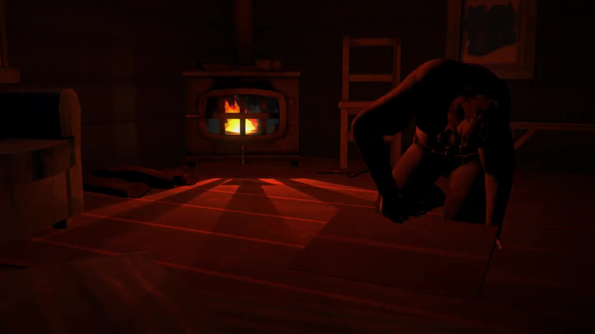

_Jeremiah opening the hidden floorboard_

_The hidden shortwave_

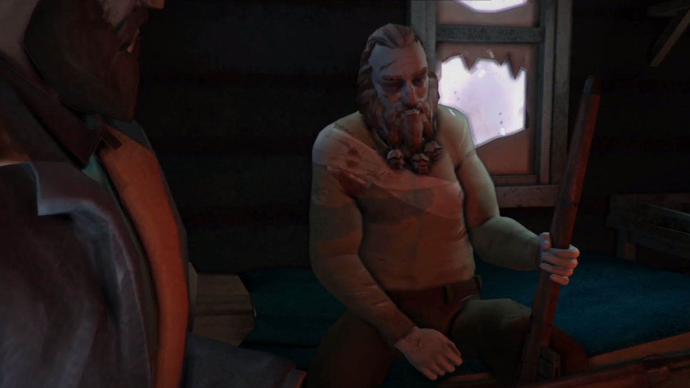

_Jeremiah teaching Mackenzie his Survival School skills_

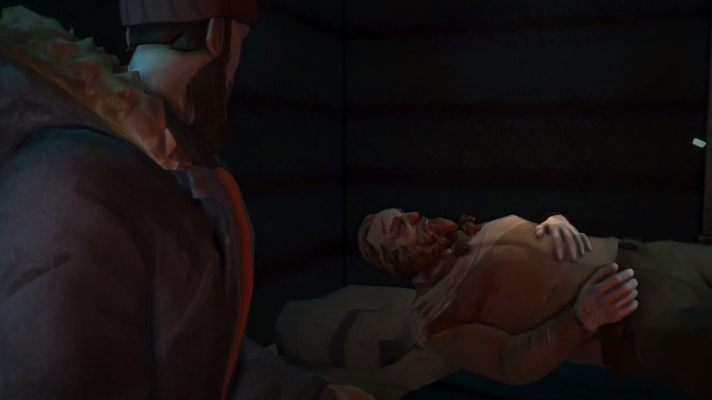

_Mackenzie Tending to the wounded Trapper_

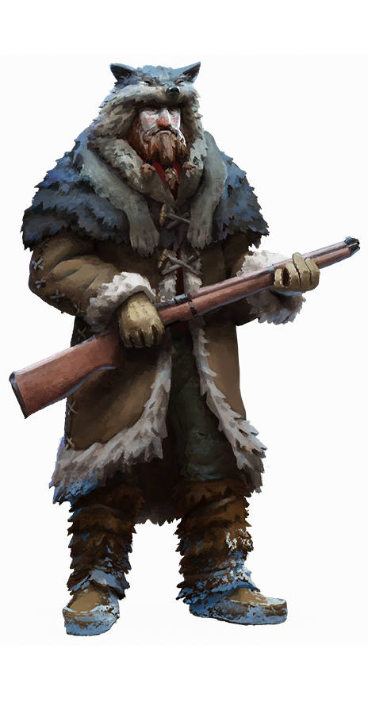

_What I Know icon_

_[Jeremiah's Knife](./Jeremiah%27s%20Knife.md)_

_[Jeremiah's Bearskin Coat](./Jeremiah%27s%20Bearskin%20Coat.md)_

_[Jeremiah's Papers](./Jeremiah%27s%20Papers.md)_

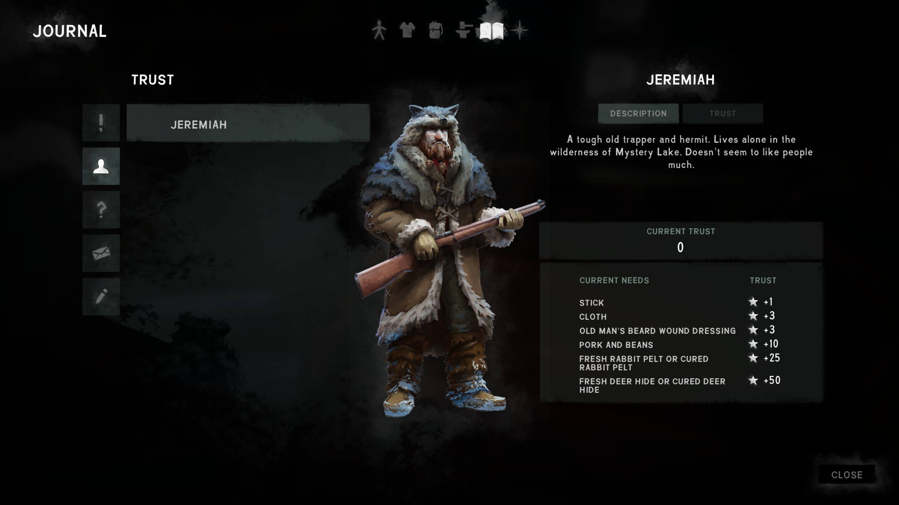

_The cut Trust menu_

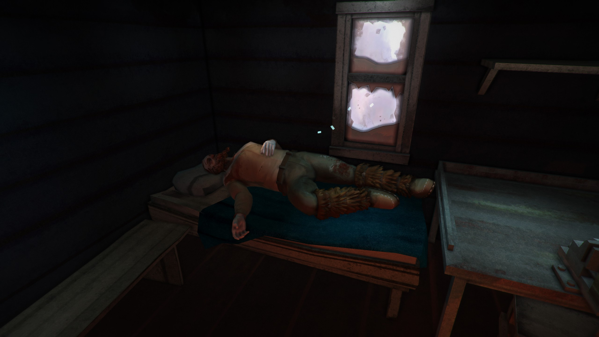

_Jeremiah at the start of [Risk of Infection](./Risk%20of%20Infection.md)_

### Redux Episode 1

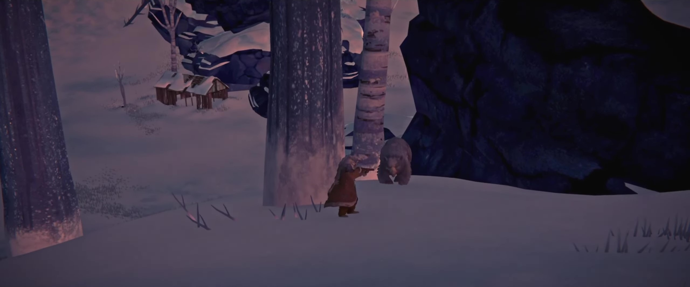

_Jeremiah being attacked by the Old Bear_

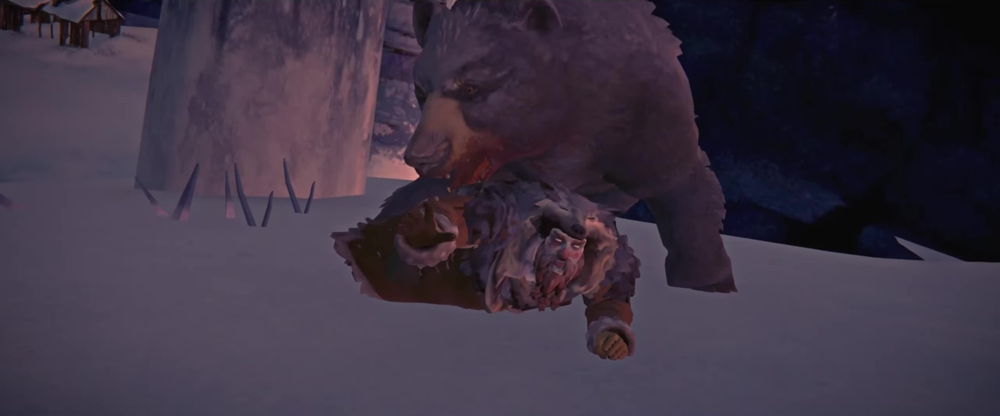

_Ditto_

### Redux Episode 2

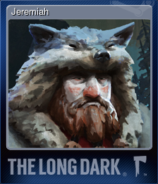

_Steam Trading Card_

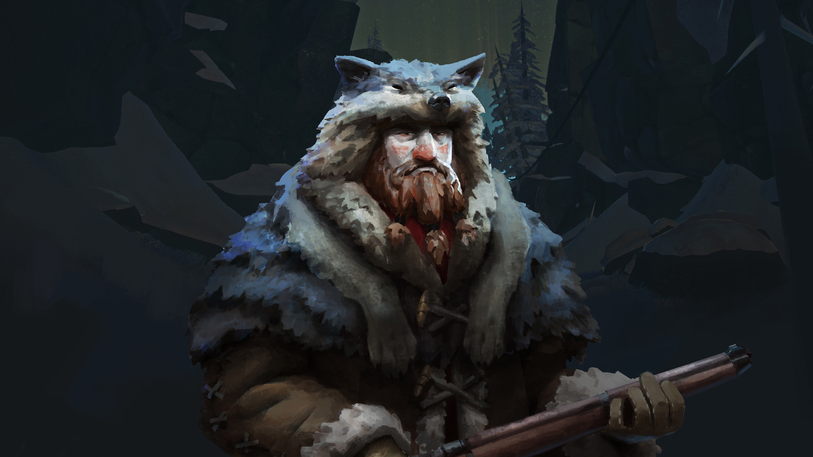

_Ditto, full screen_

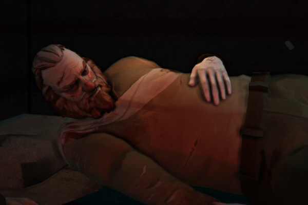

_Jeremiah resting in bed._

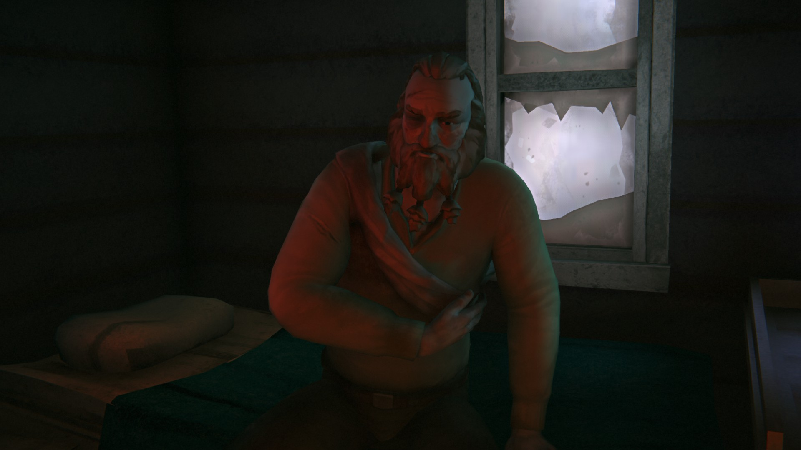

_ditto_

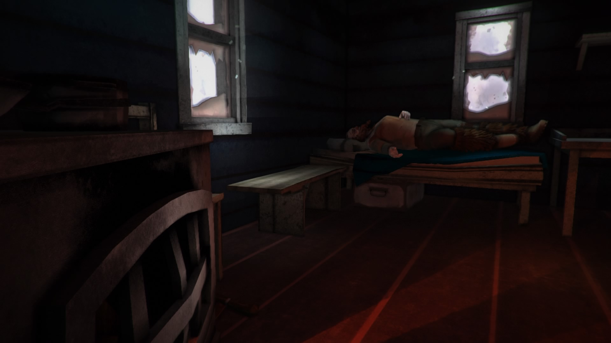

_Jeremiah unconscious on the bed._

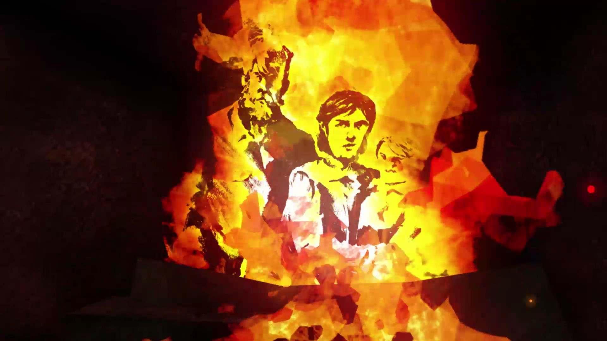

_Jeremiah recounting the tale of the "Demon Bear"_

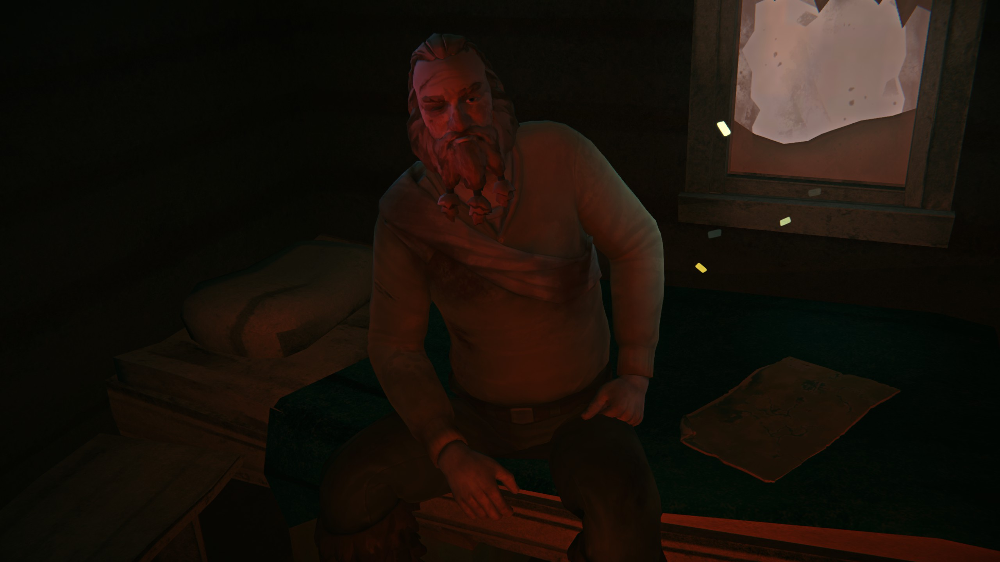

_Jeremiah with the military cartography map_

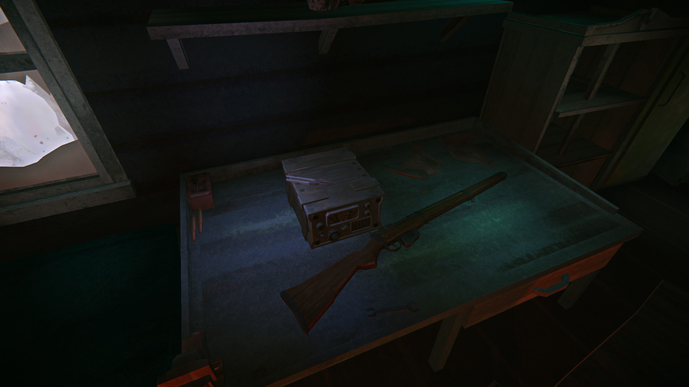

_Jeremiah's Shortwave Radio and Hunting Rifle._
