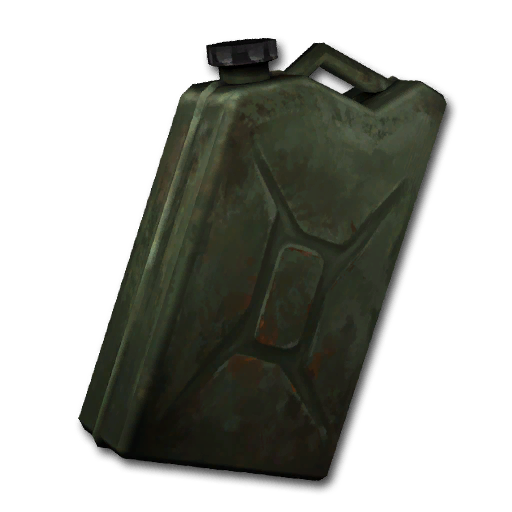

# Jerry Can

**Contents**

- [Overview](#Overview)
- [Refilling](#Refilling)
- [Locations](#Locations)
- [Trivia](#Trivia)

<table class="infobox">
<caption>Jerry Can</caption>
<colgroup>
<col style="width: 50%" />
<col style="width: 50%" />
</colgroup>
<tbody>
<tr>
<td colspan="2"><figure>

<figcaption>Jerry_Can_icon.png</figcaption>
</figure></td>
</tr>
<tr>
<td colspan="2" class="section">
<strong>General</strong>
</td>
</tr>
<tr>
<td>
Item Type
</td>
<td>
Tool|-
</td>
</tr>
<tr>
<td>
Renewable
</td>
<td>
Yes (very rarely through <a href="./Beachcombing.md" class="wikilink" title="Beachcombing">Beachcombing</a>)
</td>
</tr>
<tr>
<td colspan="2" class="section">
<strong>Statistics</strong>
</td>
</tr>
<tr>
<td>
Weight
</td>
<td>
0.10 - 3.30 kg(0.22 - 7.26 lbs)
</td>
</tr>
</tbody>
</table>

<table>
<colgroup>
<col style="width: 33%" />
<col style="width: 33%" />
<col style="width: 33%" />
</colgroup>
<tbody>
<tr>
<td style="vertical-align: top; font-size: 3em; color: #5d5980; padding-right: 10px">
“
</td>
<td>
An old metal jerry can containing fuel for oil lamps.

&#10;

In-game description

</td>
<td style="vertical-align: bottom; font-size: 3em; color: #5d5980; padding-left: 10px">
”
</td>
</tr>
</tbody>
</table>

## Overview

A **Jerry Can** is a large container that can hold up to 4 liters (1.05 Gallons) of <a href="./Lantern%20Fuel.md" class="wikilink" title="Lantern Fuel">Lantern Fuel</a>.

Unlike cans of Lantern Fuel, Jerry Cans are not spontaneously generated. They can only be found in the world, and a Jerry Can disappears after its contents have been used up.

Jerry Cans are noticeably more weight to fuel efficient per kilogram than Lantern Fuel, weighing only 0.40 kg per 0.50 liters collected, while Lantern Fuel weighs 0.50 kg per 0.50 Liters collected.

It is not possible to repair the condition of a Jerry Can.

## Refilling

A Jerry Can in the player's inventory will collect any Lantern Fuel created from cooking fish (if the can is not full), preventing the spontaneous generation of a bottle of Lantern Fuel. It will also collect kerosene from harvesting a <a href="./Storm%20Lantern.md" class="wikilink" title="Storm Lantern">Storm Lantern</a>. When multiple Jerry Cans are in the player's inventory, the can with the smallest used volume is filled first.

Refueling a lantern with both a Jerry Can and Lantern Fuel in the player's inventory will use the Jerry Can first. Therefore it is best to drop the Jerry Can before refueling so the Lantern Fuel is used first.

## Locations

Examples of places that Jerry Cans are known to spawn on Interloper:

- <a href="./Blackrock.md" class="wikilink" title="Blackrock">Blackrock</a>
  - <a href="./Cook%27s%20Farm.md" class="wikilink" title="Cook&#39;s Farm">Cook's Farm</a>
- <a href="./Broken%20Railroad.md" class="wikilink" title="Broken Railroad">Broken Railroad</a>
  - <a href="./Maintenance%20Yard.md" class="wikilink" title="Maintenance Yard">Maintenance Yard</a>: on a pallet near the opening of the garage
  - In a trunk of a truck near <a href="./Maintenance%20Yard.md" class="wikilink" title="Maintenance Yard">Maintenance Yard</a>
- <a href="./Coastal%20Highway.md" class="wikilink" title="Coastal Highway">Coastal Highway</a>
  - <a href="./Cinder%20Hills%20Coal%20Mine.md" class="wikilink" title="Cinder Hills Coal Mine">Cinder Hills Coal Mine</a> middle level (accessible during aurora)
- <a href="./Forsaken%20Airfield.md" class="wikilink" title="Forsaken Airfield">Forsaken Airfield</a>
  - <a href="./Cargomaster%27s%20Trailer.md" class="wikilink" title="Cargomaster&#39;s Trailer">Cargomaster's Trailer</a>
- <a href="./Pleasant%20Valley.md" class="wikilink" title="Pleasant Valley">Pleasant Valley</a>
  - <a href="./Three%20Strikes%20Farmstead.md" class="wikilink" title="Three Strikes Farmstead">Three Strikes Farmstead</a>
- <a href="./Sundered%20Pass.md" class="wikilink" title="Sundered Pass">Sundered Pass</a>
  - <a href="./Abandoned%20Mine.md" class="wikilink" title="Abandoned Mine">Abandoned Mine</a>
  - <a href="./Station%20Bunkhouse.md" class="wikilink" title="Station Bunkhouse">Station Bunkhouse</a>
- <a href="./Zone%20of%20Contamination.md" class="wikilink" title="Zone of Contamination">Zone of Contamination</a>
  - <a href="./Concentrator.md" class="wikilink" title="Concentrator">Concentrator</a> ground level
  - <a href="./Lantern%20Fuel.md" class="wikilink" title="Langston Mine">Langston Mine</a>

## Trivia

- When trading with <a href="./Trader.md" class="wikilink" title="Sutherland the Trader">Sutherland the Trader</a> Jerry Cans are **not returned** if traded for Lamp Oil.
- It weights as same with <a href="./Lantern%20Fuel.md" class="wikilink" title="Lantern fuel">Lantern fuel</a> can when emptied, which is ironic because of the size difference**Lua execution error in Module:Navbox function navboxLua execution error in Module:Navbox function navbox**

<a href="ru:%D0%9A%D0%B0%D0%BD%D0%B8%D1%81%D1%82%D1%80%D0%B0_%D1%81_%D0%B3%D0%BE%D1%80%D1%8E%D1%87%D0%B8%D0%BC" class="wikilink" title="ru:Канистра_с_горючим">ru:Канистра_с_горючим</a>

