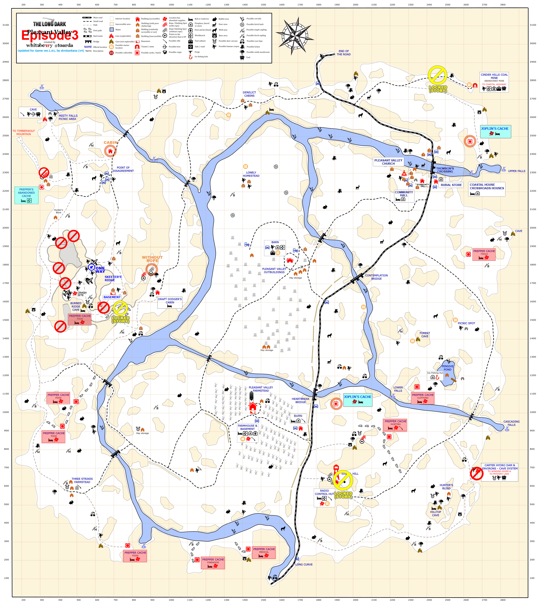

# Joplin's Bunker Raid

<table class="infobox">
<caption>Joplin's Bunker Raid</caption>
<thead>
<tr>
<th>
Episode
</th>
<th>
<a href="./Episode%203%20-%20Crossroads%20Elegy.md" class="wikilink" title="Episode 3">Episode 3</a>|-
</th>
<th colspan="2">
<strong>Missions</strong>
</th>
</tr>
</thead>
<tbody>
<tr>
<td>
Current
</td>
<td>
Joplin's Bunker Raid
</td>
<td></td>
<td></td>
</tr>
<tr>
<td>
Region
</td>
<td>
<a href="./Pleasant%20Valley.md" class="wikilink" title="Pleasant Valley">Pleasant Valley</a>
</td>
<td></td>
<td></td>
</tr>
</tbody>
</table>

|  |  |  |
|----|----|----|
| “ | The Forest Talkers have been raiding Joplin's prepper caches. Whatever supplies remain could help you survive Pleasant Valley long enough to find a way out. Search the caches to see what's left. | ” |

**Joplin's Bunker Raid** is a side mission in <a href="./Episode%203%20-%20Crossroads%20Elegy.md" class="wikilink" title="Episode 3">Episode 3</a> of the <a href="./Wintermute.md" class="wikilink" title="story">story</a>. In this mission, <a href="./Astrid%20Greenwood.md" class="wikilink" title="Astrid">Astrid</a> must search for bunkers scattered throughout Pleasant Valley.

Each bunker contains a large amount of supplies, which varies slightly but generally contains food, <a href="./Flare.md" class="wikilink" title="flare">flares</a>, <a href="./Revolver%20Ammunition.md" class="wikilink" title="revolver ammunition">revolver ammunition</a>, <a href="./Rifle%20Ammunition.md" class="wikilink" title="rifle ammunition">rifle ammunition</a>, <a href="./Flare%20Shell.md" class="wikilink" title="flare shells">flare shells</a>, and <a href="./Kerosene.md" class="wikilink" title="kerosene">kerosene</a>. The bunkers are useful particularly when completing the <a href="./Coming%20Storm.md" class="wikilink" title="Coming Storm">Coming Storm</a> mission.

## Tasks

- Locate the first bunker
- Find the journal hidden in the vent
- Locate the second bunker
- Find the next journal entry
- Locate the third bunker

## Locations

- <a href="./Forest%20Talker%20Bunker%20Memo.md" class="wikilink" title="Forest Talker Bunker Memo">Forest Talker Bunker Memo</a> is located in the <a href="./Rural%20Store.md" class="wikilink" title="Rural Store">Rural Store</a> of <a href="./Thomson%27s%20Crossing.md" class="wikilink" title="Thomson&#39;s Crossing">Thomson's Crossing</a> on Green and Capable Survivor difficulty.  On Hardened Survivor, the note is found in a backpack next to a corpse at the <a href="./Derelict%20Cabins.md" class="wikilink" title="Derelict Cabins">Derelict Cabins</a>.
- <a href="./Joplin%27s%20Journal%2C%20Part%20One.md" class="wikilink" title="Joplin&#39;s Journal, Part One">Joplin's Journal, Part One</a> is located inside a duct in the bunker near <a href="./Skeeter%27s%20Ridge.md" class="wikilink" title="Skeeter&#39;s Ridge">Skeeter's Ridge</a>
- <a href="./Joplin%27s%20Journal%2C%20Part%20Two.md" class="wikilink" title="Joplin&#39;s Journal, Part Two">Joplin's Journal, Part Two</a> is located in the bunker near <a href="./Three%20Strikes%20Farmstead.md" class="wikilink" title="Three Strikes Farmstead">Three Strikes Farmstead</a>
- The third bunker is located near <a href="./Upper%20Falls.md" class="wikilink" title="Upper Falls">Upper Falls</a>

## Gallery

<table class="gallery">
<colgroup>
<col style="width: 100%" />
</colgroup>
<tbody>
<tr>
<td><figure>

<figcaption>1901570789_preview_Map-PleasantValley-EP3-spoil-Fixv162-05.png</figcaption>
</figure></td>
</tr>
</tbody>
</table>

**Lua execution error in Module:Navbox function navbox**

