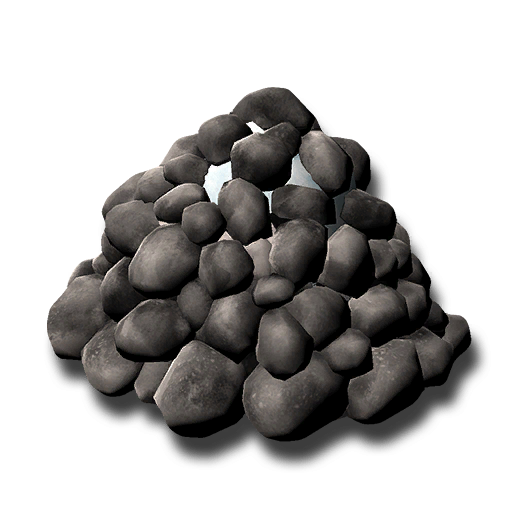

# Journal

**Contents**

- [Overview](#Overview)
- [Log](#Log)
- [Daily Log](#Daily_Log)
- [Notes](#Notes)
- [Skills](#Skills)
- [Collections](#Collections)
- [Rock Caches](#Rock_Caches)
- [General Notes](#General_Notes)
- [Stats](#Stats)
- [Trader](#Trader)
- [Photo Album](#Photo_Album)

## Overview

The Journal is a menu item in The Long Dark. It can be accessed by the default hotkey "J" or from the book icon at the top of the game menu.

The Journal contains eight menus: Log, Skills, Collections, Rock Caches, General Notes, Stats, Trader, and Photo Album.

## Log

The Log menu provides a day by day overview of each day played on the current sandbox. There are two submenu tabs for this section.

### Daily Log

The following highlights are recorded in the Log:

1.  Locations discovered - Or more accurately, locations visited, as any visited locations that have previously been discovered will also be listed here.
2.  World explored - Given as a percentage. It is unclear exactly how this is calculated within the game.
3.  Hours rested - Only counts hours that fully fall within the given day.
4.  Condition Range - Displays the highest% Condition of the day as well as the lowest% Condition.
5.  Calories Burned - Displayed as an integer.
6.  Injuries sustained - Displayed as an integer, without any details about how the injuries were sustained.

### Notes

Contains a single "notepad" where players can jot down notes. While this is marginally useful to remember storage cache locations or directions, it is currently not possible to make more than one "thread" or organize notes in any way other than manual editing, thereby limiting it's utility compared to a simple in-game word processor.

## Skills

The <a href="./Skills.md" class="wikilink" title="Skills">Skills</a> submenu provides details about current skill levels (primary skills only), perks of those levels, and progress to the next skill level within the current sandbox. Note that this menu scrolls down to reveal additional skills, depending on display settings.

Currently, the following primary skills are displayed within the skills menu:

1.  Carcass Harvesting
2.  Cooking
3.  Fire Starting
4.  Ice Fishing
5.  Rifle Firearm
6.  Archery
7.  Mending
8.  Revolver Firearm
9.  Gunsmithing

Note that secondary skills (cleaning, sharpening, and repair) are not listed in this menu and can only be tracked indirectly when attempting to perform an action related to that skill within the game menu.

## Collections

The Collections menu provides information about 8 <a href="./Collectibles.md" class="wikilink" title="Collectibles">Collectibles</a> that are available within the game, including:

1.   <a href="./Notes.md" class="wikilink" title="Notes">Notes</a> - There are a total of 25 "notes left behind" that can be tracked and reread using this submenu.
2.   <a href="./Transmitters.md" class="wikilink" title="Transmitters">Transmitters</a> - Opens up a unique screen that shows all discovered and repaired Transmitters as well as their radio coverage on the island.
3.   <a href="./Recipe%20Cards.md" class="wikilink" title="Unique Recipes">Unique Recipes</a> - 9 unique Recipe Cards can be acquired across the island and unlock special Cooking Level 5 Recipes for the player.
4.   <a href="./Polaroids.md" class="wikilink" title="Polaroids">Polaroids</a> - Polaroids are used for mapping - if the player stands at the Vista location shown in the Polaroid after collecting it and surveys the location with <a href="./Charcoal.md" class="wikilink" title="Charcoal">Charcoal</a>, a large area of the <a href="./Map.md" class="wikilink" title="Map">Map</a> will be revealed. Some regions have 2 Polaroids that can be found.
5.   <a href="./Mementos.md" class="wikilink" title="Mementos">Mementos</a> - Keeps track of all Memento notes and keys that are found. Unique items, such as keys and the <a href="./Bolt%20Cutters.md" class="wikilink" title="Bolt Cutters">Bolt Cutters</a> found in various <a href="./Tales.md" class="wikilink" title="Tales">Tales</a>, are stored here.
6.   <a href="./Cairns.md" class="wikilink" title="Cairns">Cairns</a> - Cairns are tributes to supporters from the Kickstarter campaign, each with a message written by the patron, although in many cases the message is blank (simply stating that "Its story is not yet written…"). There are currently 165 cairns in the game spread across most of the zones.
7.   <a href="./Buffer%20Memories.md" class="wikilink" title="Buffer Memories">Buffer Memories</a> - Buffer Memories can be found on Computers that become powered during an active Aurora at night. They contain details about life prior to the <a href="./The%20Collapse.md" class="wikilink" title="Great Collapse">Great Collapse</a>. They are essential to complete the <a href="./Archivist.md" class="wikilink" title="Archivist">Archivist</a> <a href="./Challenge.md" class="wikilink" title="Challenge">Challenge</a>, but note that this must be completed in the relevant challenge as opposed to normal survival/storyline gameplay.
8.   <a href="./Surveyed%20Locations.md" class="wikilink" title="Surveyed Locations">Surveyed Locations</a> - This collectible is a checklist of all mappable locations within the game that count toward the <a href="./Faithful%20Cartographer.md" class="wikilink" title="Faithful Cartographer">Faithful Cartographer</a> achievement. In the current version, an in-game menu with the surveyed locations can be checked. Undiscovered places will be hidden by default, but using the "force reveal" button will make them show, not affecting the achievement.

All collections are entirely optional components of gameplay, but may be linked to various achievements.

## Rock Caches

The Rock Cache menu contains a list of all  <a href="./Rock%20Cache.md" class="wikilink" title="Rock Caches">Rock Caches</a>, subdivided by <a href="./Region.md" class="wikilink" title="Region">Region</a>, that have been created in the current sandbox. Note that there is a limit of five (5) rock caches per region. From this menu, rock cache names and notes can be viewed/edited. The locations of each individual cache can also be viewed from this menu.

## General Notes

The General Notes menu behaves exactly like the Notes section of the Log, being a general notepad where players can jot down notes but as it's own dedicated menu.

## Stats

The Stats menu contains detailed stats about each playthrough, and compares those stats with the player's all-time high scores, subdivided by difficulty level. The following stats are tracked:

- Sandbox name (if one is chosen at the start of the playthrough):
- Days Survived
- Locations Discovered
- World Explored (displayed as a whole number percentage)
- Calories Expended
- Average Calories per day
- Distance Travelled (in kilometers)
- Hours Awake
- Hours Rested
- Hours Indoors
- Hours Outdoors
- Hours Rested (Outdoors)
- Days in Mystery Lake
- Days in Pleasant Valley
- Days in Coastal Highway
- Days in Desolation Point
- Days in Timberwolf Mountain
- Days in Forlorn Muskeg
- Days in Broken Railroad
- Days in Mountain Town
- Days in Hushed River Valley
- Days in Bleak Inlet
- Days in Ash Canyon
- Days in Blackrock
- Days in Transfer Pass
- Days in Forsaken Airfield
- Days in Zone of Contamination
- Days in Sundered Pass
- Successful Repairs
- Wildlife Bow Hits
- Rifle Shots Taken
- Wildlife Rifle Hits
- Distress Pistol Shots Taken
- Wildlife Distress Pistol Hits
- Revolver Shots Taken
- Wildlife Revolver Hits
- Wolf Close Encounters
- Wolf Struggles
- Wolf Struggles Won
- Wolves Killed
- Wolves Distracted by Decoys
- Bear Attacks Survived
- Bears Killed
- Moose Attacks Survived
- Moose Killed
- Deer Killed
- Rabbits Killed
- Rabbits Snared
- Cougar Struggles
- Cougar Struggles Survived
- Cougars Killed
- Ptarmigan Killed
- Meat Consumed (in Kg)
- Fish Consumed (in Kg)
- Fish Caught (in Kg)
- Meat Harvested (in Kg)
- Guts Harvested
- Hides Harvested
- Items Looted
- Items Crafted
- Items Broken Down
- Plants Harvested
- Cans Opened
- Can Openers Found
- Fires Started
- Longest Burning Fire (hours)
- Wrist Sprains
- Ankle Sprains
- Food Poisoning
- Dysentery
- Infection
- Hypothermia
- Blood Loss
- Scurvy
- Cabin Fever
- Intestinal Parasites
- Frostbite
- Broken Ribs
- Insomnia
- Chemical Poisoning
- Severe Lacerations
- Falls
- Blizzards Survived
- Camera Photos Taken

## Trader

The Trader menu keeps track of active trades or promises made to the <a href="./Trader.md" class="wikilink" title="Trader">Trader</a>.

## Photo Album

The Photo Album menu keeps track of photographs capture by the <a href="./Camera.md" class="wikilink" title="Camera">Camera</a>.

- 

