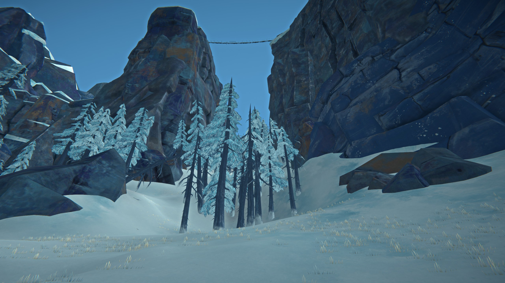
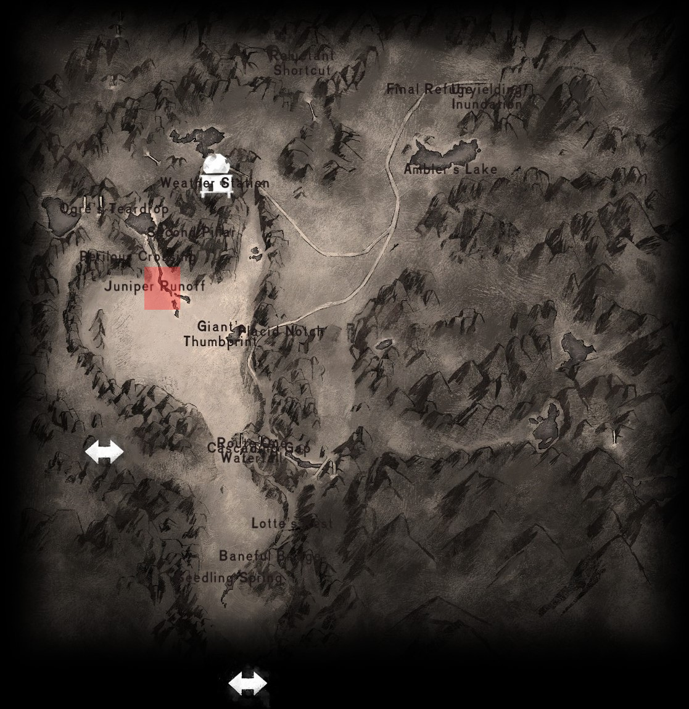

# Juniper Runoff

**Juniper Runoff**

| Property | Details |
| --- | --- |
|  |  / *Juniper\_Runoff.jpg* |
| **Location** |  |
|  |  / *Juniper\_Runoff\_Location.png* |
| Region | [Sundered Pass](./Sundered%20Pass.md)\|- |
| Description | A large slope below Perilous Crossing |
| **General** |  |
|  | Has no shelter\|} **Juniper Runoff** is a location in [Sundered Pass](./Sundered%20Pass.md). / ## Overview / It is a small snowy slope located in the lower treeline in the region. The [Perilous Crossing](./Perilous%20Crossing.md) bridge can be seen directly above the area. Going further north will lead the player to [Ogre's Teardrop](./Ogre%27s%20Teardrop.md). To the south east is [Giant's Thumbprint](./Giant%27s%20Thumbprint.md), and to the north east is [Idle Hideout](./Idle%20Hideout.md) and a cave system. / Despite a stream appearing on the map of the area when Surveying, no frozen water is present on the slope. The surrounding forest is rich in wood for fuel, some wolves and deer.**Lua execution error in Module:Navbox function navbox** |
