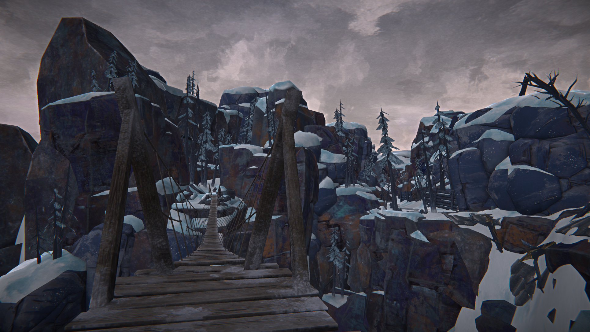
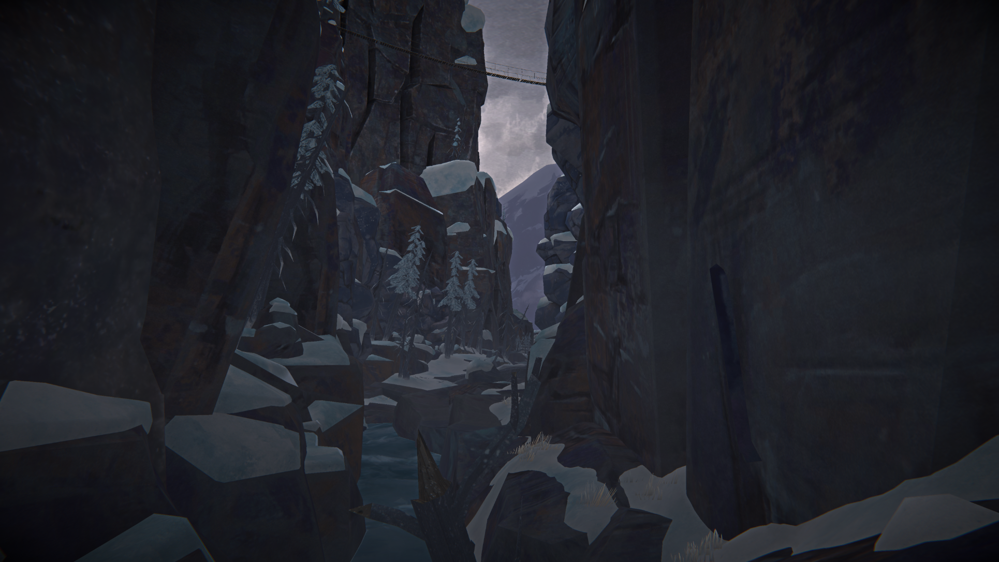
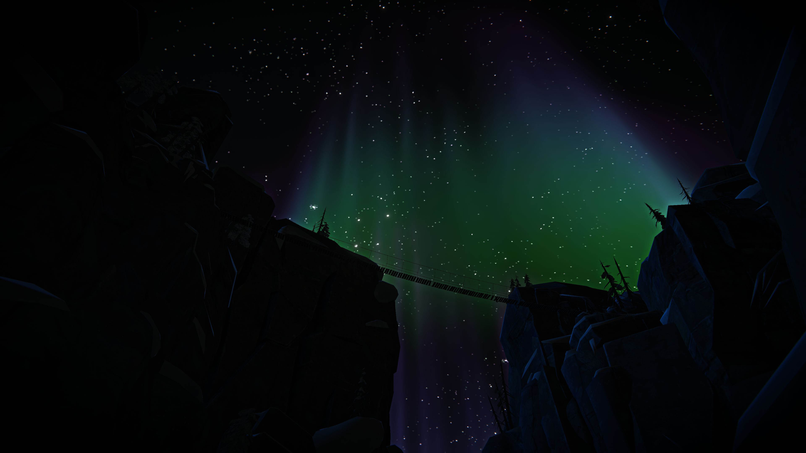

# Keeper's Pass North

**Categories:** Pages with update history, Transition zones · **Source:** [Fandom](https://thelongdark.fandom.com/wiki/Keeper's_Pass_North)

**Contents**

- [Overview](#overview)
- [Wildlife Availability](#wildlife-availability)
- [Locations](#locations)
- [Trivia](#trivia)
- [Gallery](#gallery)
- [Update history](#update-history)

**Keeper's Pass North**

[Buildersbridge1](../assets/Buildersbridge1.png)

**Location on [Great Bear Island](./Great%20Bear%20Island.md)**

[Keeper's Pass North Location](../assets/Keeper%27s_Pass_North_Location.png)

[Keeper's Pass North Region Map](../assets/Keeper%27s_Pass_North_Region_Map.png)

**Details**

**Description:** A large crevice situated in the middle of nowhere, eventually giving way to the road to [Blackrock](./Blackrock.md)

**Connecting Regions:** [Pleasant Valley](./Pleasant%20Valley.md) (via [Keeper's Pass South](./Keeper%27s%20Pass%20South.md) ) [Blackrock](./Blackrock.md)

**Locations:** 4

**Date Added:** December 2021

**Keeper's Pass North** is the 5th Transition Zone [Region](./Region.md) introduced into _[The Long Dark](./The%20Long%20Dark.md)_. It connects to [Keeper's Pass South](./Keeper%27s%20Pass%20South.md) via a cave system (which in turn connects to [Pleasant Valley](./Pleasant%20Valley.md)) and to [Blackrock](./Blackrock.md) to the north.

## Overview

It consists of winding ravine passage with a rickety rope bridge going over a river that cuts through the region. The region is notable for having no interior shelters or caves, but [Forester's Hermitage](./Forester%27s%20Hermitage.md) does provide a bed and fireplace to stay warm.

The road leading to [Milton](./Milton.md)/Pleasant Valley is damaged, with a landslide having fallen into the river below and the tunnel still blocked. A caved in tunnel that leads to Keeper's Pass South can be found to the east of the map, with a [Rope Climbing](./Rope%20Climbing.md) section nearby leading to the bottom of the river. The bottom of the river contains a shallow cave with an [Emergency Kit](./Emergency%20Kit.md) and a tuffet [Bed](./Bed.md) (the second one found in the region). Falling into the river will result in an immediate game over.

Currently, neither part of Keeper's Pass is featured on the [World Map](./Map.md), but local regional maps can be surveyed.

## Wildlife Availability

Only 2 animals are found in this region.

- [Rabbit](./Rabbit.md) can occasionally be found in the ravine and near Forester's Hermitage.
- A single [Wolf](./Wolf.md) can be found on the road to Blackrock near the transition area.
- Some [Deer Carcasses](./Deer%20Carcass.md) can occasionally be found in the region.

It is possible for this region to be free of predators after enough days survived pass, a feature shared with [Far Range Branch Line](./Far%20Range%20Branch%20Line.md).

## Locations

Only 4 locations can be found in the region.

- [Forester's Hermitage](./Forester%27s%20Hermitage.md)
- [Builder's Bridge](./Builder%27s%20Bridge.md)
- To Blackrock (Region Transition to [Blackrock](./Blackrock.md))
- To Cave System (Region Transition to [Keeper's Pass South](./Keeper%27s%20Pass%20South.md))

## Trivia

The section from the transitional cave system to Forester's Hermitage is the section that [Mackenzie](./Will%20Mackenzie.md) runs through in the beginning of [Episode 4](./Episode%204%20-%20Fury%2C%20Then%20Silence.md).

## Gallery

## Update history

- UPDATE **7 December 2021 ([Update](./The%20Long%20Dark%20%E2%80%94%20Changelog%20%E2%80%94%20Archive%202.md#1.98)):**
  - Added to game.
