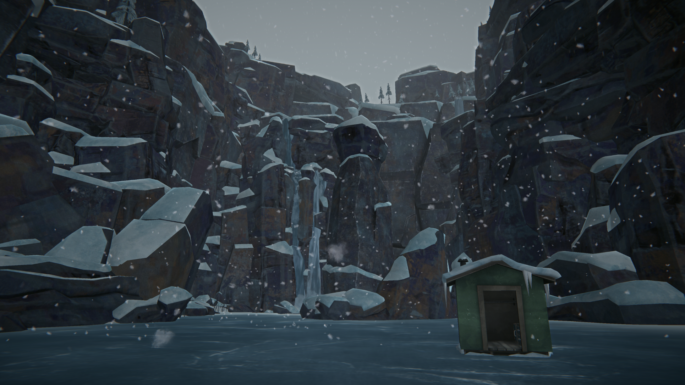

# Keeper's Pass South

**Contents**

- [Overview](#Overview)
- [Wildlife Availability](#Wildlife_Availability)
- [Locations](#Locations)
- [Trivia](#Trivia)
- [Gallery](#Gallery)
- [Update history](#Update_history)

<table class="infobox">
<caption>Keeper's Pass South</caption>
<colgroup>
<col style="width: 50%" />
<col style="width: 50%" />
</colgroup>
<tbody>
<tr>
<td colspan="2"><figure>

<figcaption>Vistekeeperspass.png</figcaption>
</figure></td>
</tr>
<tr>
<td colspan="2" class="section">
<strong>Location on <a href="./Great%20Bear%20Island.md" class="wikilink" title="Great Bear Island">Great Bear Island</a></strong>
</td>
</tr>
<tr>
<td colspan="2"><figure>
[Missing image: Keeper's_Pass_South_Location.png]
<figcaption>Keeper's_Pass_South_Location.png</figcaption>
</figure></td>
</tr>
<tr>
<td colspan="2"><figure>

<figcaption>Keeper's_Pass_South_Region_Map.png</figcaption>
</figure></td>
</tr>
<tr>
<td colspan="2" class="section">
<strong>Details</strong>
</td>
</tr>
<tr>
<td>
Description
</td>
<td>
A small crossroads in the mountains connecting <a href="./Milton.md" class="wikilink" title="Milton">Milton</a>, <a href="./Blackrock.md" class="wikilink" title="Blackrock">Blackrock</a> and <a href="./Pleasant%20Valley.md" class="wikilink" title="Pleasant Valley">Pleasant Valley</a>
</td>
</tr>
<tr>
<td>
Connecting Regions
</td>
<td>
<a href="./Pleasant%20Valley.md" class="wikilink" title="Pleasant Valley">Pleasant Valley</a> <a href="./Blackrock.md" class="wikilink" title="Blackrock">Blackrock</a> (via <a href="./Keeper%27s%20Pass%20North.md" class="wikilink" title="Keeper&#39;s Pass North">Keeper's Pass North</a> )
</td>
</tr>
<tr>
<td>
Locations
</td>
<td>
4
</td>
</tr>
<tr>
<td>
Date Added
</td>
<td>
December 2021
</td>
</tr>
</tbody>
</table>

**Keeper's Pass South** is the 4th Transition Zone <a href="./Region.md" class="wikilink" title="Region">Region</a> added to *<a href="./The%20Long%20Dark.md" class="wikilink" title="The Long Dark">The Long Dark</a>*. A <a href="./Cave%20%28Transition%20Zone%29.md" class="wikilink" title="Cave">Cave</a> connects to <a href="./Keeper%27s%20Pass%20North.md" class="wikilink" title="Keeper&#39;s Pass North">Keeper's Pass North</a> (and later <a href="./Blackrock.md" class="wikilink" title="Blackrock">Blackrock</a>) with a road leading to <a href="./Pleasant%20Valley.md" class="wikilink" title="Pleasant Valley">Pleasant Valley</a>.

## Overview

It is a continuation of the road at <a href="./Long%20Curve.md" class="wikilink" title="Long Curve">Long Curve</a>, and contains a scenic stop with a trailer, cars, and little loot. A crossroads connects to the tunnel leading to <a href="./Milton.md" class="wikilink" title="Milton">Milton</a>, but the tunnel has collapsed. Further down the road past a bridge is the road to Blackrock, but an avalanche has blocked all progress, forcing the player to go around via a Cave system to reach Keeper's Pass North.

A <a href="./Fishing%20Hut.md" class="wikilink" title="Fishing Hut">Fishing Hut</a> can be found on the frozen river and the ice can be fished with Free Form Holes. Many wolves usually wander the river area, and many <a href="./Rose%20Hip.md" class="wikilink" title="Rose Hip">Rose Hip</a> bushes and <a href="./Reishi%20Mushroom.md" class="wikilink" title="Reishi Mushrooms">Reishi Mushrooms</a> can be found in the hills.

The frozen river has patches of open ice in it. Stepping on them results in a <a href="./Weak%20Ice.md" class="wikilink" title="Weak Ice">Weak Ice</a> warning. Walking straight into the open water will immediately cause the player to plunge into the water as though they fell through weak ice (this is similar to walking into the ocean edge in coastal regions).

## Wildlife Availability

Only 2 animals are found in this region.

- <a href="./Rabbit.md" class="wikilink" title="Rabbit">Rabbit</a> can occasionally be found near the river leading to the Cave system.
- <a href="./Wolf.md" class="wikilink" title="Wolves">Wolves</a> can be found on the road to Blackrock and near Mirthless Fork.
- Some <a href="./Deer%20Carcass.md" class="wikilink" title="Deer Carcasses">Deer Carcasses</a> can occasionally be found in the region.

## Locations

- <a href="./Mirthless%20Fork.md" class="wikilink" title="Mirthless Fork">Mirthless Fork</a>
- <a href="./The%20Toe.md" class="wikilink" title="The Toe">The Toe</a>
- To Cave System (Region Transition to <a href="./Keeper%27s%20Pass%20North.md" class="wikilink" title="Keeper&#39;s Pass North">Keeper's Pass North</a>)
- To Pleasant Valley (Region Transition to <a href="./Pleasant%20Valley.md" class="wikilink" title="Pleasant Valley">Pleasant Valley</a>)

## Trivia

The beginning of <a href="./Episode%203%20-%20Crossroads%20Elegy.md" class="wikilink" title="Episode 3: Crossroads Elegy">Episode 3: Crossroads Elegy</a> takes place near the tunnel to Milton as <a href="./Molly.md" class="wikilink" title="Molly">Molly</a> finds <a href="./Astrid%20Greenwood.md" class="wikilink" title="Astrid Greenwood">Astrid Greenwood</a>. This cutscene introduced Keeper's Pass South 2 years before the region was added to the game.

## Gallery

<table class="gallery">
<colgroup>
<col style="width: 25%" />
<col style="width: 25%" />
<col style="width: 25%" />
<col style="width: 25%" />
</colgroup>
<tbody>
<tr>
<td><figure>
[Missing image: Keeper's_Pass_map_.png]
<figcaption>A detailed map of Keeper's Pass v2.35 (includes spoilers)</figcaption>
</figure></td>
<td><figure>
[Missing image: Keeper's_Pass_map_loper.png]
<figcaption>A detailed map of Keeper's Pass v2.35 (Interloper/Misery edition, includes spoilers)</figcaption>
</figure></td>
<td><figure>

<figcaption>Cabinkeeperspass.png</figcaption>
</figure></td>
<td><figure>
[Missing image: Trailerkeeper_1.jpg]
<figcaption>Mirthless Fork</figcaption>
</figure></td>
</tr>
<tr>
<td><figure>
[Missing image: 20211209131048_1.jpg]
<figcaption>20211209131048_1.jpg</figcaption>
</figure></td>
<td><figure>
[Missing image: 20211209131143_1.jpg]
<figcaption>20211209131143_1.jpg</figcaption>
</figure></td>
<td><figure>
[Missing image: 20211212182300_1.jpg]
<figcaption>20211212182300_1.jpg</figcaption>
</figure></td>
<td><figure>

<figcaption>Keeper's_Pass_Bridge.png</figcaption>
</figure></td>
</tr>
<tr>
<td><figure>
[Missing image: Keeper's_Pass_South_Rock_Arch.jpg]
<figcaption>A rock arch found south of Mirthless Fork</figcaption>
</figure></td>
<td><figure>
[Missing image: Keeper's_Pass_South_blocked_road_to_Milton.jpg]
<figcaption>The blocked road to Milton</figcaption>
</figure></td>
<td><figure>
[Missing image: Keeper's_Pass_South_blocked_road.jpg]
<figcaption>The blocked road to Keeper's Pass North</figcaption>
</figure></td>
<td></td>
</tr>
</tbody>
</table>

## Update history

- UPDATE **7 December 2021 (<a href="./The%20Long%20Dark%20%E2%80%94%20Changelog.md#1.98" class="wikilink" title="Update">Update</a>):**
  - Added to game.

**Lua execution error in Module:Navbox function navboxLua execution error in Module:Navbox function navbox** <a href="ru:%D0%9F%D0%B5%D1%80%D0%B5%D0%B2%D0%B0%D0%BB_%D1%81%D0%BC%D0%BE%D1%82%D1%80%D0%B8%D1%82%D0%B5%D0%BB%D1%8F_(%D1%8E%D0%B3)" class="wikilink" title="ru:Перевал смотрителя (юг)">ru:Перевал смотрителя (юг)</a>

