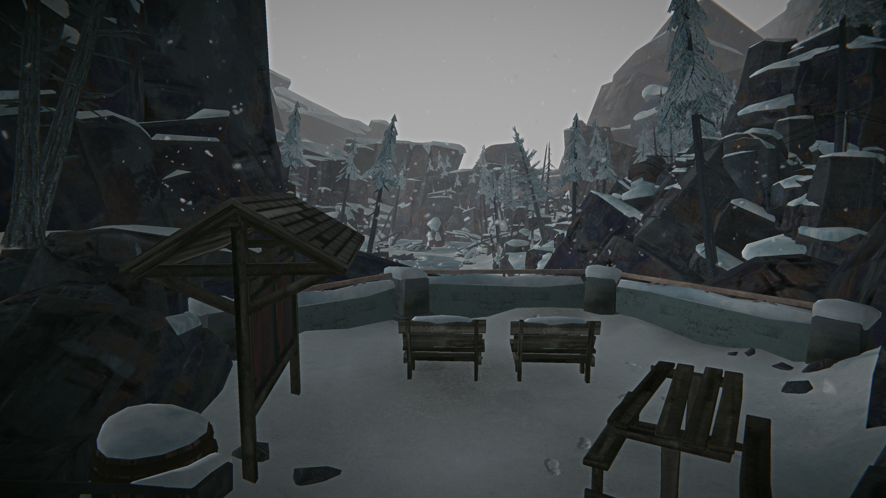
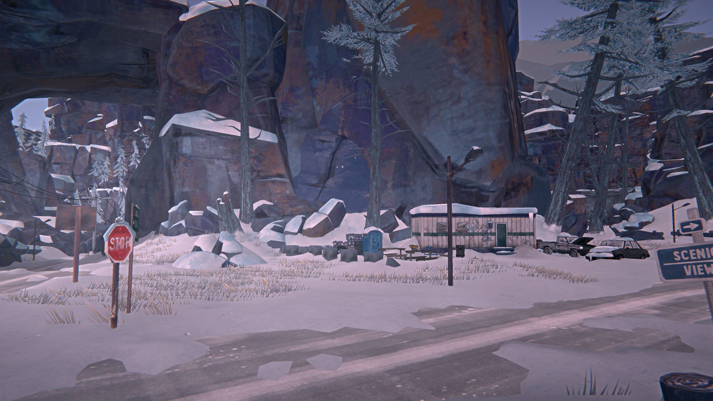
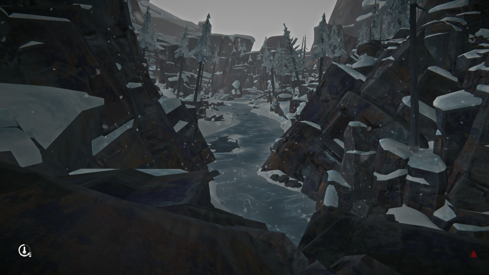
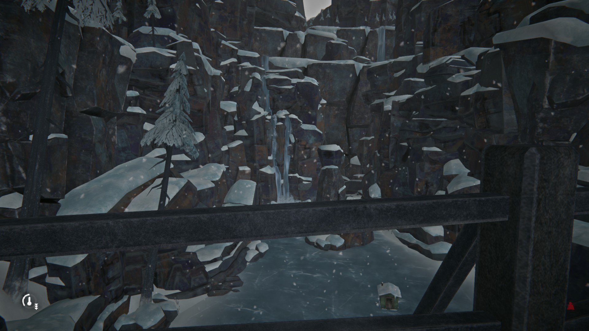
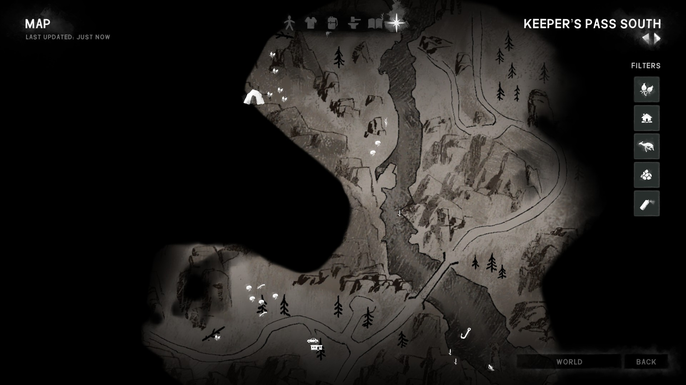

# Keeper's Pass South

**Contents**

- [Overview](#overview)
- [Wildlife Availability](#wildlife-availability)
- [Locations](#locations)
- [Trivia](#trivia)
- [Gallery](#gallery)
- [Update history](#update-history)

**Keeper's Pass South**

| Property | Details |
| --- | --- |
|  |  / *Vistekeeperspass.png* |
| **Location on [Great Bear Island](./Great%20Bear%20Island.md)** |  |
|  |  / *Keeper's\_Pass\_South\_Location.png* |
|  |  / *Keeper's\_Pass\_South\_Region\_Map.png* |
| **Details** |  |
| Description | A small crossroads in the mountains connecting [Milton](./Milton.md), [Blackrock](./Blackrock.md) and [Pleasant Valley](./Pleasant%20Valley.md) |
| Connecting Regions | [Pleasant Valley](./Pleasant%20Valley.md) [Blackrock](./Blackrock.md) (via [Keeper's Pass North](./Keeper%27s%20Pass%20North.md) ) |
| Locations | 4 |
| Date Added | December 2021 |

**Keeper's Pass South** is the 4th Transition Zone [Region](./Region.md) added to *[The Long Dark](./The%20Long%20Dark.md)*. A [Cave](./Cave%20%28Transition%20Zone%29.md) connects to [Keeper's Pass North](./Keeper%27s%20Pass%20North.md) (and later [Blackrock](./Blackrock.md)) with a road leading to [Pleasant Valley](./Pleasant%20Valley.md).

## Overview

It is a continuation of the road at [Long Curve](./Long%20Curve.md), and contains a scenic stop with a trailer, cars, and little loot. A crossroads connects to the tunnel leading to [Milton](./Milton.md), but the tunnel has collapsed. Further down the road past a bridge is the road to Blackrock, but an avalanche has blocked all progress, forcing the player to go around via a Cave system to reach Keeper's Pass North.

A [Fishing Hut](./Fishing%20Hut.md) can be found on the frozen river and the ice can be fished with Free Form Holes. Many wolves usually wander the river area, and many [Rose Hip](./Rose%20Hip.md) bushes and [Reishi Mushrooms](./Reishi%20Mushroom.md) can be found in the hills.

The frozen river has patches of open ice in it. Stepping on them results in a [Weak Ice](./Weak%20Ice.md) warning. Walking straight into the open water will immediately cause the player to plunge into the water as though they fell through weak ice (this is similar to walking into the ocean edge in coastal regions).

## Wildlife Availability

Only 2 animals are found in this region.

- [Rabbit](./Rabbit.md) can occasionally be found near the river leading to the Cave system.
- [Wolves](./Wolf.md) can be found on the road to Blackrock and near Mirthless Fork.
- Some [Deer Carcasses](./Deer%20Carcass.md) can occasionally be found in the region.

## Locations

- [Mirthless Fork](./Mirthless%20Fork.md)
- [The Toe](./The%20Toe.md)
- To Cave System (Region Transition to [Keeper's Pass North](./Keeper%27s%20Pass%20North.md))
- To Pleasant Valley (Region Transition to [Pleasant Valley](./Pleasant%20Valley.md))

## Trivia

The beginning of [Episode 3: Crossroads Elegy](./Episode%203%20-%20Crossroads%20Elegy.md) takes place near the tunnel to Milton as [Molly](./Molly.md) finds [Astrid Greenwood](./Astrid%20Greenwood.md). This cutscene introduced Keeper's Pass South 2 years before the region was added to the game.

## Gallery

| Column 1 | Column 2 | Column 3 | Column 4 |
| --- | --- | --- | --- |
|  / *A detailed map of Keeper's Pass v2.35 (includes spoilers)* |  / *A detailed map of Keeper's Pass v2.35 (Interloper/Misery edition, includes spoilers)* |  / *Cabinkeeperspass.png* |  / *Mirthless Fork* |
|  / *20211209131048\_1.jpg* |  / *20211209131143\_1.jpg* |  / *20211212182300\_1.jpg* |  / *Keeper's\_Pass\_Bridge.png* |
|  / *A rock arch found south of Mirthless Fork* |  / *The blocked road to Milton* |  / *The blocked road to Keeper's Pass North* |  |

## Update history

- UPDATE **7 December 2021 ([Update](./The%20Long%20Dark%20%E2%80%94%20Changelog.md#1.98)):**
  - Added to game.

**Lua execution error in Module:Navbox function navbox****Lua execution error in Module:Navbox function navbox** [ru:Перевал смотрителя (юг)](ru:%D0%9F%D0%B5%D1%80%D0%B5%D0%B2%D0%B0%D0%BB_%D1%81%D0%BC%D0%BE%D1%82%D1%80%D0%B8%D1%82%D0%B5%D0%BB%D1%8F_%28%D1%8E%D0%B3%29)
