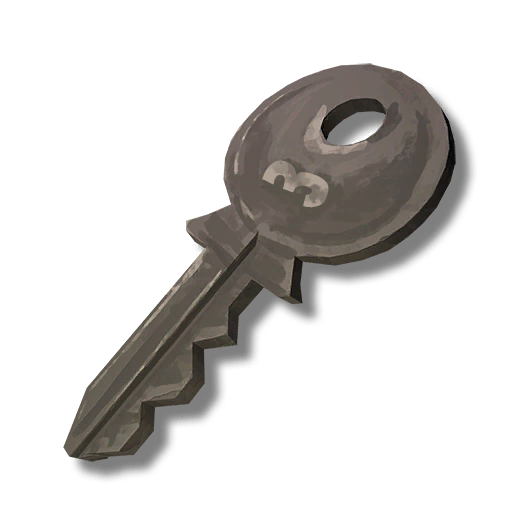

# Key To Lake Cabin 3

**Key To Lake Cabin #3**

| Property | Details |
| --- | --- |
|  |  / *Key\_To\_Lake\_Cabin\_3\_icon.png* |
| Release | [1 August 2017](./The%20Long%20Dark%20%E2%80%94%20Early%20Access%20Changelog.md#1.00) |
| Wintermute | [Episode 2](./Episode%202%20-%20Luminance%20Fugue.md) |
| **Properties** |  |
| Item type | [Collectibles](./Collectibles.md)\|- |
| Stackable | No |
| Examine | A key for one of the Mystery Lake cabins. |
| **Values** |  |
| Weight | 0.00 kg (0 lbs) |
| **Actions** |  |
| Backpack | Examine |
| On ground | Take It, Leave It |

**Key To Lake Cabin #3** is a [Collectible](./Collectibles.md) item found in [Episode 2](./Episode%202%20-%20Luminance%20Fugue.md) of the [Wintermute](./Wintermute.md) story mode that opens one of the [Lake Cabins](./Lake%20Cabins.md) at [Mystery Lake (location)](./Mystery%20Lake%20%28location%29.md). It is found inside the [Camp Office](./Camp%20Office.md) in one of the [File Cabinet](./File%20Cabinet.md) drawers and opens the door to Cabin 3.

## Update history

- UPDATE **1 August 2017 ([Update](./The%20Long%20Dark%20%E2%80%94%20Changelog.md#1.00)):**
  - Added to game.

**Lua execution error in Module:Navbox function navbox**
