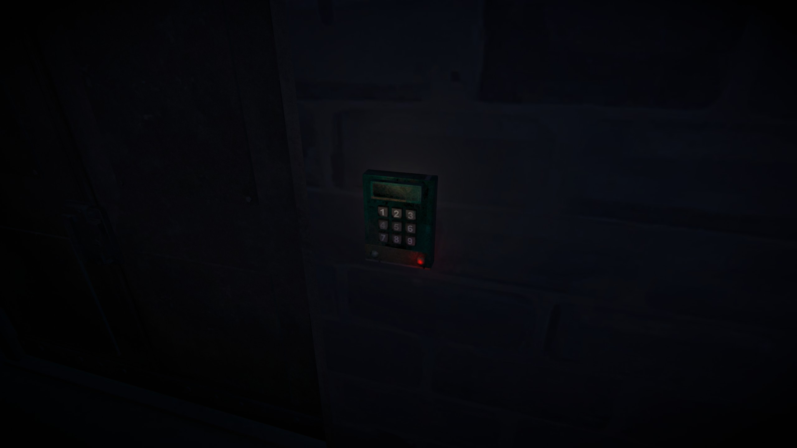
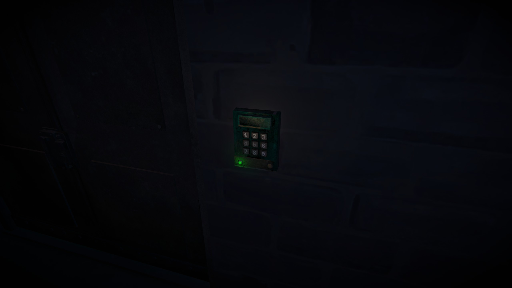
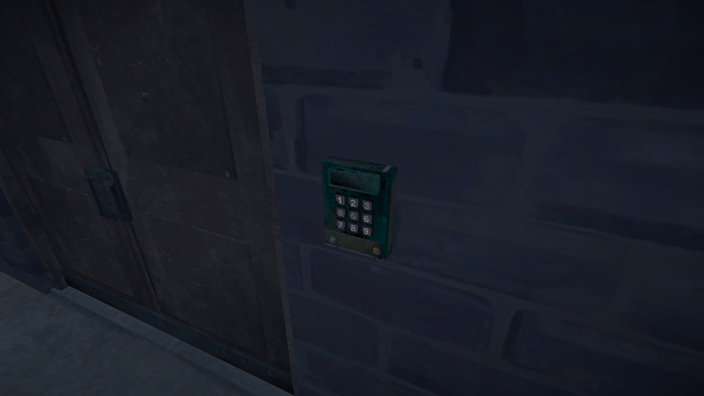

# Keypad

**Categories:** Interactable Objects · **Source:** [Fandom](https://thelongdark.fandom.com/wiki/Keypad)

**Keypad**

\[\[File:

250px\]\]

Story item

Yes

A **Keypad** is a small electronic panel with numbers on it used to open certain electronically locked doors, but are unpowered during the day.

## Overview

During an [Aurora](./Aurora.md) the Keypad is powered, but interacting with the it will produce an error noise. Finding the note with the code and then inputting the code will open the door. At this point the door remains permanantly unlocked even when the pad loses power or the door is closed again. Keypads appear in [Survival Mode](./Survival%20Mode.md) and [Wintermute](./Wintermute.md).

Note that the player does not need to carry the note that the code is on, but merely needs to read it, though carrying the note is always the safest option. The player cannot manually input the code on the keys of the Keypad, only interact with the pad as a single object.

## Survival Mode

There are currently 2 locked doors tied to a Keypad in Survival Mode:

- The [Workshop](./Workshop.md) door at [Cannery Pier](./Cannery%20Pier.md) at the [Last Resort Cannery](./Last%20Resort%20Cannery.md) in [Bleak Inlet](./Bleak%20Inlet.md) (code is in [Echo One Radio Tower](./Echo%20One%20Radio%20Tower.md))
- A locked storage room near the [Steam Tunnels](./Steam%20Tunnels.md) at [Blackrock Prison](./Blackrock%20Prison.md) in [Blackrock](./Blackrock.md) (code is in [Last Prospect](./Last%20Prospect.md))

Both doors require a code to open them, and contain a room with the [Milling Machine](./Milling%20Machine.md), [Ammunition Work Bench](./Ammunition%20Work%20Bench.md), and [Ammunition Forge](./Ammunition%20Forge.md), being the only places to find them in Survival Mode.

## Wintermute

In Wintermute, only [Episode 2: Luminance Fugue](./Episode%202%20-%20Luminance%20Fugue.md) has Keypads:

- The [Aurora Hatch](./Aurora%20Hatch.md) requires an Aurora to open the hatch, and a code to open the door to the back room (code is near a [Hidden Cache](./Hidden%20Cache.md) near [Hunting Lodge](./Hunting%20Lodge.md))
- The Control room of the [Carter Hydro Dam](./Carter%20Hydro%20Dam.md) requires a code and Aurora in order to progress the Episode during the mission [Renewed Hope](./Renewed%20Hope.md). (code is given when progressing the story)
