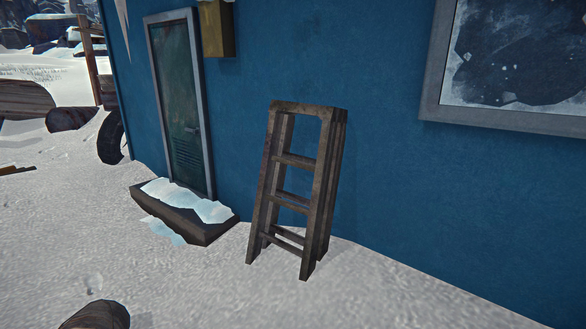

# Ladder

**Ladder**

| Property | Details |
| --- | --- |
|  |  / *Ladder.jpg* |
| **General** |  |
| Item Type | Item |
| Wintermute | Yes\|} A **Ladder** is a wooden ladder and interactable object found in many industrial areas. It can be harvested with a [Hatchet](./Hatchet.md) for 1 hour 18 minutes for 6 [Reclaimed Wood](./Reclaimed%20Wood.md) and burns 234 calories. Larger, extended wooden ladders cannot be harvested, only the small folded up ones can. / \| Reclaimed Wood \| Time \| Calories \| Condition of Tool \| / \| --- \| --- \| --- \| --- \| / \| 6 \| 1 hour 18 minutes \| 234 \| -2% Hatchet \| / \| 6 \| 1 hour 41 minutes \| 304 \| -3% Improvised Hatchet \| / \| 6 \| 1 hour 57 minutes \| 351 \| -0.5% Heavy Hammer \| / **Lua execution error in Module:Navbox function navbox** |
| Reclaimed Wood | Time / Calories / Condition of Tool |
| 6 | 1 hour 18 minutes / 234 / -2% Hatchet |
| 6 | 1 hour 41 minutes / 304 / -3% Improvised Hatchet |
| 6 | 1 hour 57 minutes / 351 / -0.5% Heavy Hammer |
