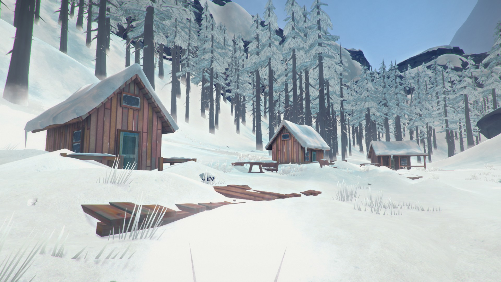
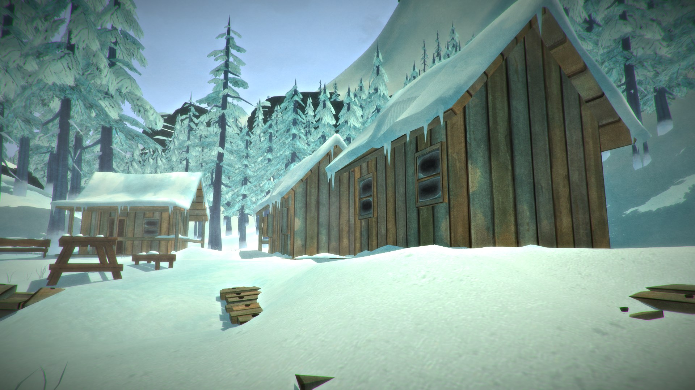

# Lake Cabins

**Categories:** Indoor locations, Locations, Locations in Mystery Lake, Residential locations · **Source:** [Fandom](https://thelongdark.fandom.com/wiki/Lake_Cabins)

**Contents**

- [Overview](#overview)
- [Common Loot](#common-loot)
- [Notes](#notes)
- [Gallery](#gallery)

**Lake Cabins**

_Lake\_cabin4.jpg_

**Location**

**Region:** [Mystery Lake](./Mystery%20Lake%20%28region%29.md)

**Description:** A small group of cabins.

**General**

**Type:** Residential

Has an interior **Lake Cabins** is an unmarked location [Mystery Lake](./Mystery%20Lake%20%28region%29.md).

## Overview

The lake cabins are located along the southern shore of [Mystery Lake](./Mystery%20Lake%20%28location%29.md). The cabins can be looted for a moderate number of items. They also provide good protection from the elements. Each cabin has a [bunk bed](./Bed.md), and a couple containers

Each of the cabins had a chance of being "ruined" in which their roofs will have collapse and they will be inaccessible. The cabins that are inaccessible varies between each game saves. Difficulty can affect how many of the cabins are ruined, with a max of 5/6 being ruin-able

Beware of [wolves](./Wolf.md) that commonly patrol north of the cabins, and wolves that may wander in from the lake.

## Common Loot

- Assorted [Food And Drink](./Food%20And%20Drink.md)
- [Clothes](./Clothing.md)
- [Fire](./Fire.md) starting materials (e.g., matches, [accelerant](./Accelerant.md), tinder)
- A [hatchet](./Hatchet.md) can be found near a backpack by the second set of lake cabins

## Notes

- In episode 2 of story mode, two of the accessible Lake Cabins (as well as the [Lone Lake Cabin](./Lone%20Lake%20Cabin.md)) need a key to be unlocked.

## Gallery

_The interior of a cabin_

_The old cabin exteriors_
