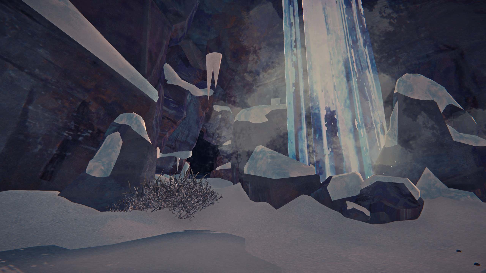
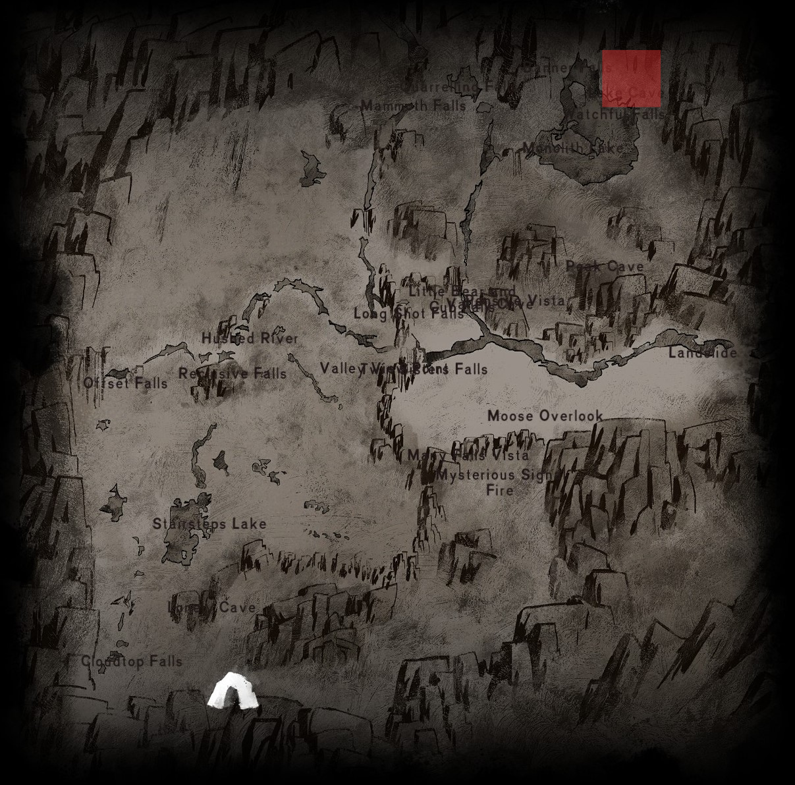

# Lake Cave

**Categories:** Caves, Locations, Locations in Hushed River Valley, Sheltered locations · **Source:** [Fandom](https://thelongdark.fandom.com/wiki/Lake_Cave)

**Lake Cave**

_Lake\_Cave.jpg_

**Location**

_Lake\_Cave\_Location.png_

**Region:** [Hushed River Valley](./Hushed%20River%20Valley.md)\|-

**Description:** A small cave on the shore of [Monolith Lake](./Monolith%20Lake.md).

**General**

**Type:** Cave\|-
