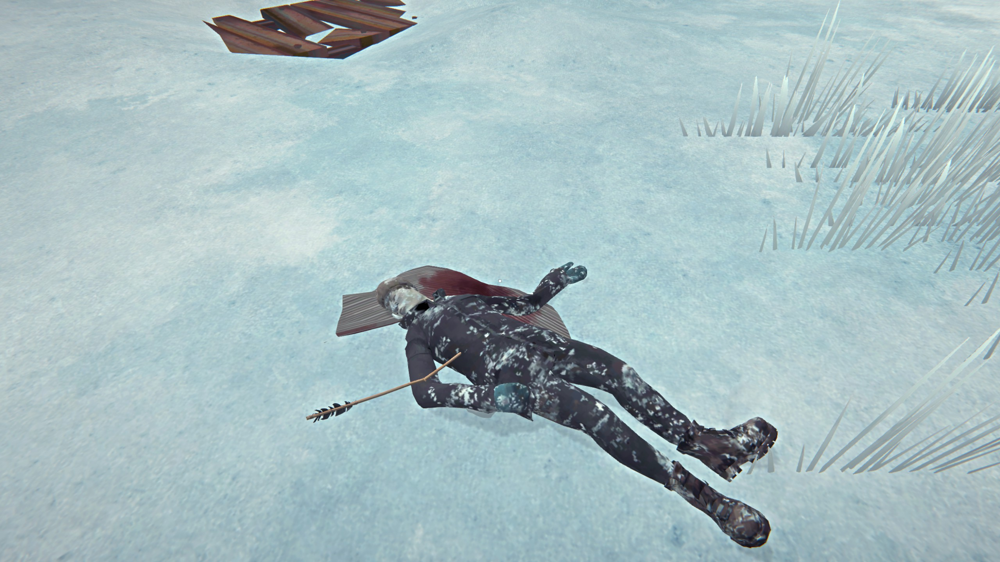

# Lake Gunshots

**Categories:** Episode 2, Pages with update history · **Source:** [Fandom](https://thelongdark.fandom.com/wiki/Lake_Gunshots)

**Contents**

- [Unlocking](#unlocking)
- [Objectives](#objectives)
- [Walkthrough](#walkthrough)
- [Redux Transcript](#redux-transcript)
- [Predux Transcript](#predux-transcript)
- [Trivia](#trivia)
- [Game History](#game-history)

**Lake Gunshots**

| Property | Details |
| --- | --- |
|  | [Lake cabin4](../assets/Lake_cabin4.jpg) |
| Episode | [Episode 2](./Episode%202%20-%20Luminance%20Fugue.md) |
| **Missions** |  |
| Current | Lake Gunshots |
| Region | [Mystery Lake](./Mystery%20Lake%20%28disambiguation%29.md) |
| Characters | [Forest Talkers](./Forest%20Talkers.md) |

**Template:spoiler**

> “**You found a note with some details on possible Forest Talker activity around Mystery Lake.**”
>
> — In-game description

**Lake Gunshots** is a side mission in [Episode 2](./Episode%202%20-%20Luminance%20Fugue.md) of the [Wintermute](./Wintermute.md). In this mission, [Mackenzie](./Will%20Mackenzie.md) investigates the [Forest Talkers](./Forest%20Talkers.md).

## Unlocking

The Quest is unlocked by finding a note [Crumpled Note (2)](./Crumpled%20Note%20%282%29.md) in the [Maintenance Yard](./Maintenance%20Yard.md) in the [Broken Railroad](./Broken%20Railroad.md) region.

## Objectives

- Head to the far side of Mystery Lake, near the cabins.
- Follow the trail of blood.
- Find the supply bag in the [Logging Camp](./Logging%20Camp.md) trailer.
- Go to the dam and retrieve the documents. Search under a [Loose Tile](./Loose%20Tile.md) at the bottom of the stairs leading to the admin area.
- Return to the Forest Talker in the lake cabin.
- Check on the lake cabin tomorrow.

## Walkthrough

- Head to the far side of [Mystery Lake](./Mystery%20Lake%20%28location%29.md), near the cabins.
- You will find a corpse on the ice. Follow the trail of blood to a cabin.
- Speak to the Forest Talker behind the door and Mackenzie will offer to help him.
- Pick up the [Logging Camp Trailer Key](./Logging%20Camp%20Trailer%20Key.md) and find the [Forest Talker Supplies](./Forest%20Talker%20Supplies.md) in the [Logging Camp](./Logging%20Camp.md) trailer.
- Go to the [Dam](./Carter%20Hydro%20Dam.md) and retrieve the [Forest Talker Documents](./Forest%20Talker%20Documents.md). Search under a loose tile at the bottom of the stairs leading to the admin area.
- Return to the Forest Talker in the Lake Cabin.
- You will face a choice determining your reward. Take the ammo (2 [Rifle Ammunition](./Rifle%20Ammunition.md)) and leave the supplies or just leave the supplies.
- Check on the Lake Cabin tomorrow.
- If you choose to take ammo out, the Forest Talker will die and will have [Blood Soaked Forest Talker Documents](./Blood%20Soaked%20Forest%20Talker%20Documents.md) on him. Otherwise, you will get new [Deerskin Pants](./Deerskin%20Pants.md). Both outcomes always leave a [Forest Talker Note](./Forest%20Talker%20Note.md) for Mackenzie inside the cabin, but with a different message depending on what choice you made.

## Redux Transcript

_Mackenzie heads to the lake cabins after reading the Crumpled Note, and finds crows flying over the lake ice, circling a body with blood all around it._

Mackenzie: "Shit...looks like someone found trouble."

_A trail of fresh blood leads away from the man's corpse, suggesting another Forest Talker is nearby. The blood trail leads to a locked cabin door. Mackenzie interacts with the door and hears a voice._

Forest Talker: "Just...leave me alone. I'm not opening the door for anyone.

Mackenzie: "It's ok...I'm not here to take anything from you. Are you with the Forest Talkers?"

Forest Talker: "I am... but I'm not letting you in, they killed my friend. How do I know you aren't one of them?"

Mackenzie: "You don't, but I'm not. Name's Mackenzie. And I'm way too stubborn to just leave you out here all by yourself. You'll have to trust me."

Forest Talker: "Seems like I don't have much of a choice. We left most of our supplies at the old Logging Camp while we fished here. Can you get them for me?"

Mackenzie: "I can try."

Forest Talker: "There's more. In that abandoned dam...we found evidence that proves there shouldn't be logging in Mystery Lake. I need that evidence. Documents nobody wanted to be found. We hid them until we could retrieve them. Under a floor tile at the bottom of the stairwell. If you could help me get the documents back...wow, it would be a huge win for the environment. If you care about, you know, living in the world."

Mackenzie: "I have a feeling "the world" has bigger problems right now, but I'll see what I can do."

Forest Talker: "Here's the key to the trailer where we stashed our supplies. I'll slide it under the door."

_Mackenzie takes the key out of the snow in front of the door. If the player checks the door again before finishing the Forest Talker's tasks, this exchange occurs:_

Forest Talker: "Did you find our stuff yet? The supplies? And the documents? I need them both."

Mackenzie: "I'm working on it."

_Mackenzie heads to the [Logging Camp](./Logging%20Camp.md), and unlocks a door with the key, taking the [Forest Talker Supplies](./Forest%20Talker%20Supplies.md). Then he heads to the Carter Hydro Dam and finds the Loose Tile mentioned, and finds the [Forest Talker Documents](./Forest%20Talker%20Documents.md)._

Mackenzie: "There you are."

_He heads back to the cabin by the lake, and speaks to the man again._

Mackenzie: "I've got your supplies and those documents you wanted here."

Forest Talker: "Hey...that's great. Thank you. But...I hope you understand if I ask you to just leave them outside the door."

_Two options appear on the screen. Choosing to take the man's ammo will have consequences later._

**White Dialogue**

- DROP SUPPLIES
- DROP SUPPLIES (TAKE AMMO)

Mackenzie: "Right. I'll...uh...leave it all here for you, just like you asked.

Forest Talker: "Thank you, stranger. You may not care, but you've made a huge difference to our cause."

_Mackenzie leaves the Forest Talker backpack by the door. If the player interacts with the door before tomorrow, this exchange occurs:_

_Mackenzie: "Hey! You still alive in there?"_

_Forest Talker: "Yeah...I'm still weak. Going to rest up here, until I'm ready to move on."_

_Mackenzie leaves the area, perhaps sleeping the day away in the other nearby cabin. When he returns, the lake cabin the Forest Talker was in is empty, and the door open. Mackenzie walks inside._

Mackenzie: "Let's see if he left anything useful."

_The Forest Talker left a note on the table, thanking Mackenzie for his help, along with a [Deerskin Pants](./Deerskin%20Pants.md)._

_If the player instead took the man's ammo, Mackenzie will see the corpse of the Forest Talker the next day dead on the ground outside the cabin with an arrow through him. It is presumed that whomever wrote the Crumpled Note, a [Breyerhouse](./Breyerhouse.md) worker, came to finish the Forest Talker off like his friend. The note inside will be angrier, with no Deerskin pants._

## Predux Transcript

> “**Jeremiah says he heard gunshots from across Mystery Lake. Could it have something to do with the Forest Talkers?**”
>
> — In-game description

There are a few differences in the script in the Predux version of this game.

_Mackenzie heads to the lake cabins after [Jeremiah](./Jeremiah.md) mentions hearing gunshots by the lake_

- FOREST TALKERS?

Mackenzie (Text): "When I was out there...I came across mention of the Forest Talkers". (sic) You know anything about that?"

Jeremiah (Text): "Oh yeah, I know all about the Talkers."

Mackenzie (Text): "What are they? Some kind of band? Or cult?"

Jeremiah (Text): "Nothing like that. Eco-activists. Terrorists, some call them. They've been fighting for years, against further exploitation of Great Bear."

Mackenzie (Text): "So...are they dangerous?"

Jeremiah (Text): "Not usually...they'll spike the occasional tree. Tie themselves to logging or mining equipment in protest. Don't think they've ever hurt anyone. But I'm not really up to date on current events."

Mackenzie (Text): "So, terrorists, or activists. Which is it?"

Jeremiah (Text): "Depends on your perspective, I guess. I try to stay out of politics. One thing's for sure - - they've been doing a lot more than just talking lately."

Mackenzie (Text): "What do you mean?"

Jeremiah (Text): "Few nights ago, heard a lot of shooting coming from the other side of the Lake. Could have been hunters I guess, but they aren't usually up this time of year."

Mackenzie (Text): "You think it was the Forest Talkers?"

Jeremiah (Text): "No idea. For their sake, I hope they got the hell out of the area before things got shut down. It won't be good for them, with Old Bear out there, and angry."

_After the conversation, Mackenzie heads to Mystery Lake and finds crows flying over the lake ice, circling a body with blood all around it._

Mackenzie: "Shit...looks like someone found trouble."

_A trail of fresh blood leads away from the man's corpse, suggesting another Forest Talker is nearby. The blood trail leads to a locked cabin door. Mackenzie interacts with the door and hears a voice._

Forest Talker (Text): "Leave me alone!"

Mackenzie (Text): "Its OK, I'm a friend. Are you part of the Forest Talkers?"

Forest Talker (Text): "I am...but I'm not letting you in, they killed my friend...I'm hurt... and scared."

Mackenzie (Text): "Maybe I can help?"

Forest Talker (Text): "Can you get my supplies? We were staying at the logging camp, we left most of our supplies there while we fished."

Mackenzie (Text): "Ok, anything else?"

Forest Talker (Text): "We'd discovered uncovered(sic) important documents in the Dam might have some relevance to whats(sic) happening here...were(sic) going to take our leader up north. We hid them, maybe you can get them? They're hidden under a lose(sic) tile at the bottom of the stair well in the Dam. Maybe with your help I can complete my mission her afterall!"

Mackenzie (Text): "I'll see what I can do."

Forest Talker (Text): "Here's the key to the trailer. I'll slide it under the door."

_Mackenzie takes the key out of the snow in front of the door. If the player checks the door again before finishing the Forest Talker's tasks, this exchange occurs:_

Forest Talker (Text): "You got my stuff yet?"

Mackenzie (Text): "I'm working on it..."

_Mackenzie heads to the [Logging Camp](./Logging%20Camp.md), and unlocks a door with the key, taking the [Forest Talker Supplies](./Forest%20Talker%20Supplies.md). Then he heads to the Carter Hydro Dam and finds the Loose Tile mentioned, and finds the [Forest Talker Documents](./Forest%20Talker%20Documents.md)._

Mackenzie : "There you are."

_He heads back to the cabin by the lake, and speaks to the man again._

Mackenzie (Text): "I've got your supplies and those documents you wanted here."

Forest Talker (Text): "Thank you so much! Just leave them outside the door."

_Two options appear on the screen. Choosing to take the man's ammo will have consequences later._

- DROP SUPPLIES
- DROP SUPPLIES (TAKE AMMO)

Mackenzie (Text): "Umm... here you go."

Forest Talker (Text): "Hoping I'll be able to make a move tomorrow. Thanks for the help!"

_Mackenzie leaves the Forest Talker backpack by the door. If the player interacts with the door before tomorrow, this exchange occurs:_

Mackenzie (Text): "you still in there?"

Forest Talker (Text): "Yes... Trying to get some rest before I head off."

_Mackenzie leaves the area, perhaps sleeping the day away in the other nearby cabin. When he returns, the lake cabin the Forest Talker was in is empty, and the door open. Mackenzie walks inside._

Mackenzie: "Let's see if he left anything useful."

_The Forest Talker left a note on the table, thanking Mackenzie for his help, along with a [Deerskin Pants](./Deerskin%20Pants.md)._

_If the player instead took the man's ammo, Mackenzie will see the corpse of the Forest Talker the next day dead on the ground outside the cabin with an arrow through him. It is unknown who killed him and his friend on the ice. The note inside will be angrier, with no Deerskin pants._

## Trivia

The Forest Talker is voiced by Brian Drummond in the Redux.

It is presumed that if the player takes the Forest Talker's ammo, the assailant that kills him takes the activist's hunting rifle, hence why one is never found. If the player leaves the ammo, the Forest Talker safely drives the assailant off, though no casings are found in the snow.

## Game History

- UPDATE **1 August 2017 ([Update](./The%20Long%20Dark%20%E2%80%94%20Changelog%20%E2%80%94%20Archive%201.md#1.00)):**
  - Added to game.
- UPDATE **17 December 2018 ([Update](./The%20Long%20Dark%20%E2%80%94%20Changelog%20%E2%80%94%20Archive%201.md#1.41)):**
  - The note [Crumpled Note (2)](./Crumpled%20Note%20%282%29.md) must be found to activate the side mission as part of the Redux edition. Previously, it was given after talking to [Jeremiah](./Jeremiah.md) during the mission [Survival School (Predux)](./Survival%20School%20%28Predux%29.md)
