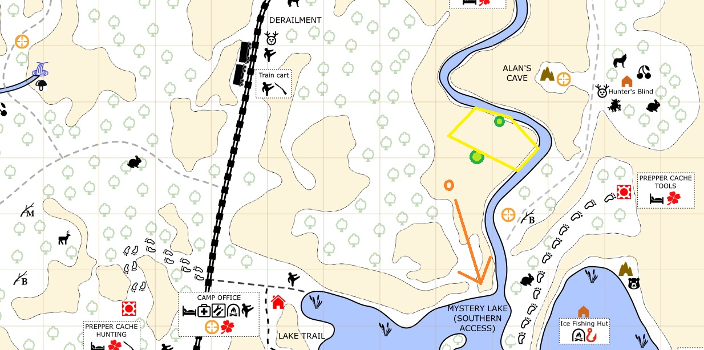
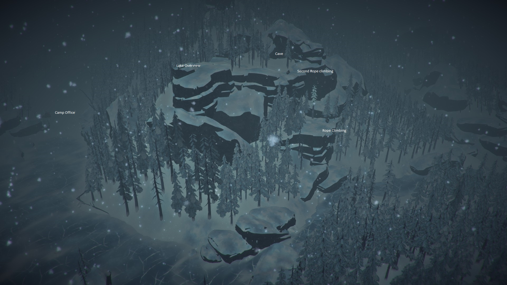
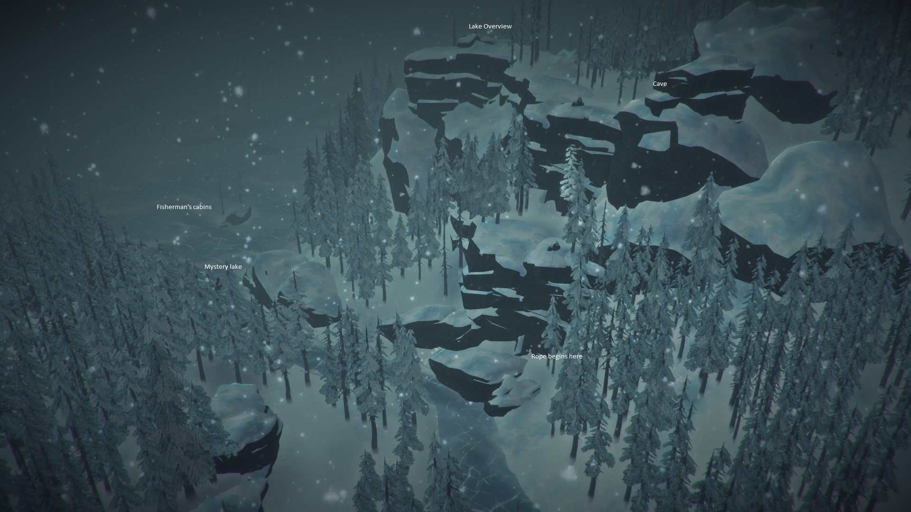

# Lake Overlook

**Categories:** Locations, Locations in Mystery Lake, Outdoor locations, Sheltered locations · **Source:** [Fandom](https://thelongdark.fandom.com/wiki/Lake_Overlook)

**Lake Overlook**

[Mystery Lake Overlook](../assets/Mystery_Lake_Overlook.jpg)

**Location**

[Lake Overlook Location](../assets/Lake_Overlook_Location.png)

**Region:** [Mystery Lake](./Mystery%20Lake%20%28region%29.md)

**Type:** Outdoors

## Overview

This location includes a cave and a spot which overlooks [Mystery Lake (location)](./Mystery%20Lake%20%28location%29.md). There is a [Rabbit](./Rabbit.md) grove as well as [Old Man's Beard Lichen](./Old%20Man%27s%20Beard%20Lichen.md) near the cave and a [Deer Carcass](./Deer%20Carcass.md) may be found near the ledge. Inside the cave there may be a [body](./Frozen%20Corpse.md) along with firewood and assorted items, including a possible revolver. The Lake Overlook is a possible Mystery Lake vista location.

This can be a very useful location for fighting Cabin Fever in Interloper if the player uses [Camp Office](./Camp%20Office.md) as [Safe House](./Safehouse.md), as the cave provides a warmth bonus. Furthermore, the rabbit grove is far from any predators, and the deer carcass can also be harvested relatively safely.

## Access

_Green are rope climb spots, orange area outlines accessible area after the first climb, orange circle is the entrance to the cave, the arrow points the direction to location discovery._ The most direct route to reach the location is to climb two ropes up from near Mystery's Lake's southern access (along the river). There is a camping spot on the ledge between the two climbs. The other ways to reach the location involve hiking, either up through the forest opposite the Camp Office, or along the ridge from the direction of the Log Sort.  

## Trivia

It is assumed it was added with the Tireless Menace update, since it was discovered as late as 16 May 2016.
