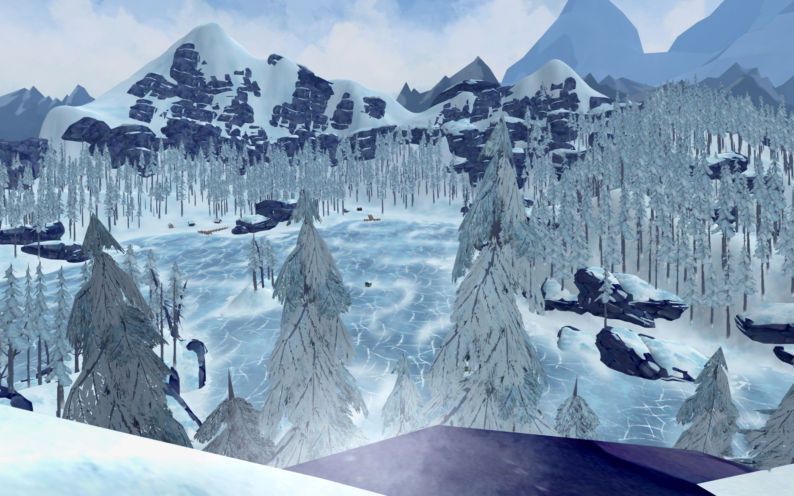
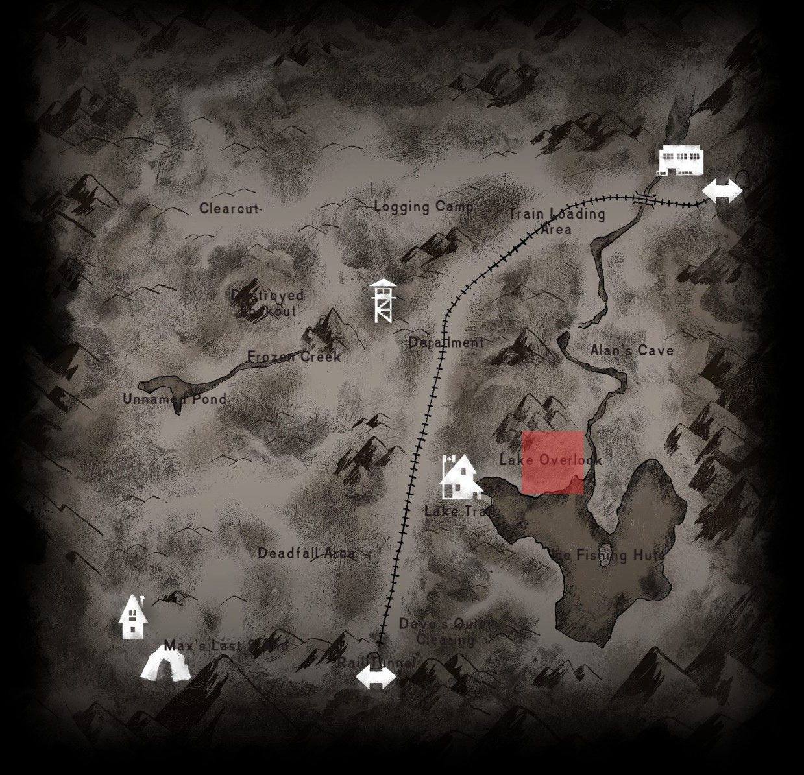

# Lake Overlook

**Lake Overlook**

| Property | Details |
| --- | --- |
|  |  / *Mystery\_Lake\_Overlook.jpg* |
| **Location** |  |
|  |  / *Lake\_Overlook\_Location.png* |
| Region | [Mystery Lake](./Mystery%20Lake%20%28region%29.md)\|- |
| Type | Outdoors\|- |
