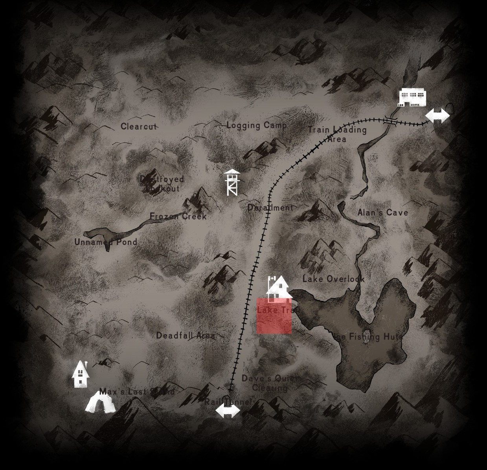

# Lake Trail

**Lake Trail**

| Property | Details |
| --- | --- |
|  |  / *Entrance to the lake trail* |
| **Location** |  |
|  |  / *Lake\_Trail\_Location.png* |
| Region |  |
| Location | Behind the Camp Office |
| Description | A winding pathway between two cliffs |
| **General** |  |
| Type | Outdoors\|- |
