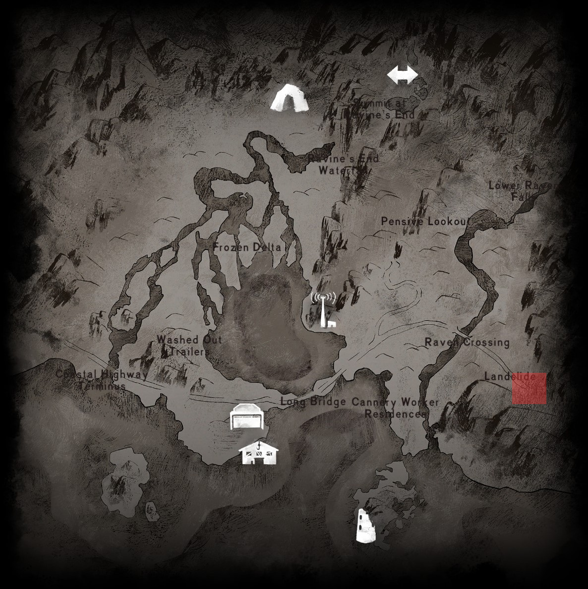

# Landslide \(Bleak Inlet\)

**Landslide (Bleak Inlet)**

| Property | Details |
| --- | --- |
|  | \[Missing image: Landslide\_Bleak\_Inlet.jpg\] / *Landslide\_Bleak\_Inlet.jpg* |
| **Location** |  |
|  |  / *Landslide\_Bleak\_Inlet\_Location.png* |
| Region | [Bleak Inlet](./Bleak%20Inlet.md)\|- |
| **General** |  |
| Type | Landmark\|- |
