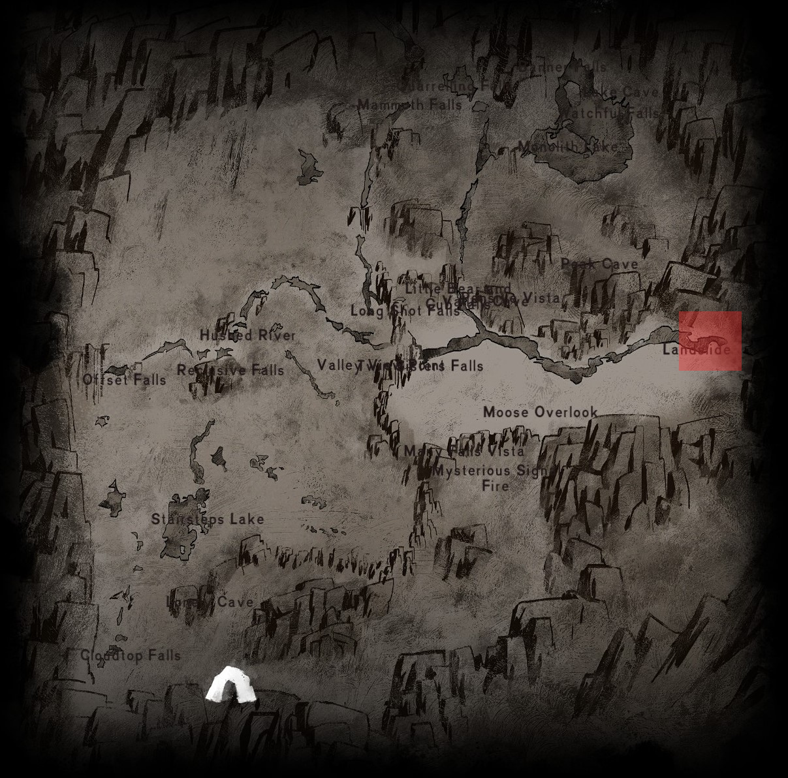

# Landslide \(Hushed River Valley\)

**Landslide**

| Property | Details |
| --- | --- |
|  |  / *Landslide\_HRV.png* |
| **Location** |  |
|  |  / *Landslide\_HRV\_Location.png* |
| Region | [Hushed River Valley](./Hushed%20River%20Valley.md)\|- |
| Description | A landslide across the river. |
| **General** |  |
| Type | Outdoors\|- |
