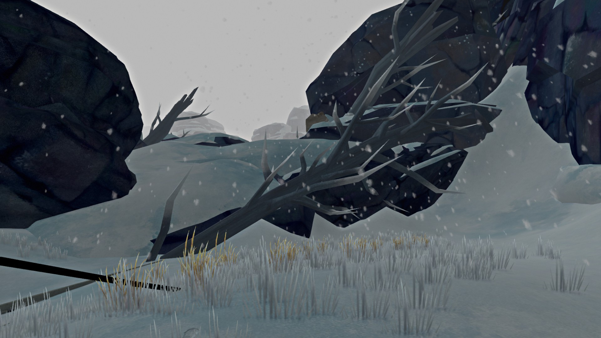

# Landslide

**Categories:** Landmarks, Locations, Locations in Broken Railroad, Outdoor locations · **Source:** [Fandom](https://thelongdark.fandom.com/wiki/Landslide)

**Landslide**

\[\[File: /  / _Front Side_ /  / _Back Side_

250px\]\]

**Location**

_Landslide\_Location.png_

Region

[Broken Railroad](./Broken%20Railroad.md)

Location

**Description:** A landslide blocking the railroad

**General**

**Type:** Landmark

## Overview

The Landslide blocks the train tracks, forcing the player to go into the nearby frozen pond and over a tree bridge to get around it entering Broken Railroad. The nearby lower pond often contains a [Wolf](./Wolf.md) hunting [Rabbits](./Rabbit.md). However, when exiting Broken Railroad, the player can climb over the landslide, saving time and [Fatigue](./Fatigue.md).

Contrary to a first glance, the Landslide can be bypassed by simply walking up to the rocks and walking over it, saving time from having to go into the nearby pond.
