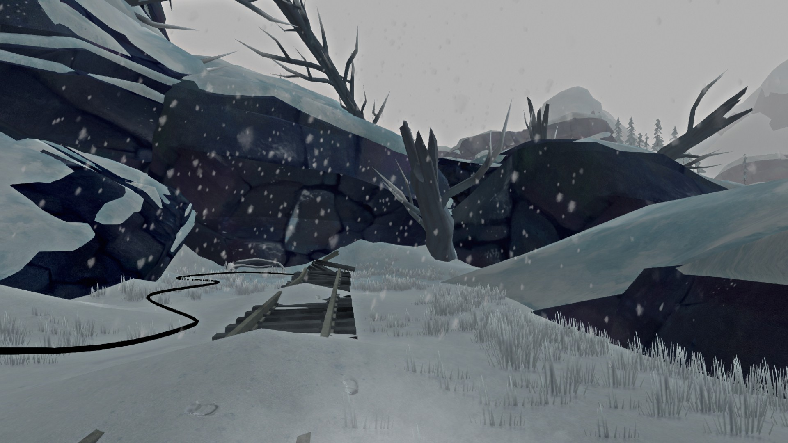
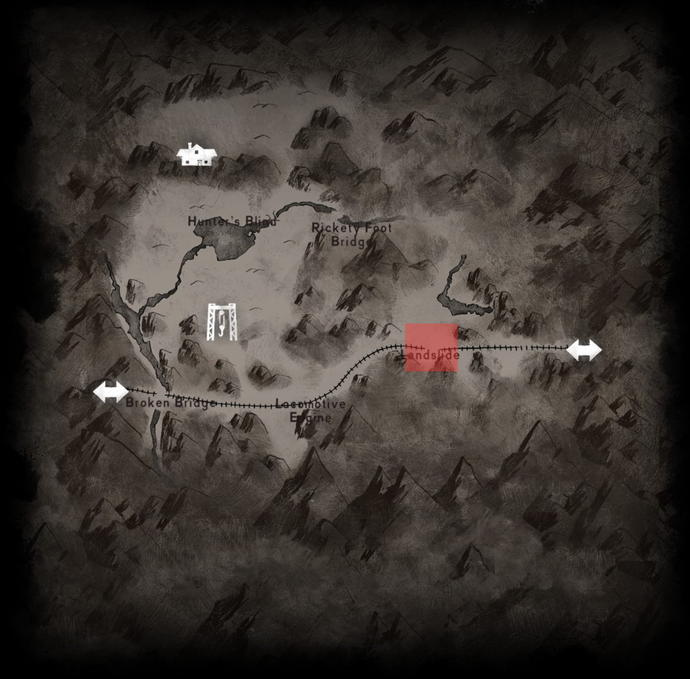

# Landslide

**Categories:** Landmarks, Locations, Locations in Broken Railroad, Outdoor locations · **Source:** [Fandom](https://thelongdark.fandom.com/wiki/Landslide)

**Landslide**

\[\[File: /  / _Front Side_ /  / _Back Side_

250px\]\]

_Front Side_

_Back Side_

**Location**

_Landslide\_Location.png_

Region

[Broken Railroad](./Broken%20Railroad.md)

Location

**Description:** A landslide blocking the railroad

**General**

**Type:** Landmark
