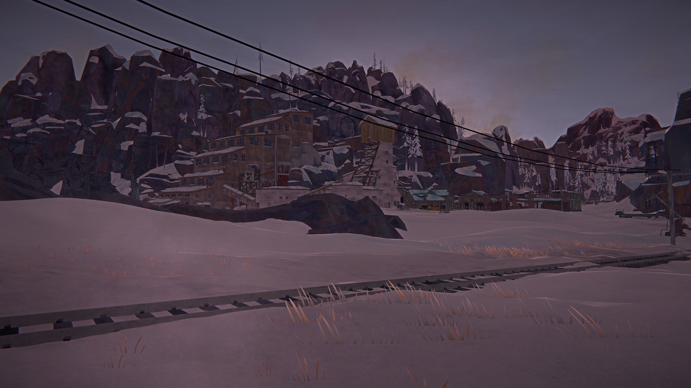

# Langston Mine

**Langston Mine**

| Property | Details |
| --- | --- |
|  |  / *Langston\_Mine\_Outside\_Buildings.png* |
| **Location** |  |
|  |  / *Langston\_Mine\_Location.png* |
| Region | [Zone of Contamination](./Zone%20of%20Contamination.md)\|- |
|  / *bed\_icon.png* |  |
|  / *workbench\_icon\_green.png* | Has a workbench\|- |
