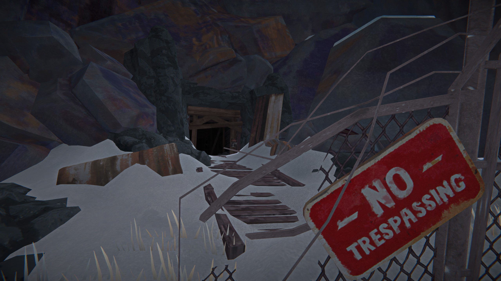
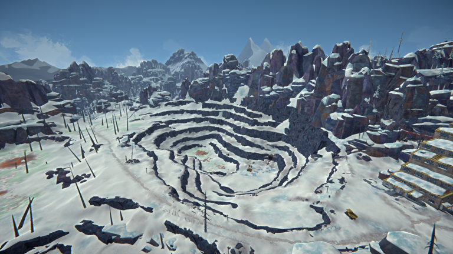
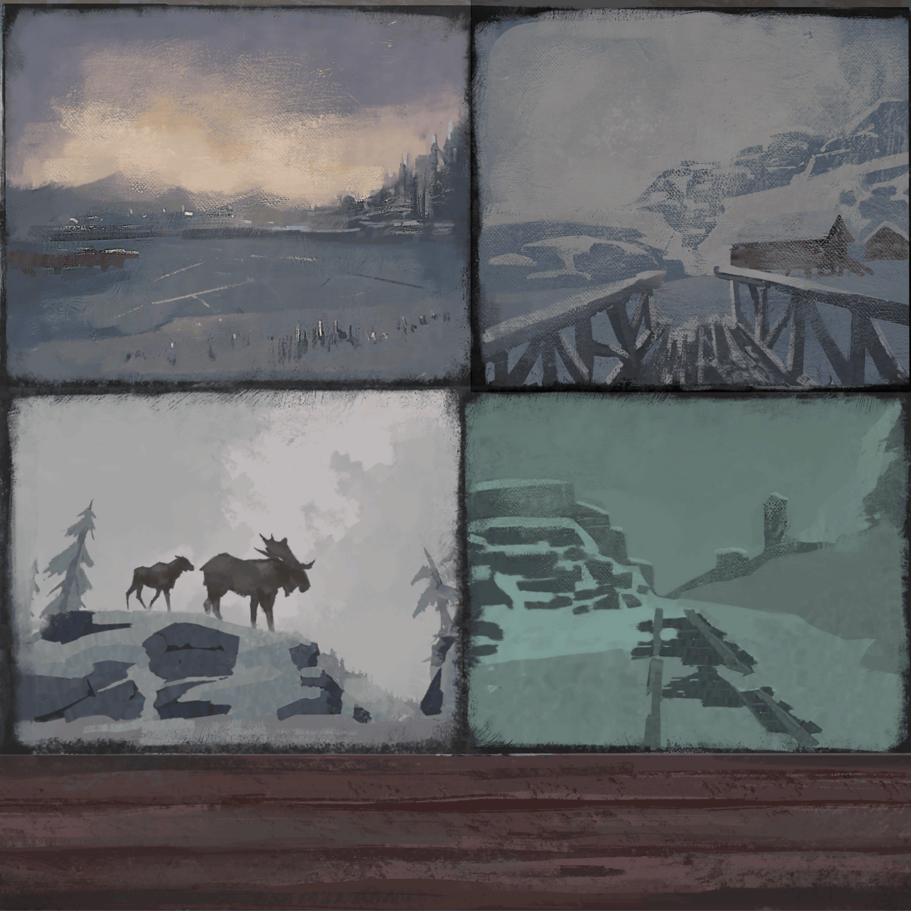

# Langston Mine

**Categories:** Indoor locations, Locations, Locations in Zone of Contamination, Locations with a workbench · **Source:** [Fandom](https://thelongdark.fandom.com/wiki/Langston_Mine)

**Contents**

- [Overview](#overview)
- [Entrances](#entrances)
- [Levels](#levels)
- [Mountainside Passage](#mountainside-passage)
- [Level 1](#level-1)
- [Level 2](#level-2)
- [Level 3](#level-3)
- [Achievements](#achievements)
- [Gallery](#gallery)

**Langston Mine**

**Location**

**Region:** [Zone of Contamination](./Zone%20of%20Contamination.md)

Has a workbench

## Overview

Due to the extreme length and dangers of the mine, it is advised to prepare oneself for exploration by:

- Bringing extra light sources such as [Flares](./Flare.md), a [Flashlight](./Flashlight.md), a [Torch](./Torch.md), or [Storm Lantern](./Storm%20Lantern.md) to avoid being trapped in the darkness.
- Bringing a [Respirator](./Respirator.md) and a light stockpile of [Canisters](./Canister.md), which is a must for passing through certain areas of the mine in order to avoid [Suffocation](./Suffocation.md). While many polluted areas of the mine can be quickly sprinted through to avoid dying, some areas cannot be thoroughly explored without a reliable source of oxygen.
- Leaving behind heavy weapons and tools to aid mobility, as there are no predators skulking the tunnels.
- Having a Flashlight to see further ahead than a Storm Lantern during an [Aurora](./Aurora.md)/[Glimmer Fog](./Glimmer%20Fog.md) event; this can often make traveling the mines much easier.
- Leaving behind [Jerry Cans](./Jerry%20Can.md), [Emergency Stims](./Emergency%20Stim.md), and the bulk of one's Canisters, as these are quite plentiful on all floors of the Mine.
- Using [Spray Paint](./Spray%20Paint.md) to create directional arrows as well as lighting [Lanterns](./Lantern.md) occasionally found throughout the walls of the mine, which can provide valuable points of reference to avoid getting lost when exploring.
- Bringing a [Bedroll](./Bedroll.md) if you wish to rest in other parts of the mine. If not, there is one bed in the mine near the third level of the elevator.
- [Campfires](./Campfire.md) cannot be started in the mine, but [Fire Barrels](./Fire%20Barrel.md) can be found at various places to cook food.

## Entrances

The mine itself has 4 levels and 7 entrances:

- A mountainside entrance near the 6th floor of the [Concentrator](./Concentrator.md) (locked but can be opened as part of Buried Echoes)
- The Elevator shaft in the [Headframe Building](./Headframe%20Building.md) has 3 entrances that lead to Levels 1, 2, and 3
- A conveyor in the [Conveyor Room](./Conveyor%20Room.md) leads to Level 1
- An entrance to level 3 in the open pit mine
- An entrance to Level 3 is near [Miner's Footpath](./Miner%27s%20Footpath.md)

## Levels

The levels in the mine are numerous, large and confusing. It is very easy to find yourself trapped or running in circles. Levels may be further split into different isolated sections.

[Fire Barrels](./Fire%20Barrel.md) and [Lanterns](./Lantern.md) can be found scattered around the tunnels and caverns, usually at junctions.

### Mountainside Passage

This "Level" is only opened as part of the Tale Buried Echoes Tale. It has two entry points, one from the locked gate in the mountainside entrance near the 6th floor of the Concentrator, and the other via a locked gate on Level 1 below the Conveyor Room.

The key to the mountain entrance can be found deeper in Level 3 after progressing the Buried Echoes. The lower entrance can be unlocked **after** completing the Tale.

### Level 1

Level 1 is accessible from the elevator shaft of the Headframe Building and via the conveyor from the [Conveyor Room](./Conveyor%20Room.md).

When coming from the elevator and keeping to the left, a small cabin can be found. Inside is a locked lockbox that can be opened with a [Mine Lockbox Key](./Mine%20Lockbox%20Key.md). The key can be looted from a corpse found on the same level, but you will need to navigate through toxic gas to reach it. The lockbox contains cash and a [Gold Nugget](./Gold%20Nugget.md).

### Level 2

Level 2 is only accessible from the elevator shaft of the headframe building. This level is characterized by a large crushing machine, presumably used to crush chunks of rock to extract uranium ore/Coal. The area around it has a [Fire Barrel](./Fire%20Barrel.md) and a [Work Bench](./Work%20Bench.md). An accessible (but one-way) chute leads down from the bottom of the machine into Level 3.

### Level 3

This is the bottom floor of the mine, and by far the largest accessible level.

There are 3 entrances: from the elevator of the Headframe Building, from the open pit mine, and from Miner's Footpath.

Close to the entrance from Miner's Footpath there is a short rope climb that blocks the path into the mine. This section of the mine has several wooden bridges suspended over deep chasms. The survivor needs to watch their step here, as a fall will result in death. Further on, Wooden [Planks](./Planks.md) block the path to the rest of the mine, and need to be broken down with a [Hatchet](./Hatchet.md) or a [Heavy Hammer](./Heavy%20Hammer.md) in order to proceed.

In the center of the level, where the chute from level 2 ends, is another cavern. The cavern contains a Fire Barrel, Lantern and a locked room. This room is the mining office, which can be unlocked with the [Mine Office Key](./Mine%20Office%20Key.md). On lower difficulties, a [Hunting Rifle](./Hunting%20Rifle.md) with ammo and other supplies can be found inside. On Interloper, the rifle will be replaced by a [Distress Pistol](./Distress%20Pistol.md) with several shells.

The cavern around the elevator has many walkways with several mining cabins with good loot. One of the unlocked cabins contains a bed. The area also has a [Work Bench](./Work%20Bench.md) and [Fire Barrel](./Fire%20Barrel.md).

West of the main elevator is large cavern with a skylight and a chemical pool at the bottom. Continuing along the walkway will take you to a cavern with two gates, one of which is locked; it can be opened by using the [Bolt Cutters](./Bolt%20Cutters.md) after having progressed enough through Buried Echoes.

Continuing further through more toxic gas will bring you across some [Supply Bins](./Supply%20Bin.md) and two corpses. The corpse in the section with the low ceiling carries the [Mine Office Key](./Mine%20Office%20Key.md). You can continue further into a crawlspace to reach the pit entrance.

## Achievements

-  [Too Greedily, too Deep](./Too%20Greedily%2C%20too%20Deep.md)

## Gallery

_A photo of the Langston Mine in the [Vacant Depot](./Vacant%20Depot.md) in [Transfer Pass](./Transfer%20Pass.md)_

