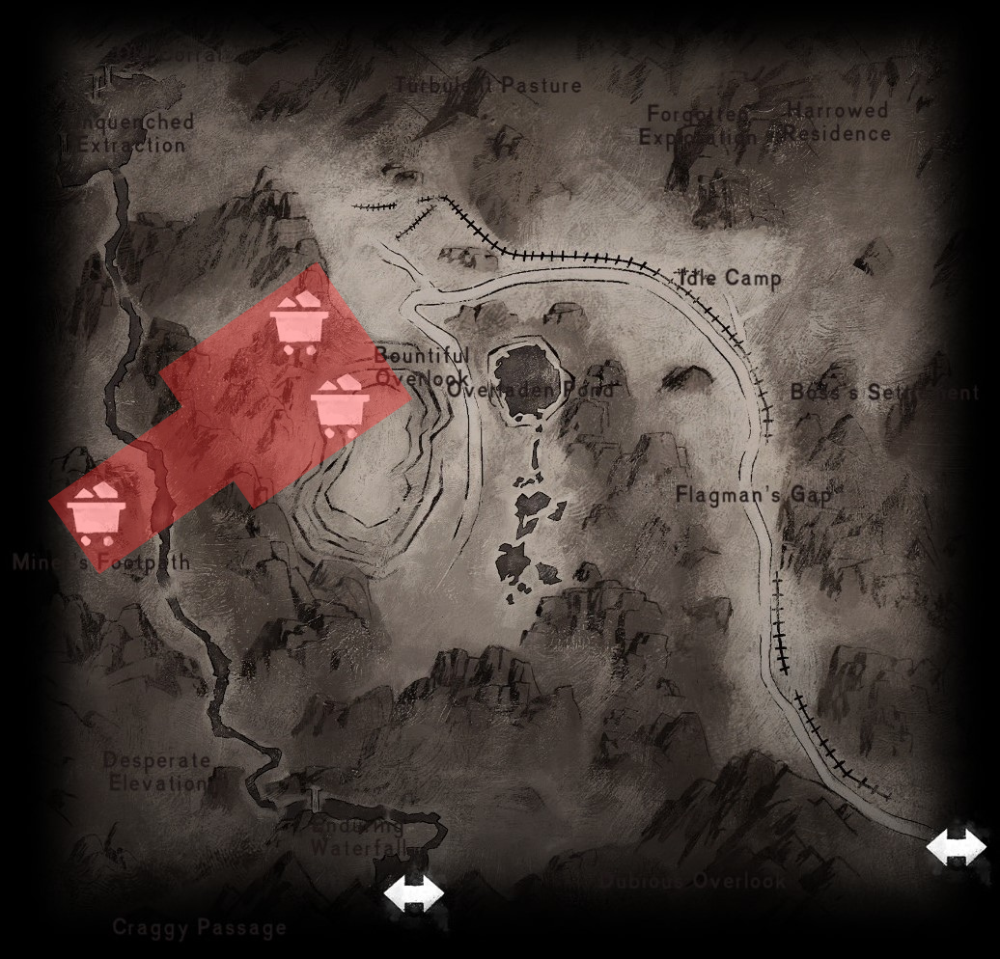

# Langston Mine

**Categories:** Indoor locations, Locations, Locations in Zone of Contamination, Locations with a workbench · **Source:** [Fandom](https://thelongdark.fandom.com/wiki/Langston_Mine)

**Langston Mine**

| Property | Details |
| --- | --- |
|  |  / _Langston\_Mine\_Outside\_Buildings.png_ |
| **Location** |  |
|  |  / _Langston\_Mine\_Location.png_ |
| Region | [Zone of Contamination](./Zone%20of%20Contamination.md)\|- |
|  / _bed\_icon.png_ |  |
|  / _workbench\_icon\_green.png_ | Has a workbench\|- |
