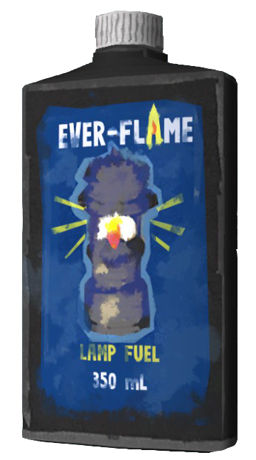

# Lantern Fuel

**Contents**

- [Overview](#Overview)
- [Obtaining](#Obtaining)
- [Products](#Products)
- [Gallery](#Gallery)
- [Trivia](#Trivia)

<table class="infobox">
<caption>Lantern Fuel</caption>
<colgroup>
<col style="width: 50%" />
<col style="width: 50%" />
</colgroup>
<tbody>
<tr>
<td colspan="2"><figure>

<figcaption>Lantern_Fuel_icon.png</figcaption>
</figure></td>
</tr>
<tr>
<td colspan="2" class="section">
<strong>General</strong>
</td>
</tr>
<tr>
<td>
Item Type
</td>
<td>
Fire Starting|-
</td>
</tr>
<tr>
<td>
Renewable
</td>
<td>
Yes
</td>
</tr>
<tr>
<td>
Firestarting Slot
</td>
<td>
Accelerant
</td>
</tr>
<tr>
<td colspan="2" class="section">
<strong>Statistics</strong>
</td>
</tr>
<tr>
<td>
Weight
</td>
<td>
0.00 - 0.50 kg(0 - 1.1 lbs)
</td>
</tr>
<tr>
<td>
Bonus chance
</td>
<td>
+40%
</td>
</tr>
</tbody>
</table>

<table>
<colgroup>
<col style="width: 33%" />
<col style="width: 33%" />
<col style="width: 33%" />
</colgroup>
<tbody>
<tr>
<td style="vertical-align: top; font-size: 3em; color: #5d5980; padding-right: 10px">
“
</td>
<td>
Small bottle of Lamp Fuel

&#10;

In-game description

</td>
<td style="vertical-align: bottom; font-size: 3em; color: #5d5980; padding-left: 10px">
”
</td>
</tr>
</tbody>
</table>

## Overview

**Lantern Fuel** is a container of kerosene fuel for the <a href="./Storm%20Lantern.md" class="wikilink" title="Storm Lantern">Storm Lantern</a>. It can also be used as an optional accelerant for starting fires or an ingredient for crafting a <a href="./Torch.md" class="wikilink" title="Torch">Torch</a>.

Unlike the <a href="./Jerry%20Can.md" class="wikilink" title="Jerry Can">Jerry Can</a>, when the container is emptied, it is spontaneously removed from the player's inventory and spontaneously generated when harvesting a storm lantern or cooking fish when no Jerry Can is in the player's inventory.

Jerry Cans are noticeably more efficient per kilogram than Lantern Fuel, weighing only 0.4 kg per 0.5 liters collected, while Lantern Fuel weighs 0.5 kg per 0.5 liters collected, the 0.1kg is a static addition, with even 0.04l still weighing 0.14kg. As such fully depleting a fuel package by refueling a lantern with it, decreases the weight in backpack by 0.10kg, presumably by throwing away the packaging.

Refueling a lantern with both a Jerry Can and Lantern Fuel in the player's inventory will use the Jerry Can first. Therefore it is best to drop the Jerry Can before refueling so the Lantern Fuel is used first. It is also better to use up multiple emptier packages than one full one.

## Obtaining

Bottles of Lantern Fuel can usually be found fairly frequently throughout the world, most often in houses and cabins. They an also be created by cooking <a href="./Ice%20Fishing.md" class="wikilink" title="fish">fish</a>.

## Products

## Gallery

<table class="gallery">
<colgroup>
<col style="width: 100%" />
</colgroup>
<tbody>
<tr>
<td><figure>

<figcaption>old model</figcaption>
</figure></td>
</tr>
</tbody>
</table>

## Trivia

- Lantern Fuel features the fictional brand name "Ever-Flame," and the container lists the volume as "350mL" or 0.35 L.
- <a href="./Coho%20Salmon%20%28Raw%29.md" class="wikilink" title="Coho Salmon">Coho Salmon</a> is the most efficient fish for the production of lantern fuel, due to its large weight and high yield per kg.
- It weights as same with <a href="./Jerry%20Can.md" class="wikilink" title="Jerry Can">Jerry Can</a> when emptied, which is ironic because of the size difference

**Lua execution error in Module:Navbox function navboxLua execution error in Module:Navbox function navbox** <a href="ru:%D0%A2%D0%BE%D0%BF%D0%BB%D0%B8%D0%B2%D0%BE_%D0%B4%D0%BB%D1%8F_%D1%84%D0%BE%D0%BD%D0%B0%D1%80%D1%8F" class="wikilink" title="ru:Топливо_для_фонаря">ru:Топливо_для_фонаря</a> <a href="es:combustible_de_farol" class="wikilink" title="es:combustible de farol">es:combustible de farol</a>

