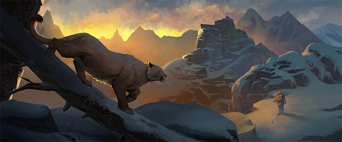
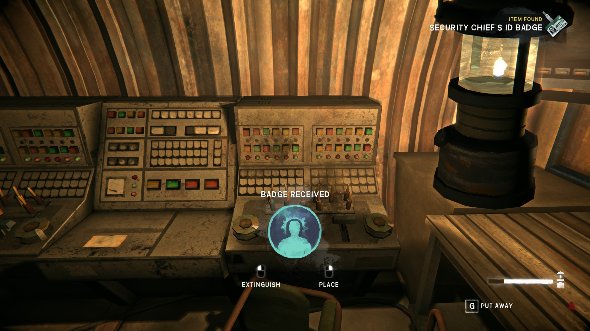
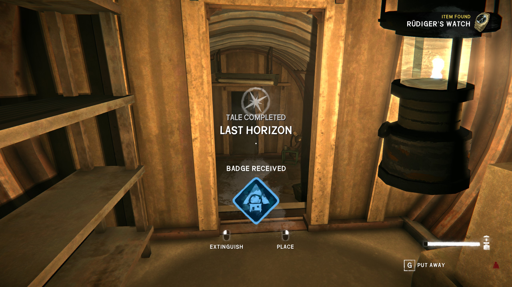

# Last Horizon

**Categories:** DLC Content · **Source:** [Fandom](https://thelongdark.fandom.com/wiki/Last_Horizon)

**Contents**

- [Preface](#preface)
- [Objectives](#objectives)
- [Find out what happened to Rüdiger](#find-out-what-happened-to-rudiger)
- [Go to the Weather Station](#go-to-the-weather-station)
- [Search the Weather Station](#search-the-weather-station)
- [Find the Foreman's Refuge](#find-the-foreman-s-refuge)
- [Find Rüdiger's Hideout](#find-rudiger-s-hideout)
- [Access to the High Peak](#access-to-the-high-peak)
- [Reach the High Plateau](#reach-the-high-plateau)
- [Return to Bunker Omega and discover Rüdiger's fate](#return-to-bunker-omega-and-discover-rudiger-s-fate)
- [Collectibles](#collectibles)
- [Clothing](#clothing)
- [Notes](#notes)
- [Gallery](#gallery)
- [Trivia](#trivia)

**Last Horizon**

| Property | Details |
| --- | --- |
| **Missions** | |
| Previous | [Buried Echoes](./Buried%20Echoes.md) |
| Current | Last Horizon |
| Next | [Sutherland's Tale](./Sutherland%27s%20Tale.md) |
| Region | [Sundered Pass](./Sundered%20Pass.md) [Forsaken Airfield](./Forsaken%20Airfield.md) |

[Ptarmigan icon](../assets/Ptarmigan_icon.png)

**DLC-Exclusive content.**; This content requires the [Tales from the Far Territory](./Tales%20from%20the%20Far%20Territory.md) addon to be installed before it can be seen or used in regular gameplay.

“

**Enter Sundered Pass to look for evidence of Rüdiger's escape.**

”

**Last Horizon** is the third [Tale](./Tales.md) released for the [Tales from the Far Territory](./Tales%20from%20the%20Far%20Territory.md) addon in [Survival Mode](./Survival%20Mode.md). As of V 2.27, Last Horizon can be started on a new playthrough out of order as soon as the [Handheld Shortwave Radio](./Handheld%20Shortwave%20Radio.md) is acquired, as long as [Signal Void](./Signal%20Void.md), [Buried Echoes](./Buried%20Echoes.md), and Last Horizon have been completed on another playthrough and their associated [Badges](./Badges.md) are acquired. The [Transmitter](./Transmitters.md) in [Forsaken Airfield](./Forsaken%20Airfield.md) will need to be repaired before this Tale can be started if played out of order, and [Bunker Omega](./Bunker%20Omega.md) will need to be uncovered to finish it. 

## Preface

_SPOILER WARNING_  
 _This section may contain spoilers from the [story](./Wintermute.md) of The Long Dark._

Continuing the events of the last Tale, the survivor buries the remains of the Security Chief and follows a nearby pass from [Enduring Waterfall](./Enduring%20Waterfall.md) into a hidden mountain installation, then sets out to find any evidence of Rüdiger's escape. Head to [Sundered Pass](./Sundered%20Pass.md), where a Weather Station that was mentioned in the Security Chief's notes may hold clues as to the fate of Rüdiger, along with any successful results of his project.

## Objectives

- Reach the Weather Station and search the area using the Handheld Shortwave during an [aurora](./Aurora.md).
  - Look for remnants of Rüdiger's team [0/2].
- Use the Polaroid and Key to find the [Foreman's Refuge](./Foreman%27s%20Refuge.md) in Sundered Pass.
- Use the Polaroid and Handheld Shortwave to locate Rüdiger's Hideout in Sundered Pass.
  - Search the Hideout for details on Rüdiger's movements [0/2].
- Find the access point to the High Peak.
  - Reach the High Peak Plateau and and look for signs of Rüdiger and the Foreman. [0/2]
- Return to the [Omega Bunker](./Bunker%20Omega.md) and investigate the area shown in the Polaroid.
  - Discover Rüdiger's true fate. [0/4]

## Find out what happened to Rüdiger

After burying the [The Security Chief's Remains](./The%20Security%20Chief%27s%20Remains.md) at [Enduring Waterfall](./Enduring%20Waterfall.md), the only thing left to do is find out where Rüdiger may have gone. [Security Chief's Log 33](./Security%20Chief%27s%20Log%2033.md) mentions that Rüdiger had an escape plan in the form of a transmission site over the mountains after the failure of The Machine in the [Langston Mine](./Langston%20Mine.md), in the region known as [Sundered Pass](./Sundered%20Pass.md).

You have 2 convenient ways to get there from Enduring Waterfall:

- Follow the river downstream of the falls to the cave. Proceed through the cavern until you come across a natural bridge made of stone over a bottomless pit. You'll know you're going the right way if you come across a mountain rope climbing section and a large frozen waterfall.
- Head east back to the tracks and return to the [Vacant Depot](./Vacant%20Depot.md) in [Transfer Pass](./Transfer%20Pass.md). The road behind the old train station has a sign with scratched out text (Likely Rüdiger covering his tracks) that leads up into the mountains and into a collapsed tunnel. Climb the nearby rope to bypass the tunnel and head into the Pass.

**This guide will be choosing the Vacant Depot route, however, one of the possible routes leads past the exit of the transfer cave.**

Make sure you have enough warm clothing, supplies, and weapons for this trip, as Sundered Pass is not for the faint of heart; with few shelters, very cold weather, and [Timberwolf](./Timberwolf.md) packs spread out across the region. Travel by day, or night if you must, and wait until the [Aurora](./Aurora.md)/[Glimmer Fog](./Glimmer%20Fog.md) appears. Regardless of what path you take, your objective is to reach a [Weather Station](./Weather%20Station.md) in the mountains.

## Go to the Weather Station

**Option 1: The road throughout the mountains**

**Note**: if at any point Glimmer Fog appears, always stick to the roads.

When you enter Sundered Pass, turn right at the fork and you will reach the other side of the collapsed tunnel from Transfer Pass. Continue following the road throughout the mountains. You will cross [Baneful Bridge](./Baneful%20Bridge.md) and eventually find Refuge Shelter A, [Lotte's Rest](./Lotte%27s%20Rest.md). Rest up here if you need to and continue to follow the road. If your [Handheld Shortwave Radio](./Handheld%20Shortwave%20Radio.md) is active, by the time you pass [Cascading Gap](./Cascading%20Gap.md), it will start detecting a signal on the blue setting. Follow it.

Walking into a large field (filled with Timberwolves so beware) past Refuge Cabin B, [Placid Notch](./Placid%20Notch.md), you'll see a shiny Radar Dome high above on a large plateau, but following the road there meets you with a problem, an impassable collapsed bridge. Walking behind the plateau (and likely fighting more Timberwolf packs) does not yield an entrance to the Weather Station, so keep heading west past the pond where you will eventually pass through a cave with running water. Past this cave is a fork in the road, head left to a rickety rope bridge, [Perilous Crossing](./Perilous%20Crossing.md). If you headed left and went past a [Rock Climb](./Rock%20Climb.md), you went the wrong way. Climb a final Rope Climb and you'll reach the top at [Second Pillar](./Second%20Pillar.md).

**Option 2: Through the forest and past the transition cave.**

**Note:** This route is harder to find, and there is less shelter on the way. It is highly recommended to take it only if you carry little weight, have some fuel to make a fire and coffee and an [Insulated Flask](./Insulated%20Flask.md) to keep you warm. There will be no timberwolves through this route.

When you arrive from Transfer pass, turn left and go down into the forest. Watch out for the wolves in the forest. Stick to the mountain wall to your left, and eventually you will find the [Last Lonely House](./Last%20Lonely%20House.md). Use the opportunity to warm up and maybe heat up some coffee for the Insulated Flask.

To the west of the house is a slope that leads to a climbing rope spot. Climb it and you will end up in the mountains on the western most portion of the map.

At some point you will see the transition cave to [Forsaken Airfield](./Forsaken%20Airfield.md) and [Zone of Contamination](./Zone%20of%20Contamination.md) on your left, you can warm up in there and also find some coal. If you took the way through the transition cave you will come out here.

Continue to forward past a tree bridge and over a Rock Climb, and eventually you will reach an intersection. The way to your left leads into an open cave and is the way you will come up from if you take Option one. Take the path in front of you, it leads over a suspension bridge, [Perilous Crossing](./Perilous%20Crossing.md), then you have to climb a final rope to Second Pillar to reach the Weather Station.

### Search the Weather Station

Searching the 3 buildings at the outpost does not yield anything useful for the investigation (besides a [Bloody note](./Notes.md)). Remember the signal that lead you here? The Handheld Shortwave is always the key, so wait until it is powered and then search the area. Hold up in the [Station Bunkhouse](./Station%20Bunkhouse.md) until then.

When the Radio is powered, it will point in the direction next of a small ledge near the Radar building. Dig through the snow to uncover a [Lock Box](./Lock%20Box.md) and [Foreman's Technical Log 1](./Foreman%27s%20Technical%20Log%201.md). Inside the Lock Box is [An Old House Key](./An%20Old%20House%20Key.md) and some other loot. After listening to the Foreman's log, the survivor will open the clipboard box to find [Foreman's Polaroid 1](./Foreman%27s%20Polaroid%201.md) inside, with a photo of a small cabin.

## Find the Foreman's Refuge

The text on the back of the Polaroid mentions a forest below the treeline, which can be seen slightly southwest of your position if you walk back to the Second Pillar. Make your way there via the rope bridge and continue past the Transition Cave that leaves the region (rest here if you need to). Climb down the Rope Climbing section and near the bottom you will find the [Last Lonely House](./Last%20Lonely%20House.md). The front door is unlocked but the door to the bedroom is not, requiring An Old House Key.

The bedroom has the following loot: [Foreman's Technical Log 2](./Foreman%27s%20Technical%20Log%202.md), a [Safe](./Safe.md), and under the bed are the unique [Tactical Gloves](./Tactical%20Gloves.md).

Grab the Technical Log and yet another Polaroid is inside, [Foreman's Polaroid 2](./Foreman%27s%20Polaroid%202.md), pointing to a ruined building that the Foreman believed to be Rüdiger's Hideout, a building out in the field near Refuge Cabin B [Placid Notch](./Placid%20Notch.md), in a place called [Old Settlement](./Old%20Settlement.md).

## Find Rüdiger's Hideout

Travel south from the door of the Last Lonely House to return back to the collapsed tunnel leading to Transfer Pass, and then follow the road up the mountains out into the field (avoiding Timberwolf packs along the way). Wait inside Placid Notch until the Handheld Shortwave becomes active, and then follow the signal. Unlike the Weather Station signal, this location has a very short detection range.

Behind the ruined building, near the bathroom, is a large mound of snow. Uncover it to find a pair of doors that lead to the building's [Basement](./Basement%20%28Sundered%20Pass%29.md). Look in the back for a table near the [Bed](./Bed.md), where you will find [Rüdiger's Diary 1](./R%C3%BCdiger%27s%20Diary%201.md) and [Foreman's Polaroid 5](./Foreman%27s%20Polaroid%205.md). Rüdiger was aware that someone was stalking him, and he fled to somewhere higher in the region to get a signal for help. The Foreman was also here and left another Polaroid, pointing towards a settlement past a lake, the "high point" Rüdiger mentioned fleeing to.

## Access to the High Peak

Leave the Basement when **fully rested**, travel north up the road to [Final Refuge](./Final%20Refuge.md) or the [Fishing Hut](./Fishing%20Hut.md) ([Ambler's Lake](./Ambler%27s%20Lake.md)) to get around the avalanche ([Unyielding Inundation](./Unyielding%20Inundation.md)), down a long valley will lead to shear cliff and a upward [rope climb](./Rope%20Climbing.md): **this climb is very long and with no ledges to rest**. **It is so long that it is possible to run out of Stamina without the use of an [Emergency Stim](./Emergency%20Stim.md) or [Crampons](./Crampons.md) or [Improvised Crampons](./Improvised%20Crampons.md)**.

At the top of this climb is [Roamer's Cave](./Roamer%27s%20Cave.md), a [rabbit grove](./Rabbit%20Grove.md) and burned trailer for [reclaimed wood](./Reclaimed%20Wood.md). After you rest from the long climb, follow the wooden steps up to the Polaroid's location and clear the snow out to proceed.

## Reach the High Plateau

The journey ahead will be extremely cold, becoming colder as The Survivor ascends in elevation and requires three [rope climbs](./Rope%20Climbing.md). Two outdoor caves which provide some warmth and shelter are in the area, and a rock tunnel.

On the other side will be [High Peak Plateau](./High%20Peak%20Plateau.md), with a shed next to a signal dish containing 2 items: [Rüdiger's Diary 2](./R%C3%BCdiger%27s%20Diary%202.md) and [Foreman's Technical Log 3](./Foreman%27s%20Technical%20Log%203.md) (with another Polaroid inside, [Foreman's Polaroid 3](./Foreman%27s%20Polaroid%203.md)). This photo shows an already familiar location you've explored long ago, [Bunker Omega](./Bunker%20Omega.md).

## Return to Bunker Omega and discover Rüdiger's fate

(Note: If you have finished Last Horizon before and are playing Tales out of order, Bunker Omega cannot be opened without first completing [Signal Void](./Signal%20Void.md))

Leaving High Plateau requires descending a [Mountaineering Rope](./Mountaineering%20Rope.md): a spare rope can be looted from the outpost with a signal dish with a rock to attach it to just below the camp. Descending this rope a long, steep slope leads to south-eastern Sundered Pass. The road may be followed to southern Sundered Pass and [Transfer Pass](./Transfer%20Pass.md), or crossing the region to the Far Territory's Transition Cave and to [Forsaken Airfield](./Forsaken%20Airfield.md) or [Zone of Contamination](./Zone%20of%20Contamination.md).

The last step of Final Horizon requires returning to [Bunker Omega](./Bunker%20Omega.md) in Forsaken Airfield. Once inside, head left to the boiler room and in the storage closet a false wooden wall (shown in the Foreman's Polaroid 3) can be interacted with to reveal a hidden room.

4 items are needed to progress the Tale:

- [Rüdiger's Diary 3](./R%C3%BCdiger%27s%20Diary%203.md) on the left console above the remains
- [Foreman's Technical Log 4](./Foreman%27s%20Technical%20Log%204.md) across from the remains on the wooden table (with [Foreman's Polaroid 4](./Foreman%27s%20Polaroid%204.md) inside)
- [Security Chief's ID Badge](./Security%20Chief%27s%20ID%20Badge.md) also on the wooden table (Picking up the badge will instantly unlock the [Feats](./Feats.md) Settled Mind and Celestial Navigator)
- [Rüdiger's Watch](./R%C3%BCdiger%27s%20Watch.md) hidden under the chair behind the remains

Rüdiger's Diary reveals his goal on [Great Bear Island](./Great%20Bear%20Island.md) was an effort to prepare human civilization for a potential or imminent disaster; however he underestimated The Machine's effects and the Island's unpredictable nature, ultimately resulting in the project failing and the deaths of the team. The Foreman's Log reveals that the skeleton is Rüdiger's who was mauled by a cougar prior to hiding in Bunker Omega, and killed in a struggle with The Foreman. The Foreman composed his final log and left it along with Security Chief's ID Badge and his [Tactical Jacket](./Tactical%20Jacket.md) (except on [Interloper/Misery modes](./Survival%20Mode.md)) before presumably concealing the room. Given that The Foreman is still in pursuit of "The Data" (presumably The Machine's) and that Rüdiger after fleeing Zone of Contamination traveled to the data dish in Sundered Pass, it can be inferred Rüdiger may have transmitted this data to some unknown third party. The Foreman's fate unknown.

After all 4 narrative items are acquired the Tale ends, awarding a [Badge](./Badges.md) and the [Feats: "Celestial Navigator" and "Settled Mind"](./Feats.md), and completing the Tales from the Far Territory.

## Collectibles

### Clothing

- [Tactical Gloves](./Tactical%20Gloves.md)
- [Tactical Jacket](./Tactical%20Jacket.md)

### Notes

- [An Old House Key](./An%20Old%20House%20Key.md)
- [Foreman's Technical Log 1](./Foreman%27s%20Technical%20Log%201.md)
- [Foreman's Technical Log 2](./Foreman%27s%20Technical%20Log%202.md)
- [Foreman's Technical Log 3](./Foreman%27s%20Technical%20Log%203.md)
- [Foreman's Technical Log 4](./Foreman%27s%20Technical%20Log%204.md)
- [Foreman's Polaroid 1](./Foreman%27s%20Polaroid%201.md)
- [Foreman's Polaroid 2](./Foreman%27s%20Polaroid%202.md)
- [Foreman's Polaroid 3](./Foreman%27s%20Polaroid%203.md)
- [Foreman's Polaroid 4](./Foreman%27s%20Polaroid%204.md)
- [Foreman's Polaroid 5](./Foreman%27s%20Polaroid%205.md)
- [Rüdiger's Diary 1](./R%C3%BCdiger%27s%20Diary%201.md)
- [Rüdiger's Diary 2](./R%C3%BCdiger%27s%20Diary%202.md)
- [Rüdiger's Diary 3](./R%C3%BCdiger%27s%20Diary%203.md)
- [Rüdiger's Watch](./R%C3%BCdiger%27s%20Watch.md)
- [Security Chief's ID Badge](./Security%20Chief%27s%20ID%20Badge.md)

## Gallery

_Rüdiger's fate and the [Tactical Jacket](./Tactical%20Jacket.md)_

## Trivia

- Completing Last Horizon unlocks a [Badge](./Badges.md) of the same name, as well as two [Feats](./Feats.md), Settled Mind and Celestial Navigator.
- The name of this Tale, "Last Horizon," is an example of poetic irony, as it is the opposite of Dr. Rüdiger final line in [My Testament](./My%20Testament.md): "Once again. I have seen the new horizon." Rüdiger never lived to see his new horizon by the end of this Tale.
