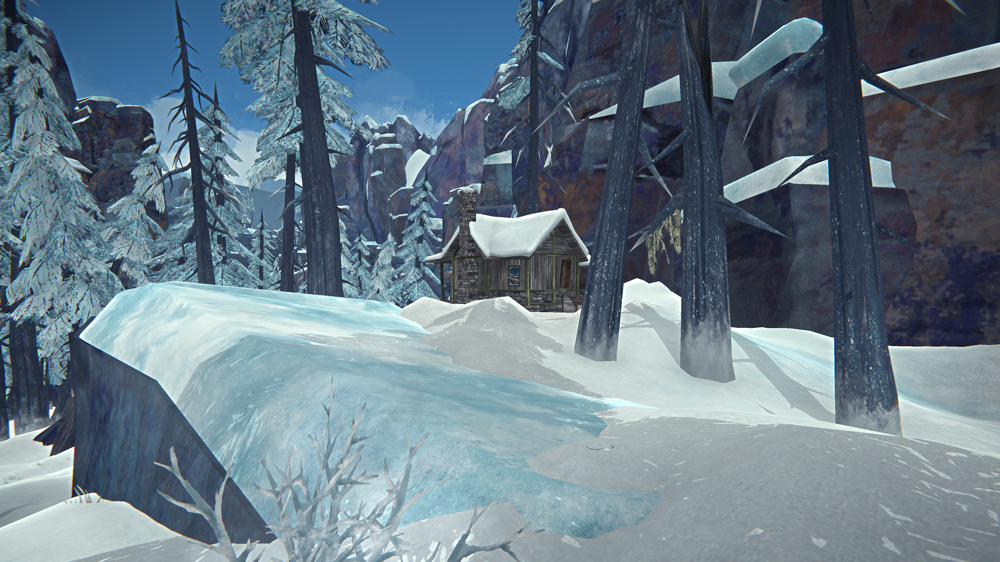
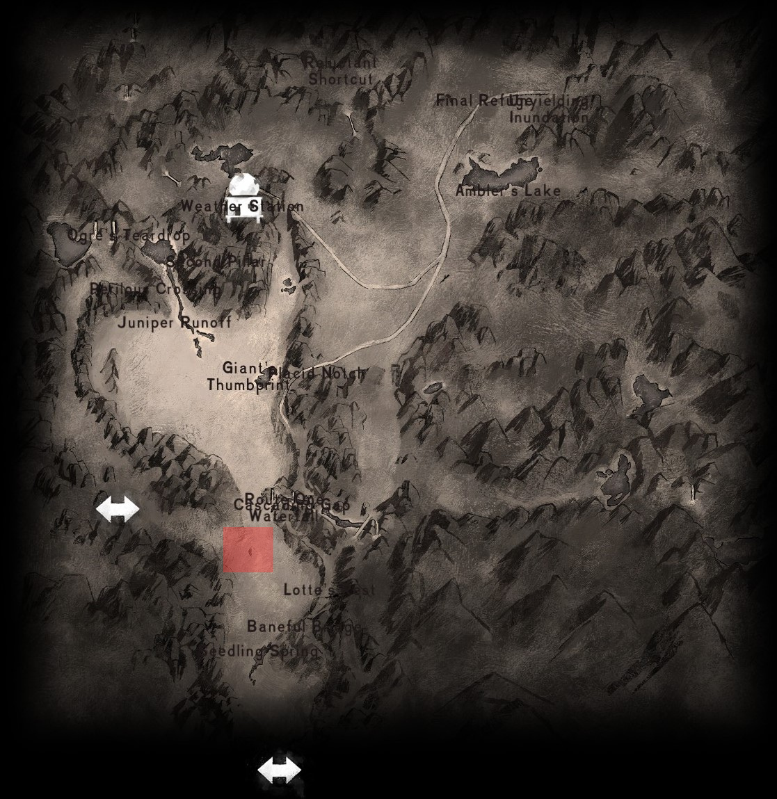

# Last Lonely House

**Last Lonely House**

| Property | Details |
| --- | --- |
|  |  / *Last\_Lonely\_House\_resized.png* |
| **Location** |  |
|  |  / *Last\_Lonely\_House\_Location.png* |
| Region | [Sundered Pass](./Sundered%20Pass.md)\|- |
| Description | A small cabin atop a ridge. |
| **General** |  |
| Type | Residential\|- |
|  / *bed\_icon.png* | Has a bed |
|  / *workbench\_icon\_green.png* | Has a workbench\|- |
